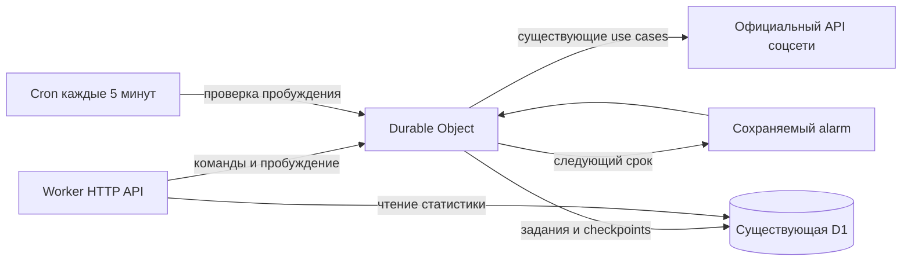

# Варианты фонового сбора на Cloudflare

Дата проверки документации: 17 октября 2026. Статус: предложение архитектуры.

Для Social Analytics на бесплатном тарифе предпочтителен пилот исполнителя
на **Durable Objects с alarms**, с сохранением заданий, курсоров и статистики
в существующей D1. Это меняет среду исполнения фоновой работы, где сейчас
ограничивает CPU. Дополнительный Worker и перенос аналитической БД не нужны.

## Какой предел мешает сбору

В [инциденте 11 октября](collection-incident-2026-10-11.md) зафиксированы
50 `exceededResources` из 422 Cron-вызовов, из них 34 закончились ровно
на **10 миллисекундах CPU**. Это историческое окно, а не текущий статус
production. CPU не включает ожидание Instagram и D1. Лимит Cron на Workers
Free по актуальной [документации Workers][workers-limits] составляет 10 мс;
его wall time ограничен отдельно, 15 минутами.

По рабочему дереву `backend/src/index.ts` вызывает
`createScheduledOperations(env).tick()` через `waitUntil`. Фабрика в
`backend/src/app/create-features.ts` задаёт максимум 6 попыток HTTP и deadline
90 секунд с резервом 15 секунд. Этот прикладной бюджет не увеличивает CPU
Cloudflare. `waitUntil` также не увеличивает его.

Второй предел — пропускная способность. Один шаг на пятиминутный Cron даёт
не более 288 слотов в сутки на все работы. В
[предыдущей модели](collection-architecture-review.md#75-численная-модель-а-не-обещание-экономии)
исторический проход комментариев из 3914 шагов занимал бы около 13,6 суток
эксклюзивной обработки при такой частоте. Даже полностью успешные ticks
оставляют эту очередь медленной.

## Сравнение механизмов

| Вариант | Доступность и CPU | Применение к нашему сбору |
| --- | --- | --- |
| Существующий Worker и Cron на Free | 10 мс CPU на вызов | Сохраняется текущий ресурсный предел. Дополнительные оптимизации не дают доказанного запаса. |
| Durable Object и alarms | SQLite-backed DO доступны на Free; для обработчика, включая alarm, указан default 30 секунд CPU | Основной кандидат. Один объект может выбирать работу, выполнять порцию и назначать следующее пробуждение. Проверить исполнение на фактическом Free до полной миграции. |
| Cloudflare Queues | Есть на Free; 10 000 операций в сутки, retention 24 часа | Полезны для доставки и распределения независимых задач. CPU на Free требует проверки из-за неоднозначной документации; считать проблему CPU автоматически решённой нельзя. |
| Cloudflare Workflows | На Free 10 мс CPU на шаг, до 1024 шагов на instance | Дают сохраняемые шаги и ожидания, но не увеличивают бесплатный CPU-бюджет. Дублируют часть уже реализованных checkpoints. |
| Workers Paid и прежний Cron | От $5 USD в месяц на аккаунт; для текущего интервала Cron менее часа — 30 секунд CPU | Самый небольшой переход по коду для увеличения CPU. Сам по себе оставляет ограничение одного шага за пять минут. |

Источники: [DO limits][do-limits], [DO pricing][do-pricing],
[Queues pricing][queues-pricing], [Workflows limits][workflows-limits],
[Workers pricing][workers-pricing], [Workers limits][workers-limits].

У [Queues limits][queues-limits] есть неоднозначность: страница относит
табличные лимиты к Free и Paid и называет default CPU 30 секунд, но рядом
говорит, что consumer наследует обычные per-invocation ограничения Workers.
Workers Free при этом документирован как 10 мс. Поэтому здесь нет
категорического вывода ни о 10 мс, ни о гарантированных 30 секундах для
бесплатного consumer. Нужен изолированный тест на аккаунте или уточнение
Cloudflare. У Workflows бесплатные 10 мс указаны явно в тарифной таблице.

DO имеет отдельную таблицу CPU и прямо относит default 30 секунд к alarm.
Это достаточное основание выбрать пилот, но локальная эмуляция не доказывает
production enforcement. Повышение лимита до пяти минут для пилота не нужно.

## Предлагаемая схема

Первый пилот использует один именованный объект для установки владельца:
нынешний `tick()` выбирает задания глобально через `nextSchedule` и
`workHeads`. Это позволяет проверить другую среду исполнения без одновременной
переписи политики выбора. Класс DO размещается в том же Worker; ему нужны
namespace binding и регистрация класса со SQLite backend. Собственное
минимальное хранилище DO обслуживает alarm и состояние пробуждения.

В D1 остаются `collection_jobs`, `collection_schedules`, снимки, receipts,
ключи идемпотентности, leases и checkpoints. DO напрямую использует операции
через корневые фабрики, D1 binding и официальный клиент источника. Если DO
лишь вызовет старый HTTP endpoint, тяжёлая работа останется в Worker с прежним
ограничением. Domain сохраняется чистым; Cloudflare API находится в адаптере.

Первый этап сохраняет один существующий шаг и прежний интервал. После проверки
CPU и восстановления второй этап назначает alarm по ближайшей готовой работе:
короткая ограниченная задержка при backlog, фактический `nextAttemptAt` при
backoff, ближайший срок расписания при отсутствии готовых заданий. Приоритеты
Stories, discovery и возрастных точек сохраняются. Число попыток к источнику,
таймауты, ограничение размера порции и source backoff остаются обязательными.
Увеличивать число запросов до проверки квот источника нельзя.

При переходе к alarms необходимо изменить справедливость выбора:
`tick()` сейчас передаёт в `selectWork` номер пятиминутного слота. Несколько
вызовов внутри одного слота не гарантируют прежнего чередования архивной и
срочной работы. Нужен сохраняемый счётчик выбора либо другая проверяемая
политика, чтобы длинный backlog не вытеснял свежие данные.

Для нескольких активно собираемых аккаунтов можно выделить DO на подключение
соцсети. Перед этим `nextSchedule`, `workHeads` и остальные selectors должны
получить область аккаунта: простое создание нескольких DO с нынешним глобальным
`tick()` приведёт к конкуренции за одну и ту же работу. Это отдельный этап.

## Восстановление и контракты

Alarms исполняются как минимум один раз. У объекта один pending alarm;
повторный `setAlarm` заменяет предыдущий. После необработанной ошибки
платформа делает до шести повторов с экспоненциальной задержкой. Длительный
сбой может исчерпать их, поэтому нужен явный путь следующего пробуждения.
Семантика описана в [Alarms API][alarms].

Следующие условия обязательны для реализации:

- Сохранять детерминированные operation IDs страниц и проверку lease при
  записи. Повтор после сбоя между сохранением снимка и checkpoint не должен
  создавать второй снимок. Последовательные alarm handlers не заменяют
  защиту от параллельной ручной команды или старого deployment.
- Использовать D1 как источник истины при повторе. Запись задания в D1 и
  постановка alarm не являются общей транзакцией. Cron вызывает только
  лёгкий `ensureAwake` у известного объекта; сверку D1 выполняет DO. Так
  восстанавливается работа после пропущенного пробуждения или исчерпания
  alarm retries без тяжёлого selector в десятимиллисекундном Cron.
- Ошибки инфраструктуры получают ограниченный backoff и следующее пробуждение;
  ошибки источника, истёкшая авторизация и задания с исчерпанными прикладными
  попытками сохраняют нынешние правила. Alarm не должен бесконечно оживлять
  намеренно остановленный job. При отключении расписания автоматические
  задачи прекращаются, явные ручные задания следуют своему контракту.
- GET остаётся чтением. Существующий синхронный `advance(jobId)` должен
  возвращать прежний результат через вызов DO, если переносится в него.
  Простое подтверждение постановки вместо результата было бы изменением
  API/MCP-контракта. HTTP-маршрутизация и сериализация на Free всё ещё имеют
  свой CPU-бюджет и проверяются отдельно.
- При переключении исполнителя прежний Cron перестаёт собирать самостоятельно.
  Существующие leases не сбрасываются. При откате сначала отключаются
  новые alarm-циклы, затем возвращается прежний исполнитель; сохранённые
  cursors и снимки продолжают использоваться. Invocation logs остаются выключены.

Для варианта с Queues всё равно потребовались бы идемпотентность и сверка
ожидающих заданий: [доставка как минимум один раз][queue-delivery] допускает
дубли. Неатомарная пара D1 commit и queue send требует outbox или
восстановительной сверки. Очередь полезнее при нескольких независимых
исполнителях; в текущей установке DO уже может последовательно выбирать
сохраняемые задания из D1.

## Бесплатный бюджет

По [тарифу DO][do-pricing] Free включает 100 000 запросов и 13 000 GB-s
duration в сутки. Учитывается время активности, включая ожидание I/O,
при выделенных 128 MB. Это отличается от CPU-учёта обычного Worker.
Ожидать backoff следует через alarm, завершая обработчик, без активных таймеров.

Для примера, при условных десяти секундах активности на порцию:

| Сценарий | Расчёт duration | GB-s в сутки |
| --- | --- | --- |
| 288 порций | 288 × 10 × 0,128 | 368,64 |
| 3000 порций | 3000 × 10 × 0,128 | 3840 |

Это сценарии, не замеры проекта. В бюджет входят также пробуждения, повторы
и другие DO аккаунта. `setAlarm` учитывается как запись строки. D1 и Instagram
имеют отдельные ограничения; ускорение обработки может упереться в них.
Превышение бесплатного бюджета DO вызывает ошибки до суточного сброса.

У Queues короткое сообщение обычно требует три операции: запись, чтение,
удаление. Следовательно, 10 000 операций дают около 3333 успешных сообщений
в сутки до повторов и других очередей; это расчёт по [тарифу][queues-pricing].
Сообщение с retention 24 часа не заменяет долговременный job в D1.

## Порядок перехода и приёмка

1. Добавить изолированный локальный пилот DO, работающий с тестовыми данными.
   Проверить cold start, одну порцию каждого типа, повтор alarm, потерю ответа
   после D1 commit, перезапуск объекта, истёкший lease, исчерпание повторов,
   отключение расписания и конкуренцию с ручной командой. Выполнить root
   `pnpm check`; новые миграции D1, если понадобятся, применить локально.
2. Отдельно разрешённый изолированный запуск на фактическом Workers Free
   проверяет CPU выше 10 мс в DO и работу alarm после завершения HTTP-запроса.
   Внешний API в этом тесте заменить контролируемым ответом. Локальные тесты
   подтверждают логику, но не тарифные ограничения Cloudflare.
3. После подтверждения переключить существующий сбор с сохранением checkpoints.
   Первый выпуск меняет исполнитель, следующий — скорость продолжения и
   расчёт следующего alarm. Деплой и удалённые изменения требуют явного
   разрешения по `AGENTS.md`; платный тариф не подключается этим предложением.
4. Принимать по 24–48 часам автоматического выполнения и минимум двум
   ежедневным циклам: CPU/errors отдельно для Cron и DO, реальные новые
   receipts и полезные snapshots, возраст ожидающих заданий, freshness и
   пропущенные deadlines, D1 reads/writes, duration DO и rate-limit источника.
   Успешный alarm или `/health` без прогресса данных приёмкой не считается.

Рекомендация: начать с пилота DO на Free. Если приоритетом станет минимальное
изменение кода и допустима подписка, Workers Paid с прежним исполнителем —
более короткий путь к увеличению CPU; ускорение очереди остаётся отдельной
задачей в обоих вариантах.

[workers-limits]: https://developers.cloudflare.com/workers/platform/limits/
[workers-pricing]: https://developers.cloudflare.com/workers/platform/pricing/
[do-limits]: https://developers.cloudflare.com/durable-objects/platform/limits/
[do-pricing]: https://developers.cloudflare.com/durable-objects/platform/pricing/
[alarms]: https://developers.cloudflare.com/durable-objects/api/alarms/
[queues-limits]: https://developers.cloudflare.com/queues/platform/limits/
[queues-pricing]: https://developers.cloudflare.com/queues/platform/pricing/
[queue-delivery]: https://developers.cloudflare.com/queues/reference/delivery-guarantees/
[workflows-limits]: https://developers.cloudflare.com/workflows/reference/limits/
