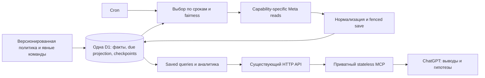

# Архитектура и политика сбора Social Analytics: независимый аудит

Дата: 9 октября 2026 года. Проверяемый backend: **0.2.16**. Первая интеграция — Instagram; продукт и его контракты остаются Social Analytics.

**Рекомендация:** один Worker, одна D1 и существующий приватный MCP достаточны для текущих задач. Сохранить модули, реальные наблюдения и защиту записи. Перепроектировать политику вокруг необходимых наблюдений: отдельно обнаружение, метаданные, метрики, календарные периоды и комментарии; один исполнитель с индексируемыми сроками и объединением причин чтения одного объекта. Базовый продукт — вариант B ниже; ранняя почасовая динамика и частый контроль архива — явно выбранные расширения.

Это аналитический результат, а не согласование реализации. В ходе аудита production, расписание и данные не изменялись; миграции, deploy, push, ручной сбор и invocation logs не запускались.

## 1. Цели продукта и необходимые данные

Источники целей: текущий запрос владельца, [исходная задача MCP][D1], записанная [дорожная карта #15](https://github.com/DenisChernykh/social-analytics-service/issues/15), реализованные backend/MCP use cases. Наличие функции само по себе не доказывает необходимость её частоты.

Классы пользы: **Н** — необходимо для вопроса; **Т** — повышает точность; **С** — только улучшает свежесть; **Р** — нужно для отдельного, реже используемого вопроса. Последняя категория — работа без нового результата — оценивается отдельно, а не присваивается всей истории.

| Сценарий | Н: минимально необходимые факты | Т / С / Р | Достаточная базовая политика |
| --- | --- | --- | --- |
| Найти публикацию по названию или описанию | Полный каталог, ID, caption, локальный title, дата, тип, ссылка | С: правки caption и доступность объекта; Р: расширенные provider metadata | Обнаружение новых объектов и отдельная сверка каталога; метрики при поиске не нужны |
| Какие публикации успешнее | Сопоставимые реальные views/reach/реакции, выбранная цель, тип публикации, возраст и время наблюдения | Т: органическое/платное распространение и версия определения; С: последнее lifetime | Возрастные пары 1/7/30 дней плюс обновление выбранного объекта |
| Эффективность относительно охвата/просмотров | Числитель и соответствующий знаменатель **одного наблюдения** | Т: размер выборки, peer group, медиана, ratio of sums отдельно от median ratios | Те же снимки; дополнительные сборщики для относительного рейтинга не нужны |
| Сравнить на одинаковом возрасте | Дата публикации и настоящее наблюдение в допустимом окне | Т: более узкое окно; Р: точки 1h/6h/3d/14d и подробная кривая | 24h/168h/720h обязательны в B; окно явно показывать |
| Почему сработали тема, формат, время | Предыдущие факты плюс подтверждённые rubric/topic/format/hook/goal и местное время | Т: длительность, distribution, сезонность, частота публикаций, эксперимент; Р: анализ видео/озвучки | Заполнять контекст; количество снимков не заменяет описание содержания |
| Изменение активности аккаунта за неделю/месяц | Нативные Account Insights за **точные** календарные периоды и timezone | Т: повтор после задержки источника; С: предварительный ранний результат | День, неделя, месяц; раннее и зрелое наблюдения раздельно |
| Динамика подписчиков | История followers_count с временем и источником | Т: нативные follows/unfollows за период; С: внутридневные значения | Профиль раз в сутки, чаще при отдельной задаче |
| Кто аудитория и кто вовлекается | Нативные follower/engaged breakdowns, timeframe, ограничения выдачи | С: ежедневная демография; Р: сравнение соседних коротких окон | Обычно недельный срез; monthly minimum в A |
| Какие вопросы и возражения в комментариях | Тексты, parent/root связи, дата публикации/наблюдения, полнота пагинации | С: быстрый webhook refresh; Т: повторная сверка, edits/hidden/likes | Начальный архив один раз; dirty/recent objects и ограниченная сверка |
| Stories и последовательности | Своевременно обнаруженные Stories, метрики/navigation, ID и порядок | Т: подтверждённая владельцем последовательность; Р: почасовая кривая | В B: обнаружение каждый час, начальный и предэкспирационный снимок |
| Старый ролик снова растёт | Несколько lifetime observations, интервалы и сопоставимость определений | Т: короткие промежутки между чтениями | Недельный watchlist; monthly archive не сохраняет прежнюю точность сигнала |
| Проверить гипотезу/эксперимент | План, вариант, назначенные публикации, одинаковый возраст, реальные outcomes | Т: достаточная выборка и контроль смешивающих факторов | Запись владельцем; использовать уже собранные снимки |
| Коммерческая эффективность | Реальные обращения/заказы/выручка/затраты, валюта, период и attribution | Т: время производства, distribution, связанный CTA | Owner records/отдельный внешний источник; из likes продажи не выводятся |
| Разбор аккаунта и следующие действия | Доказательства из перечисленных сценариев и ограничения покрытия | Т: корректная база необычности; Р: больше полей и длиннее история | Расчёт по запросу; ChatGPT формулирует проверяемые гипотезы |

### 1.1. Что действительно ограничивает полезность сегодня

Живой MCP `analyze_content(ageDays=7, metric=saves, rankingMode=per_100_reach, productType=REELS)` исследовал все **126 Reels**, без усечения. Пригодны **4 пары**, исключены 3 слишком молодых и 119 подключённых после нужного окна. Старые семидневные результаты нельзя восстановить повторным чтением lifetime сегодня. Это потребность в **будущих своевременных** снимках, а не основание бесконечно перечитывать все старые ролики.

У всех 247 сохранённых объектов отсутствуют `context_json` и длительность; live SELECT подтвердил это для Feed/Reels/Stories. В выбранном рейтинге нет business records. Backend умеет анализировать контекст и коммерческие записи, но сбор Instagram их не создаёт. Наполнение этих данных сильнее приближает ответ «почему», чем автоматическое добавление ещё одной возрастной точки. Видеопризнаки не следует угадывать по caption. Отсутствие полей не означает, что их нужно массово извлекать платным сервисом.

Причинность остаётся ограниченной: одинаковый возраст, относительные коэффициенты и группы повышают сопоставимость, но сами по себе не доказывают, что тема или час публикации вызвали результат. Эксперименты и достаточная выборка — самостоятельная часть продукта.

### 1.2. Информация, ради которой дополнительные записи не нужны

Поиск, локальное название, подтверждённая рубрика, эксперимент и расчёт относительной эффективности не требуют собственных фоновых опросов метрик. Один подходящий snapshot обслуживает рейтинг, peer baseline, эксперимент и возрастную точку.

Проверка пустого Stories edge нужна для обнаружения исчезающих объектов. Но каждый такой ответ не обязан одновременно создавать профильный snapshot и переписывать вспомогательные состояния. Аналогично, обнаружение уже известного последнего Reels не требует полного набора Insights, если подходящее наблюдение уже есть и обновление не due.

Расширенные metadata — не «бесполезные данные»: ссылки на media/thumbnail, children карусели, audio/AI flags доступны MCP и могут помочь отдельному вопросу. Их получение **при каждом** чтении статистики пока не обосновано пользовательским сценарием.

## 2. Что проверено сейчас и каким данным можно доверять

Новые безопасные агрегаты, SQL, метаданные ответов и расчёты: [collection-architecture-review-evidence.json][E1]. Тексты публикаций/комментариев, имена авторов, OAuth values и credentials туда не выгружались.

| Проверка | Независимый результат |
| --- | --- |
| Локальная основа | HEAD `8ed0040c31c818e7331a991704a77e6870b94c6b`; существенные незакоммиченные изменения уже существовали до аудита |
| Source provenance | Все **85** source SHA256 из manifest выпуска совпадают с текущими файлами; расхождений 0 |
| Production backend, 09:53 UTC | Health 200 / 0.2.16; активная версия `e659a098-741f-47ba-891f-ad25274efa70`, 100% трафика |
| Последний backend deployment | `231496e2-70ef-4f0b-aff3-8dc3adffc123`, 09.10 06:29:40 UTC |
| Bundle provenance | Прежняя побайтная сверка активного immutable version: SHA256 `a6034b1536f348711a692e9c9c5b16cfb7b01700e199faeb78a9444b6036eda8`; сейчас подтверждены тот же active version и 85 source hashes. Bundle повторно не скачивался |
| Cron | Удалённо и локально `*/5 * * * *`; budget 1 полезная порция, до 6 HTTP attempts, 90s wall budget, 15s reserve |
| Расписание владельца | Enabled, discovery 60 минут, Asia/Yekaterinburg, failures=0, errorCode=null |
| Storage | Одна D1, примерно **10.03 MiB** в основном срезе; 24 таблицы с внутренними. Применены 0000–0012; это проверено SELECT, миграции не выполнялись |
| Private Sites/MCP | Live Site13, deployment succeeded, MCP ready; source commit `0bda71f779fff2ce07895bbf02f28b21481003bf`; только owner, 0 external visitors, 0 automations; D1/R2 у adapter не настроены |
| Реальный MCP | list_accounts, describe_metrics, get_collection_status и относительный analyze_content успешно прочитали production |
| Runtime/logging | `usage_model=standard`, logpush=false; локальная конфигурация отключает observability/invocation logs. Удалённое settings не вернуло все поля observability |
| Тариф и effective overrides | API subscriptions вернул 403. **Free/Paid и административный CPU override не установлены**; standard не доказывает Free |
| Проверка проекта | Node 24.18.0, pnpm 11.15.1; root `pnpm check` прошёл: 137 backend + 24 MCP tests, типы, границы, формат и обе сборки |

Существующие обязательные документы прочитаны и сопоставлены с кодом: [CPU audit][D2], [production verification][D3], [data implementation][D4], [architecture][D5], [metrics][D6], [collection improvements][D7], [API audit][D8], [comments optimization][D9]. Развёрнутая 0.2.16 уже исключает HTTP presentation из scheduled bootstrap; совет просто «убрать Hono из Cron» запаздывает.

### 2.1. Границы новых измерений

- Cloudflare Scheduled/D1 Analytics: **08.10 09:50:52.952 — 09.10 09:50:52.952 UTC**, cutoff на 3 минуты раньше чтения. Scheduled dataset отдельно от HTTP, но без version dimension; deployment windows и 38 точных совпадений с adaptive rows подтверждают текущую версию.
- Основные D1 SELECT выполнены около 09:53 UTC с той же нижней границей; у них нет общего транзакционного snapshot. Для качества media snapshots выполнен отдельный SELECT с обеими границами точного суточного окна.
- Supplemental HTTP attribution: около **10:19 UTC**, 591 receipt с начала новой эпохи 08.10 16:20:25 UTC — примерно **18 часов**, не полные сутки. Он не смешивается с первоначальными 576 receipts.
- MCP status 10:03 UTC закономерно показывает больше jobs/periods, чем D1 09:53 UTC. Разность срезов не выдаётся за нарушение идемпотентности.
- D1 Analytics account-wide включает HTTP, Cron и диагностические SELECT. Суточные rows не приписаны одному Cron или одному механизму.
- 47 raw local profiles независимо пересчитаны через samples/timeDeltas, исключая idle: совпали с сохранёнными результатами. Это проверка арифметики, а не новое профилирование production.

Первое чтение Cloudflare было недоступно из-за истёкшей OAuth session; обычный read-only Wrangler SELECT 1 восстановил доступ. Один диагностический SELECT использовал отсутствующую колонку; исправленный запрос к `context_json` прошёл. Эти ошибки не записывали данные. Прямые страницы Meta оказались недоступны; использованы текущие Cloudflare primary docs, Meta docs через Context7 и отдельно обозначенные прежние bounded live observations.

## 3. Реестр путей создания и обновления данных

Код всех семи модулей проверен: instagram, analytics, collection, account-insights, community, content, reviews; также root composition, schema/migrations и MCP adapter. Ссылки [C1]–[C20] в конце указывают на конкретные входы.

Частоты в реестре — **политика**, если не отмечено «наблюдалось». Это не обещание её исполнения очередью.

| ID / механизм | Кто запускает и как часто | Факты и потребитель | Пересечение / более простой эквивалент | Потери и поведение при задержке |
| --- | --- | --- | --- | --- |
| R01. Cron selection [C1][C2][C3] | Cloudflare каждые 5 минут; 1 portion на весь Worker | Выбирает job/schedule/deadline; данных Meta сам выбор не создаёт | Отдельные due-поиски lifetime, age, comments, Story expiry плюс periodic schedules; нужен индексируемый следующий срок | Убрать исполнитель нельзя: автоматический сбор исчезнет. Задержка может закрыть age/Story/90d окна |
| R02. Открытие/управление schedule [C2] | Явная команда владельца, enable/disable/timezone/discovery frequency | Schedule + policy activation history; status и SLA coverage | Установки и запись истории должны быть отдельны от каждого productive tick | Без истории нельзя честно оценить обязательства в прошлом; выключение должно останавливать automatic jobs |
| R03. Publication discovery [C2][C4] | Номинально каждый час; 21 completed новых scheduled jobs в основном суточном срезе | Страница каталога, profile, metrics каждого объекта, пока не встретится известный; поиск/рейтинг/age | Проверка known происходит **после** Insights. Можно обнаруживать metadata-only, а метрики отдавать единому due observation | При большем интервале позже виден новый пост; 1h/6h точки могут быть потеряны. Прошлые ранние lifetime значения невосстановимы |
| R04. Initial metadata и enrichment [C4][C5] | В каждом sync/refresh, включая уже известный объект; текущий manual pass заполняет новые поля архива | Caption/type/URL/children/audio/AI и source/time; каталог и MCP | Rich metadata связаны с metrics. Достаточно initial, исправлений по явному запросу и редкой отдельной сверки | Уменьшение частоты задержит edits/URL refresh, не отменит age сравнение; старые поля сохранять при deferred |
| R05. Lifetime media refresh [C3][C4] | <2d каждый час; 2–8d каждые 6h; 8–31d ежедневно; далее 7d; deferred может сделать объект due раньше | Настоящие накопленные показатели; saved report, growth, review, comments_count | Те же запросы, что age/discovery/manual. Одна observation может закрыть несколько причин | Редкая архивная частота снижает точность resurgence. Неизвестные/deferred поля не превращать в нули |
| R06. Age obligations [C3][C6] | 1/6/24/72/168/336/720h; tolerances 0.5/1/6/6/12/12/24h | Snapshot в настоящем окне; analyze_content, группы, эксперименты | Не семь обязательных дополнительных HTTP: любой подходящий lifetime snapshot закрывает точку. Один список next observation проще двух независимых due-поисков | После окна нет backfill одинакового возраста. Наличие reach закрывает collection point, но не гарантирует нужную пару saves/reach |
| R07. Stories discovery [C2][C4] | 60 минут; 23 completed jobs в основном срезе, за сутки 0 Story snapshots | Только сейчас discoverable Stories; metadata + insights при непустом edge; Story analysis | Пустой edge всё равно получает profile и создаёт account snapshot. Достаточен лёгкий edge poll | Отключение теряет Stories целиком; редкое обнаружение сокращает оставшееся время до исчезновения |
| R08. Story updates / expiry [C2][C3] | Все найденные Stories в часовом обходе; дополнительные при expiry в пределах 20m и отсутствии snapshot последних 15m | Navigation, scalar/profile activity, предэкспирационное наблюдение | Сейчас expiry приоритет запускает обход edge; не гарантирует, что срочный ID будет первым. Прямой refresh конкретной Story проще | Delay может оставить объект без позднего результата. Финальность и post-expiry доступность отдельных полей не подтверждены |
| R09. Profile observations [C4][C5] | Каждая page/media/Stories portion; профиль также читается на каждый Account Insights/demography шаг | Followers/media count, account identity; history и проверка соответствия connection | Profile coupled с разными flows. Явная ежедневная задача + эквивалентная identity validation проще случайной busy-cadence | Daily теряет внутридневную кривую подписчиков. Убирать проверку принадлежности token/account нельзя |
| R10. Calendar planning [C2][C7] | Примерно раз в 24h после предыдущего плана; не строго в local midnight | До 103 day/week/month intervals за rolling 90d; exact activity reports | Прочитывает eligibility из всей JSON history, merge с существующим job. Можно создавать upcoming period tasks и индексировать maturity | Delay первичного backfill теряет истекающие периоды. Сохранить pending head/operation ID при merge |
| R11. Account activity collection [C7] | По очереди: отсутствующие и ещё не зрелые периоды; 1 interval/portion | 12 metric inputs, native total values, revisions/coverage; get_account_activity, review | Уже не бесконечный daily reread всех 90d: зрелые завершённые периоды исключаются. Day/week/month reach не взаимозаменяемы | Без native week/month unique reach нельзя точно суммировать days; ожидание ≥48h улучшает зрелость, не даёт source finality |
| R12. Demography [C2][C7] | Daily supporting job, четыре dimensions; ещё после full/manual flow; 4 новых observations в суточном срезе | Follower/engaged breakdowns, timeframe; audience report | Обычно weekly достаточно. Follower и engaged — разные факты, объединять их значения нельзя | Более редкая частота теряет краткую аудиторию; не прошлые возрастные показатели поста. Top categories не вся популяция |
| R13. Full catalogue [C2][C4] | Manual collect_all; automatic catalogue через 30d | Один объект на страницу + **все Insights**, cursor и coverage; поиск и completeness | Reconciliation metadata-only можно читать страницами по несколько объектов; backfill metrics отдельно | Без сверки возможны пропущенные/изменённые объекты. Нельзя молча изменить внешнюю семантику manual collect_all |
| R14. Historical backfill / enrichment [C2][C7][C8] | После включения/ручного запроса; до конца сохранённой очереди | Доступные 90d calendar periods, старые metadata/current lifetime, comments/replies | Различать one-off заполнение и регулярную свежесть; не считать весь текущий manual расход постоянным | Исчезнувшие Stories и старые same-age результаты не восстановятся. Не перезапускать длинный cursor при переходе |
| R15. Comment full pass [C8][C9] | Initial/manual; supporting automatic reconciliation через 30d, если нет running full job | Полные API pages по media, тексты и replies, idempotent checkpoint; ChatGPT questions/ideas | Пообъектные полные periodic refresh уже обеспечивают reconciliation; второй monthly archive pass может повторять их | Отмена initial pass оставит старые вопросы вне анализа; pagination complete не доказывает равенство comments_count |
| R16. Comment media refresh [C3][C8] | <72h: 1h; до 30d: 6h; архив: 7d; event generation/count difference дают приоритет | Новый полный API pass выбранной publication, updates существующих строк | Webhook+recent policy+одна bounded reconciliation вместо двух архивных путей. Count — подсказка, не доказательство отсутствия edits/replies | При разрежении позже появятся edits/likes/скрытие/новые тексты; stop на known ID меняет completeness и должен быть объявлен |
| R17. Replies и expansion [C8][C9] | outer 5, nested 50; отдельное continuation усечённых веток; до 2 omitted probes на pass | Parent links, тексты, доказательство полного/partial ответа | Field expansion уже устранил большинство запросов пустых replies. Пробы omitted branches остаются отдельным расходом | Без continuation теряются длинные ветки; omitted ≠ доказанно empty. Сохранять partial/cursor/stall diagnostics |
| R18. Comments webhook [C10] | Реальная подписка и события Meta; 4 events сохранены | Подпись, minimal dedupe, dirty generation, discovery cue для unknown media; без текста в webhook store | Позволяет не опрашивать неподвижный архив часто, но не заменяет initial/repair pass | Потерянные события требуют сверки; generation защищает событие, пришедшее во время pass |
| R19. Explicit collect/refresh [C2][C4][C7][C9] | Только команда пользователя/MCP mutation: одна media/page/Story/period, full job, comments, continue/resume | Те же persisted facts; вопрос с требованием свежести | Пользоваться тем же исполнителем/ports, не создавать второй scheduler | По запросу восстановится latest, но не прошлый age. Сохранять operationId/status/cursor и отсутствие автоматического mutation retry |
| R20. Jobs, retries, leases [C2][C3][C4][C9] | Каждый productive step; lease 15m, stable SHA-derived UUID страницы, checkpoints, limit5 failures | Progress/recovery/fencing; status и надёжность всех data flows | Collection + sync/insight/comment operation states частично дублируют orchestration, но нижний fence нужен и explicit operations | Удаление fence ради CPU приводит к гонкам/повторной записи. Consolidation требует доказательства crash recovery |
| R21. HTTP receipts, quota, support cache [C11][C12] | Каждая атрибутируемая source HTTP attempt; 15s timeout; max6 attempts/portion; explicit unsupported evidence cached24h | Safe parameters/status/timestamps/provenance, counters, backoff; numerical coverage и diagnostics | Full receipt begin/finish + state/cache writes стоят SQL. Core-first может сократить бесполезные probes; broad unsupported cache небезопасен | Нельзя считать отсутствие quota header запасом квоты; expired cache не доказывает вечную неприменимость; OAuth/внешние диагностические вызовы не добавлены в receipt accounting задним числом |
| R22. History maintenance [C12][C13] | На первом transport finish в scope: до 100 receipts старше 30d, sample removal старше 7d; expired support при его изменении; OAuth attempts при новом OAuth | Ограничение diagnostic storage; основные snapshots/comments не удаляет | Имеющиеся индексы не подходят всем prune/latest queries. Достаточен отдельный bounded maintenance срок | Retention не точный TTL без запросов. После удаления sample ответ не восстановить, нормализованный факт остаётся |
| R23. OAuth/connect/refresh/disconnect [C13] | Owner connect; refresh при expiry<7d и предыдущем refresh≥1d, по обращению к source; явный disconnect | Encrypted connection, scopes/identity; доступ ко всем collectors | Это не аналитический сбор. Scope/token context должен оставаться отдельным от global cache | Без renewal сбор остановится; disconnect не удаляет всю аналитическую историю. Не изменялось в аудите |
| R24. Owner facts и lifecycle [C9][C14] | Явные title/duration/context suggestions/confirmation, business import, experiments, Story sequences; explicit erase comments | Факторы эффективности, реальные коммерческие outcomes, решения и deletion lifecycle | Записи владельца используют существующие media IDs; background AI отсутствует и не нужен для базового сбора | Без этих фактов «почему»/profit неизвестны. Удаление — отдельное действие; не применять как оптимизацию |
| R25. Saved analytics/status/review [C3][C15][C16] | GET/MCP read по запросу; **Meta не вызывают** | Full cohort, saved history, coverage, benchmark, growth, groups/review | Повторные history computations и peer medians можно объединить; это read CPU, не избыточный Meta collection | Нельзя обещать latest при saved read; отсутствие чисел/coverage показывать, вычисления не заменяют новые наблюдения |
| R26. MCP / UI / ChatGPT [C17][C18] | Каждое обращение; adapter stateless, tool schemas; UI по действиям пользователя | Backend JSON→validated MCP content/structuredContent→ChatGPT; UI status/history | Повторная инициализация schemas/JSON serialization; оптимизировать immutable части без global credentials. Sites cron/storage отсутствуют | Внешние names/input/output и owner access сохраняются; ChatGPT interpretation не пишет новую статистику |

### 3.1. Временные ограничения: что требует срочности, а что нет

**Same-age snapshots.** Instagram lifetime сегодня не возвращает значение семидневного возраста старого ролика. Срочность окна задаётся вопросом пользователя, не универсальным обязательством Meta опрашивать каждый час.

**Stories.** Существующая реализация считает discoverability до publishedAt+24h и работает с текущим Stories edge. Следует успевать обнаружить и сохранить наблюдение до исчезновения. Утверждение «все Story Insights недоступны ровно после 24h» здесь не доказано; доступность по известному ID и отдельных fields после expiry надо проверить отдельно при естественном появлении Story. Поэтому поздний снимок B называется предэкспирационным, не финальным.

**Account Insights.** Meta описывает retention user metrics до 90d и задержку до 48h; некоторые значения зависят от threshold и могут возвращаться empty. Нативные week/month и timeframe demographics сохранять буквально. Источник через [официальную Meta Insights documentation](https://developers.facebook.com/documentation/instagram-platform/insights/) / Context7. Локальные ограничения 31d и maturity48h — политика сервиса вокруг возможностей API, не доказательство финальности всех fields.

**Media lifetime.** В предыдущей bounded source verification получены поля Reels возрастом примерно 1927d ([D4]). Это не универсальное обещание бессрочной доступности. Равным образом нельзя оправдывать весь weekly archive sweep утверждением, что любой Media Insight исчезает через 2 года: конкретный срок зависит от field, Login и API; сейчас он не установлен для всего набора.

**Comments.** Реализованная пагинация не имеет надёжного time filter; edits/hidden/replies могут меняться без роста comments_count. Поэтому webhook и counts позволяют приоритизировать, но полная сверка остаётся нужна. Строки comments обновляются по ID; сервис не хранит все прошлые версии текста.

## 4. Откуда появились требования

Issues — свидетельство **записанного решения**, а не доказательство авторства первоначального человеческого запроса. В доступной истории многие созданы под аккаунтом владельца, но они могли быть сформулированы агентом. Там, где исходное сообщение не найдено, намерение владельца не реконструировано.

| Правило / функция | Установленный источник | Класс происхождения | Что действительно обязательно |
| --- | --- | --- | --- |
| Анализ успешности, относительных коэффициентов, одинакового возраста, аудитории, комментариев, будущей коммерции | Текущий запрос владельца | Явное продуктовое требование | Эти вопросы сохранить; точные технические интервалы в запросе не предписаны |
| ChatGPT, статистика выбранного ролика по названию | [Исходная задача MCP][D1] | Записанный запрос пользователя | Поиск и saved analysis; не realtime на всех media |
| «Обнови весь аккаунт» и регулярная статистика с opt-in | [#5](https://github.com/DenisChernykh/social-analytics-service/issues/5) | Записанное продуктовое требование; первичное сообщение не установлено | Полнота/cursor/recovery, управляемая частота; age1/7/30d указаны как цель |
| Полный catalogue + всё поле metadata + полный Insights на каждом старом объекте | Текущий SyncAccount и поздний enrichment [D4][C4] | Сочетание реализации и исправления прежнего покрытия | Полный каталог нужен; связка со всеми lifetime метриками не следует из полноты каталога |
| Семь точек 1h/6h/1d/3d/7d/14d/30d | [#17](https://github.com/DenisChernykh/social-analytics-service/issues/17), commit `02ce9b1` | Записанная рекомендация расширить age coverage | Настоящие timestamps, future windows, no fabrication. Не доказана необходимость всех семи точек каждому владельцу |
| 1h/6h/24h/7d lifetime TTL по возрасту | [architecture][D5], [metrics][D6], dueMedia [C3] | Инженерная эвристика; первоначальный автор/обоснование точных чисел неизвестны | Выбранная свежесть и capacity должны быть явными; Instagram не требует этих интервалов |
| Часовой discovery | Default schedule + [API audit][D8] | Настройка/рекомендация своевременности, полезная для ранних age windows | Соответствие выбранным окнам. Для базовых 1/7/30d нужен иной запас, чем для 1h |
| Stories и последовательности | [#10](https://github.com/DenisChernykh/social-analytics-service/issues/10), текущие tools | Записанный дополнительный продуктовый сценарий; discoverability — источник срочности | Не пропустить объект и не выдать navigation за unique-viewer completion |
| Повтор всех Story Insights каждый час | Код [C2][C4] | Унаследованный способ обхода; отдельное продуктовое обоснование неизвестно | Поздний результат важен; подробная почасовая Story кривая — отдельный выбор |
| Calendar activity/native day-week-month | [#6](https://github.com/DenisChernykh/social-analytics-service/issues/6) | Записанное продуктовое требование + API semantics | Отличать активность аккаунта от lifetime постов; native unique aggregates нельзя суммировать |
| 90d backfill | Meta user metrics retention, [#6], [D7] | Требование API + решение сохранять историю у себя | Успеть до expiry, не обязательно перечитывать всю историю каждый день |
| Recheck48h, service31d guard | [D4], automaticPlan [C7] | API delay + консервативная инженерная политика | Отдельно preliminary/mature/sourceFinal=false; точная eligibility по фактическим метрикам |
| Demography ежедневно, четыре dimensions | [#7](https://github.com/DenisChernykh/social-analytics-service/issues/7) описывает аудиторию; daily создаёт supportingJobs [C2] | Продуктовая функция установлена; ежедневная частота — инженерное решение, первичное обоснование неизвестно | Follower/engaged/timeframe и subset semantics, не ежедневность всех breakdowns |
| Полный comments/replies archive | [#11](https://github.com/DenisChernykh/social-analytics-service/issues/11) | Записанный продуктовый источник вопросов/идей | Достоверные тексты и связи, понятное покрытие, no automatic replies |
| Field expansion, dirty updates/webhook, periodic repair | [#18](https://github.com/DenisChernykh/social-analytics-service/issues/18), commits `65a6a41` / `3484d5e`, [D9] | Рекомендация оптимизации с API ограничениями | Не полагаться только на count; не терять truncation/replies; подтверждать webhook delivery |
| Comments1h/6h/7d плюс global full30d | comment-policy [C6] и supportingJobs [C2] | Конкретные эвристики реализации; #18 требует явную политику, но не эти числа | Одно измеримое freshness/reconciliation обещание; совместная частота требует нового решения |
| RunBudget1 и небольшие страницы | commit `24db4a2`, ресурсные ошибки, [D2][D9] | Инженерное ограничение против CPU aborts | Ограниченный размер порции; одно HTTP/объект на тик — не неизменная продуктовая цель |
| Leases/stable operation IDs/fenced writes | #5/#18 и recovery code | Инженерная защита корректности | Сохранить либо заменить доказанно эквивалентной защитой |
| Receipts/provenance/quota/cache, retention7/30d | [D4], schema0009–0012 | Исправление достоверности; retention — политика хранения | Не смешивать response/source value/coverage. Полный sample на каждый факт не единственный возможный дизайн |
| Weekly старые media | TTL [C3]; real resurgence consumer [C16], [#14](https://github.com/DenisChernykh/social-analytics-service/issues/14) | Эвристика с установленным аналитическим потребителем | Не называть её бесполезной. Разрежение требует объявить потерю чувствительности/скорости сигнала |
| Один Worker/D1, без платных новых сервисов, отключённые logs | AGENTS.md | Явное архитектурное ограничение владельца | Сохраняется во всех вариантах; платный тариф не предложен как скрытое условие |

### 4.1. Проверяемая цепочка накопления сложности

1. **Полнота аккаунта → одна дорогая universal sync.** #5 требует полный каталог и регулярные updates. SyncAccount [C4] связывает profile, metadata и metrics; discovery [C2] проверяет known только после этой работы. Поздний [data implementation][D4] добавляет richer metadata и дополнительные fields в тот же путь. Подтверждена эволюция единого пути, но не доказано, что пользователь хотел все эти fields каждый час.
2. **Same-age → два селектора одного наблюдения.** #17 расширяет список; dueAgeMedia и dueMedia [C3] независимо выводят eligibility из snapshots, хотя запись одна. Это дублирование поиска и состояния требования, а не обязательное удвоение запросов Meta.
3. **Комментарии как идеи → full pass, age-TTL pass и webhook.** #11 даёт первоначальную потребность; #18 обоснованно добавляет expansion/dirty state, не отменяя supporting full30d. Теперь два periodic способа гарантировать сверку частично накладываются. Это конкретное место для пересмотра reconciliation, с сохранением initial archive и пропущенных событий.
4. **Свежая activity во время backfill → ежедневный merge очереди.** [Production verification][D3] документирует реальный bug0.2.13 и fix0.2.14. Исправление необходимо; из него не следует необходимость каждый день вычислять eligibility из всей накопленной JSON history.
5. **История и coverage → дорогой read status.** История фактов нужна пользователю. Но [C3] повторно строит age coverage из всех snapshots, а [C15] повторно вычисляет peer medians по каждой media. Накопление history не требует повторять всю вычислительную работу при каждом GET.
6. **CPU abort → сильное дробление.** Защита 1portion дала контролируемое выполнение, но ограничила весь Worker288 slots/day. #18 прямо предупреждает не увеличивать runBudget вслепую. Обратная крайность — сохранять 1portion независимо от demand — тоже не обеспечивает сроки.

Доказательства подтверждают добавление механизмов без полного последующего объединения политики. Они **не позволяют** уверенно приписать конкретную ошибку «AI-агенту» или восстановить непоказанный разговор владельца.

## 5. Реальные частоты, стоимость и полезный выход

### 5.1. Состояние данных и очереди

Основной D1 срез около 09:53 UTC: 1 account, **247 media** (113 Feed,126 Reels,8 сохранённых Stories),746 media snapshots,680account snapshots,3791unique comments,5772 comment collection operations,143 Account Insights operations,234 jobs,3running. Сохранённые 8 Stories не означают 8 доступных сейчас.

Non-Story возрастные группы:2 объекта<2d,1 от 2 до 8d,11 от 8 до 31d,225 старше 31d. Для comments другие границы:3 объекта<3d,11 от 3 до 30d,225 старше 30d.

MCP10:03 UTC:235 jobs; running activity/comments/manual без ошибок. Calendar59/103, missing44, recheck2; 89 daily/12 weekly/2 monthly intervals. Comments pass166/236,70remaining; last full pass03.10;234/239 publications stale,4 partial,22unverified reply branches. Full pass и query freshness показывают разную полноту; их нельзя свести к одному зелёному completed.

Policy obligations24h —2/2,720h —1/1; у других окон denominator0. Это небольшой условный набор, а не гарантия всех будущих age windows. Discovery lag **not_measured**, measured denominator0,247history_inferred; часовой SLA по новым публикациям не доказан.

### 5.2. Выход за выбранное суточное окно

| Данные / работа | Измерено | Что это означает |
| --- | ---: | --- |
| Media snapshots | **94**:71 page +23single-media;0 Story | Реальные observations, не 94 новых публикации |
| Snapshots с числовым reach | **54/94** | Сохранённая строка не всегда полезна для рейтинга |
| Snapshots с хотя бы одним request_deferred | **40/94** | Budget заканчивается до части данных; count completed не равен numerical completeness |
| Feed/Reels snapshot density | 3 Feed snapshots /3 objects;91 Reels /53 objects | Основной поток наблюдений в этом окне — Reels |
| Profile observations | **117**;3 distinct followers_count,1 distinct media_count | Частота обусловлена количеством рабочих порций. Три значения — не доказательство трёх единственных реальных изменений |
| Activity observations | **51**,51 distinct signatures | Сильная доля — полезное заполнение разных периодов.35 complete,3 partial,13 без нового coverageState; legacy не записана в empty |
| Demography observations | **4**,4 distinct signatures | Один полный daily набор четырёх dimensions, не четыре независимых audience products |
| Comment operations | **88**completed,435 comment observations,24 zero-collected pages,6 objects | Observations включают повторные upserts, updates и replies, не 435 новых unique comments |
| Unique comments | 3791 в предыдущем 06:47 и основном 09:53 срезах | Рост unique IDs в этом промежутке не виден. Изменения текста/likes/hidden/author не измерены |
| Jobs созданные в основном окне |21scheduled,23 Stories,27comments_refresh,1audience | Job ≠ portion ≠ HTTP attempt; comments job может иметь несколько pages |

**Вывод о полезности:** activity backfill — не доказанная избыточность. Невысокий прирост unique comments не доказывает бесполезность reread. В то же время 117 profile observations и 40deferred media snapshots показывают, что граф работы ориентирован на universal sync, а не на достаточный набор данных для вопроса.

### 5.3. HTTP: атрибуция по существующим операциям

Supplemental срез 10:19 UTC: **591attempt**,407 success,184 not_supported. Без timeout/rate-limit в основном срезе; неизвестный quota header не доказывает безопасный запас.

Метод: прочитаны job.id/origin/pages только внутри процесса; пересчитан существующий SHA256-derived UUID `job.id:page`; сопоставлен receipt.operation_id. В evidence экспортированы только агрегаты. Direct/не сопоставленные операции сохранены отдельной строкой.

| Origin | HTTP attempts | Различных operation IDs | not_supported | Сумма HTTP wall, s |
| --- | ---: | ---: | ---: | ---: |
| manual историческое заполнение | **222** |37 |**146** |123.706 |
| activity |117 |39 |0 |69.749 |
| direct / не атрибутировано |86 |19 |34 |48.757 |
| scheduled discovery |51 |16 |4 |31.379 |
| comments full pass |38 |38 |0 |28.687 |
| stories |38 |19 |0 |17.324 |
| comments_refresh |31 |31 |0 |19.271 |
| audience |8 |4 |0 |3.462 |
| **Всего** |**591** |203 |**184** |**342.335** |

Operation IDs здесь уникальны внутри origin; таблица не доказывает 203 различных Cron invocations. HTTP wall суммирует ожидания отдельных запросов и не равен CPU/latency Worker.

По endpoint: profile134,media_catalog106,insights282,comments65,replies4. Среди unsupported15metadata и 169 insights. Повторяются requests с facebook_views/crossposted_views, смешанные batch и single-field probes. **146 из 184 unsupported** относятся к текущему manual enrichment. Это 37.6%всех attempts для manual и 79.3%всех unsupported. У каждого из 37manual operation IDs по 6 attempts в среднем.

Это временный проход, поэтому его расход нельзя автоматически объявить постоянной суточной стоимостью. Но архитектурный дефект применим шире: основной набор делит budget с факультативными cross-surface fields; [C11] сначала запрашивает mixed batch, затем может пробовать поля отдельно. В exact24h40 snapshots имеют deferred. Предлагаемый core-first порядок должен проверяться по полезным значениям/attempt, а не только по исчезновению ошибок.

### 5.4. Production CPU и wall

Percentiles — nearest rank по raw Scheduled rows. Ошибка truncates CPU; её значение не равно ресурсу, нужному для успешного выполнения.

| Окно | Cron n / success / exceededResources | CPU p50 / p95 / max, ms | Сумма CPU |
| --- | --- | --- | --- |
| Все версии в выбранных 24h |287 /274 /13 |36.574 /70.197 /155.473 |11.213s |
| 0.2.15 после её deployment до 0.2.16 |170 /157 /13 |40.877 /76.488 /116.736 |7.494s |
| 0.2.16,06:30–09:50UTC |**41 /41 /0** |**38.954 /66.644 /155.473** |1.724s |

Ожидалось около 288 пяти минутных слотов, dataset содержит 287. При ingestion/границах/изменении секунд scheduledDatetime это не доказательство пропуска Cron. Предыдущий независимый 14hсрез [D3] содержал 168 из 168 слотов.

38 из 41current rows точно сопоставлены с adaptive minute/status/CPU/one request, все с active version0.2.16. Для них wall p50≈**6.617s**,p95≈9.971s,max≈10.004s. Нет основания назвать wall или 128MiB memory limit установленной причиной aborts.

У предыдущей версии 12 из 13resource aborts имелиCPUровно 10ms и 0 external subrequests, что согласуется с CPU limit; причина первой ошибки 48.584ms отдельно не установлена. Новые 41 success — примерно 3h20m, а не доказанная суточная устойчивость. Максимум 155.473ms приходится на первый daily-plan tick; он подтверждён [D3], не выводится только из времени суток.

Workers Free допускает **10ms CPU** на invocation; ожидание network/DB не считается CPU. Runtime flexibility объясняет отдельные success выше лимита, но не гарантирует их продолжение. Тариф текущего аккаунта неизвестен. [Официальные Workers limits](https://developers.cloudflare.com/workers/platform/limits/).

### 5.5. D1: суммарные строки отдельно от Worker CPU

Account-wide24h:7368 read queries,5012 write queries,**2 894 439rows read**,**10 473rows written**; query batch latency p50/p95/p99=0.41/3.15/11.68ms. Это включает GET/диагностику, не только Cron. Index maintenance входит в rows written; нельзя делить их на число comments и получить «цену комментария».

На D1 Free опубликованы 5millionrows read/day и 100krows written/day; выбранный смешанный срез использует примерно 57.9%и 10.5%таких бюджетов **если** тарифFree. Это не подтверждение текущего тарифа и не прогноз свободного остатка завтра. [D1 pricing](https://developers.cloudflare.com/d1/platform/pricing/). По объёму 10MiB новая storage infrastructure не обоснована.

Из сохранённой read-only production SQL проверки около 07:59UTC, в том же current code/schema:

| Query | Returned / rows_read | D1 SQL duration, ms | Причина |
| --- | ---: | ---: | --- |
| dueMedia |1 /3985 |4.280 | Latest correlated subquery, JSON deferred eligibility, sort; LIMIT1 не делает поиск дешёвым |
| dueAgeMedia |0 /1914 |1.419 | Media×7targets, range snapshots |
| nextCommentRefresh |1 /549 |1.525 | Correlated snapshots/state/jobs и computed priority |
| nextStoryExpiry |1 /247 |0.288 | Account range scan с expiry predicate |
| recordPolicy |1 /1010 |1.987 | Повторные connection/policy reads, latest receipt index не под этот порядок |
| periodObservations |56 /5325 |18.099 | Account history, JSON requested/saved metric sets, GROUP BY |
| Receipt prune: each of2queries |0 /503 |0.387 /0.326 | Даже отсутствие expired entries проверяется scan |

Это измерения конкретных запросов, не их daily CPU contribution. При неизменном наборе данных исполнение **всех четырёх** media/comment/Story due checks288 раз дало бы примерно 1.93millionrows read/day. Это условная механическая оценка: branches не всегда выполняют весь набор; нельзя прибавить её к 2.89millionкак отдельный расход.

### 5.6. Local profiles: холодный запуск, пустой тик и пики

Fixture1x:247 media,737 snapshots,3791 comments,5765 comment operations,226 jobs,137 insights,500 receipts.10x увеличивает эти объёмы в 10 раз; periods остаются 103. n=30warm samples на сценарий; cold imports n=12. Метод — sampled active time workerd/M5 Pro; ожидание может ошибочно попасть в длинный sample. CPU этих профилей **не billed production CPU**; серверная SQL duration не прибавляется к CPU.

| Сценарий | Local active p50,ms1x→10x | SQL statements / D1 binding calls / HTTP,1x | Вывод |
| --- | --- | --- | --- |
| Enabled, no work |**3.338→20.323** |7 /7 /0 | История влияет на дорогую проверку необходимости работы |
| Account Insights portion |6.357→5.869 |30 /22 /3 | Не каждый путь растёт с каталогом |
| Comments normal / expanded |5.239→5.607 /7.022→8.330 |26 /20 /1;35 /20 /1 | Один HTTP может вернуть до 255 comments; размер записи важнее request count |
| Discovery empty edge |7.852→11.606 |44 /33 /2 | Fixture пустого каталога; не цена реального known-media request |
| Discovery new |9.664→13.004 |51 /36 /3 | Bookkeeping уже большой относительно одной публикации |
| Daily plan+portion |**13.314→31.864** |55 /46 /3 | Значимый peak; не только сам календарный расчёт |
| Due backlog selection |2.265→11.512 |Зависит от due heads | Рост active backlog важнее completed history |

Cold exact bundle import p50=13.216ms, import+empty scheduled=22.472ms; немедленный warm повтор=1.228ms. Diagnostic Cron-only import7.420ms, minimal1.067ms. Cron-only artifact не содержит HTTP и не может заменить production Worker; эта разница не готовая экономия одного допустимого patch.

Изолированный календарный алгоритм≈0.4–0.5ms/plan при 1x/10x; нельзя назвать Intl/timezone главным виновником daily peak по одному frame. Node staged measurements независимо показывают сильный рост dueMedia и comments eligibility, а не дорогую SHA/маленькую scope factory.

D1 Free limits публикуют 50queries/invocation,100bind parameters и 500MB/database; нужно различать SQL statements, batch binding calls и внешние fetches.55 SQL/46 bindings не доказывают причину 13aborts, но показывают недостаточный запас для дополнительных fallback/receipts. [D1 limits](https://developers.cloudflare.com/d1/platform/limits/).

### 5.7. Суточный расход и per-invocation peaks — разные проблемы

**Больше всего измеренных HTTP** сейчас создаёт historical manual enrichment, затем activity backfill; steady-state policy отдельно требует оценки. **Большой установленный CPU peak** — daily planning+portion и cold initialization. **Пустой тик** не виден как HTTP, но читает историю и масштабируется с каталогом.

Для каждого origin нет полного production распределения CPU/D1/writes: receipts дают HTTP, jobs — последний step wall и накопленный прогресс, Scheduled — invocation CPU без subtype. Поэтому точная таблица «процент дневногоCPU каждого механизма» была бы выдумкой. При следующем разрешённом изменении достаточно компактных reason/portion counters с epoch и полезным выходом; invocation logs для этого не нужны.

## 6. Дублирование, технические риски и преимущества

### 6.1. Где нужна другая политика, а где нужен лучший алгоритм

| Находка | Продуктовая избыточность | Техническая проблема | Решение / цена |
| --- | --- | --- | --- |
| Profile при каждой source portion |117 наблюдений/сутки без установленной потребности в такой частоте | Несколько flows читают profile; пустой Stories sync тоже записывает snapshot | Daily task, отдельная identity validation; потеря внутридневных followers, но не Account Insights |
| Discovery known media с Insights | Уже достаточно свежий объект получает полный путь снова | known check после SyncAccount.execute | Metadata-only discovery + unified observation due; если молодой объект всё равно due, его metrics нужны и экономии одного чтения не будет |
| Weekly lifetime всего архива | Не нужен для 1/7/30d рейтинга, **нужен для resurgence** | History-dependent due SQL вызывается часто | Monthly base + weekly watchlist; объявить снижение чувствительности к коротким всплескам |
| Семь age points плюс TTL | Не каждая точка нужна базовому вопросу | Два SQL selectors, reach-only completion | Единственная observation fulfilment с перечнем причин/нужных пар; early points opt-in |
| Unsupported optional fields до core | Не все cross-surface fields нужны вопросу сейчас | Mixed batch/probes расходуют 6attempt budget | Core-first, optional continuation; нельзя broad-cache неизвестные capabilities на весь provider |
| Empty Story hourly job | Edge polling необходим для исчезающих объектов | Лишние profile/snapshot/job/receipt maintenance связи | Лёгкая проверка + bounded save discovery result; при наличии Story сохранить источник и own metadata |
| Global comments full30d и object full7d | Две periodic сверки одного API-каталога после initial pass | Разные job origins/state orchestration | Одна full repair due date на media; webhook не отменяет эту дату |
| Daily calendar history scan | Calendar reports необходимы; perpetual scan — не продукт | JSON nested eligibility и повторная очередь | Upcoming tasks + normalized period eligibility; old facts не менять |
| Full catalogue через 1 объект+Insights | Полный каталог необходим; каждый старый metric — отдельная цель | Перебор всех source capabilities для metadata completeness | Bounded metadata pages и отдельные observation tasks; сохранить manual full semantics |
| Heavy saved status/rank | Данные и полный cohort нужны; повторный расчёт не повышает точность | Coverage≈O(7×M×S), peers≈O(M²logM), repeated frequency/business filtering | Index snapshots by media/window, compute baseline1 раз/group, preindex owner records; без усечения 100 objects |

У coverage [C3][C6] все observations загружаются и проверяются `.some` для каждой media в семи окнах. Одно вычисленное windows array затем сериализуется под двумя именами analysisCoverage/collectionCoverage — это **дублирование ответа**, не два независимых вызова ageCoverage. Их смысл должен быть разделён: пригодность для конкретной пары и нарушение записанного обязательства разные вопросы.

В ranking [C15] generic и metric-valid snapshots читаются отдельно; это даёт корректный fallback и причины исключений. Объединение допустимо лишь с сохранением этого различия. Дальше baseline для одинаковых peer groups вычисляется повторно, как и preceding7d frequency и business record filtering. Здесь можно существенно сократить read CPU без отказа от данных.

### 6.2. Риски корректности и роста

**Межаккаунтный выбор.** nextSchedule [C3] берёт одну строку по `retryAt,nextDiscoveryAt`, прежде чем вычислить реальную due eligibility; tick [C2] проверяет только этот account. Synthetic SQLite counterexample сохранён в [E1]: у idle A retryAt0, у due B retryAt900, now1000; A.nextDiscovery2000. Выбран A; при отсутствии его других работ selectWork возвращает no work и retryAt не продвигает. Due discovery B скрыт до следующей работы A. Это доказанный риск алгоритма, **не production-инцидент при нынешнем одном аккаунте**. Global job heads помогают уже созданным jobs, но не обнаружению due periodic work другого account.

**Capacity diagnostics видят только heads.** Candidate list содержит одну schedule и не более двух job heads. `capacityDeficit` на таком списке не доказывает, что всего backlog достаточно обработать к срокам. Нужны demand/queue age по всем account/reason classes, а не количество кандидатов в одном tick.

**Истекающая Story может быть не первой в edge.** Expiry priority запускает очередной Stories pass со storyPageSize1. При нескольких Stories срочный известный ID может ждать остальных pages. Deadline должен относиться к конкретной Story observation, а discovery — оставаться отдельным.

**Age readiness не равен reach availability.** dueAge проверяет presence reach; при not_supported/not_returned/deferred нужная точка может оставаться due каждый 5 minute tick до закрытия окна. Структура допускает повторные бесполезные profile/metadata reads даже при cached unsupported. Это риск по коду, не измеренный факт всех 24h. Требуется reason-specific retry/cooldown и отдельная unfulfillable/partial eligibility, без фиктивного closed success и без подмены исторического времени.

**Calendar completion не равен numeric complete.** periodObservations исключает completed inputs с полным requested metric set и без deferred; значения могут быть null. Это ограничивает бесконечные retries, что правильно, но статус должен показывать numerical coverage. DST/31d guard может исключить конкретный interval; не превращать его в собранный.

**Потерянная свежесть без failed job.** Current comments stale234/239 при running без ошибок — наглядный пример. Успешный bounded step и соблюдение пользовательского срока не одно и то же.

**Контрактный дефект review_account.** MCP [C19] принимает `rankingMode=per_100_reach/per_100_views`, но review HTTP schema/ReviewInput [C16] не содержит rankingMode, а root factory [C20] вызывает content.rank с metric reach и default absolute. Параметр не управляет расчётом. Без определённой цели/числителя review безопасное исправление — явно вернуть FEATURE_UNAVAILABLE для неподдержанного relative mode. Простая передача mode недостаточна: `100 * reach / reach` даст одинаковый score 100 при положительном reach. Расширение review потребует осмысленного metric, единиц signals и baseline. Корректная защита relative mode в analyze_content не устраняет этот отдельный mismatch.

**Ограниченные рыночные сигналы.** Resurgence [C16] рассматривает историю ограниченного набора ranked объектов и требует близких интервалов; weekly sweep не гарантирует обнаружение каждого архивного всплеска. Monthly observations увеличат blind spots; это нужно отражать в покрытии.

**Документы/UI отстают от исполнения.** В implementation readiness остаётся release0.2.15; актуальная verification уже 0.2.16. UI [C18] содержит обещание daily comments, которое не равно full30d плюс per-media age policy. Исторические chapters полезны как evidence, но нуждаются в явно обозначенном current summary, чтобы агент не обещал старую частоту.

**История растёт без общей retention политики.** Core snapshots/operations сохраняются; receipts ограничены, comments хранят latest текст. Объём сейчас мал. Следующий риск — repeated historical reads и число операций, а не необходимость нового storage. Отдельно решить retention диагностических jobs/webhook dedupe, сохранив minimal evidence, policy activation и ID recovery.

### 6.3. Что сохранять в архитектуре

- Feature-first modular monolith, capability ports, pure domain, явная root composition и проверка public boundaries. Количество interfaces само по себе не объясняет measured CPU; DI framework или generic repository ничего здесь не исправляют.
- Один backend как source of truth; приватный Sites adapter без второй базы/фонового scheduler; GET reports читают сохранённое и не запускают Meta.
- Реальные source/observedAt/API/definition/surface/distribution, null с reason, numerator/denominator одной observation, native period semantics.
- Stable logical operation IDs, attempt timestamps, account/job leases, ownership fences, атомарный batch snapshot/checkpoint и webhook generations.
- Bounded pagination, partial replies, cursor recovery, без автоматического удаления отсутствующих comments/media и без выдуманной прошлой истории.
- Quota/backoff, explicit support evidence, timeout и отделение transport success от numerical coverage.
- Различие proposed/confirmed context и фактических business records; owner-only writes и отсутствие автоматических ответов людям.

Double orchestration state в collection_jobs и source operations можно уменьшить позже, но source operation fence обслуживает также прямые API commands. Удалять его только потому, что collection job тоже имеет lease, опасно.

## 7. Три альтернативные архитектуры

Во всех вариантах остаются один Worker, одна D1, текущий private MCP, история уже собранных фактов, explicit refresh, leases/checkpoints, rate-limit controls и API contracts. Ни один вариант не требует нового paid service/Queue/KV/R2/Redis. Это варианты будущего решения, не внесённые изменения.

### 7.1. A — минимальный аналитический продукт

- Каталог metadata: discovery каждые 6h; reconciliation раз в 30d, несколько objects/page с лимитом bytes/CPU.
- Для новой non-Story publication initial snapshot и 24h/168h/720h в тех же честных окнах. После 30d latest только по explicit request; ранее записанная история остаётся.
- Account activity: native day/week/month после≈48h settling, без ранней версии в базовом режиме; profile daily.
- Demography: четыре dimensions monthly/on request.
- Comments: existing initial archive сохранить; выбранные 10 объектов weekly + dirty webhook refresh. Полного регулярного archive refresh нет; coverage ограниченного списка явно показывать.
- Stories automatic off; сохранённые Story facts читаются, explicit сбор доступен, пока объект discoverable.
- Context/business/experiments/reviews вычисляются по запросу и owner input.

Основные рейтинги и одинаковый возраст остаются. Потеряны ранние кривые, систематическая Story история, чувствительный archive resurgence и гарантированная свежесть комментариев всего каталога. A не покрывает **все** дополнительные возможности текущего продукта; это сознательная минимизация.

При 6hdiscovery можно успеть к 24h окну с 18–30h tolerance, но только при оставшемся execution reserve. Это не обещание 1h/6h coverage. Day/week/month periods должны быть собраны до source90dexpiry, а backlog должен иметь отдельный приоритет.

### 7.2. B — базовая рекомендация

- Discovery non-Story каждый час, metadata-only; new ID сразу создаёт metadata/observation obligations.
- Media initial + daily в первые 7d +30d point. Сроки привязаны к возрасту от publishedAt, а не произвольному полуночному обходу. Daily наблюдения обслуживают 1d/3d/7d вопросы;30d point обязателен;14d возможен опционально. Архив monthly latest, weekly только selected resurgence watchlist.
- Account day/week/month: один ранний и один mature read после≈48h, без daily сканирования зрелых периодов. Initial90dbackfill один раз с expiry priority.
- Profile daily; scopes/account identity проверяются эквивалентно при смене/использовании connection, не через случайное число snapshots.
- Demography четыре dimensions weekly; timeframe сохраняется буквально, on-demand доступен. Weekly storage наблюдений this_month не превращает их в календарную неделю.
- Stories edge hourly, initial + конкретная предэкспирационная observation. Не poll all Insights hourly; navigation/profile-activity сохранять с field-specific semantics.
- Comments: существующий initial full archive завершить; новые/последние 7d daily, возраст 7–30d weekly; verified webhook делает media dirty; каждый archive media имеет один monthly full repair due. Повторный global monthly pass не нужен поверх этих full passes.
- Optional provider metadata при появлении, owner request/редкой сверке. Core observations получают приоритет перед факультативными capability probes.

B сохраняет все перечисленные главные вопросы, поиск, относительные рейтинги, календарную динамику, аудиторию, темы комментариев, эксперименты и коммерческие записи. Он не сохраняет детальную 1h/6h кривую по умолчанию, полный почасовой Story путь, daily demographics и прежнюю чувствительность ко всем старым роликам. Watchlist уменьшает последнюю потерю, но не эквивалентен мониторингу всего каталога.

### 7.3. C — расширенное наблюдение

- Hourly discovery, initial + текущие media TTL1h/6h/24h/7d и все семь age windows; **один** snapshot удовлетворяет все совпавшие причины.
- Profile каждые 6h как явная задача; daily demography; ранние/mature native periods.
- Hourly Story discovery и hourly observations плюс предэкспирационное окно.
- Comments1h в первые 3d,6h до 30d,weekly далее, dirty webhook и full initial backfill. Отдельный global monthly pass убрать, если individual full passes обеспечивают не худшую сверку.
- Full catalogue metadata-only; rich optional fields по поддержке/запросу; owner contexts/business/experiments сохраняются.

C оправдан, если пользователь принимает решения по первым часам, подробно изучает Stories и хочет быстро замечать изменение комментариев/архивный рост. Он сохраняет больше вопросов, но требует заметно большей пропускной способности. При 1portion/5min такой объём не помещается; необходим либо меньший выбранный каталог, либо проверенный bounded multi-portion/чаще executor в том же Worker. Чаще Cron сам по себе увеличивает no-work cost, если selector остаётся историческим.

### 7.4. Общая более простая техническая основа

Уменьшение частот без изменения исполнения оставляет дорогой idle tick. Для A/B/C общий дизайн:

1. Metadata discovery/reconciliation создаёт и обновляет объект; не обязан собирать Insights.
2. Один desired observation объекта содержит reasons: initial, age, latest, dirty/comment count, explicit request; сроки/требуемые поля объединяются. Нужные 24h/7d/30d observations не пропускаются из-за старого backlog.
3. В D1 индексируемые `next_due_at`, `deadline_at`, account/reason/status и небольшое materialized eligibility. Это projection будущей работы, не копия facts. Можно расширить существующие jobs/state; новая универсальная workflow framework не нужна.
4. Один executor выбирает earliest deadlines и fairness **по всем** аккаунтам, выполняет bounded portion и атомарно сохраняет snapshot/checkpoint + следующий срок.
5. Calendar periods имеют явные preliminary/mature obligations; plan upcoming intervals не требует reread всех JSON facts при каждом daily tick.
6. Comments сохраняют свой pagination cursor/generation; initial archive и periodic repair — режимы одной traversal, не две регулярные программы обхода.
7. Maintenance имеет собственный bounded due, подходящие индексы; request receipts остаются безопасными и связаны с observation.
8. API/MCP facade отображает новые внутренние tasks в прежние operation/job/status/coverage contracts. Старые IDs/cursors доводятся прежним совместимым executor до завершения.

У policy change есть version/effectiveFrom. Она меняет будущие obligations, не прошлые facts и не прежний SLA denominator. Нужна reconciler-проверка projection против фактов; появление projection не разрешает доверять stale state без fence.

### 7.5. Численная модель, а не обещание экономии

Предположения steady-state сценария:

- 225 старых non-Story objects;1 новая публикация/day;2 новые Stories/day. Это сценарий нормального будущего спроса рядом с текущим объёмом, **не фактическая скорость публикаций владельца**.
- Средний полный comment pass =2 HTTP pages, включая expansion/continuation. Это допущение; настоящая длина зависит от публикации и replies.
- 2 дополнительных dirty media/day после coalescing, не перекрытых periodic passes.
- Catalogue: 239 objects, 25 metadata/page, раз в 30d; объём каталога для этой строки заморожен на текущем срезе, прирост месяца не моделируется. Page size — предмет bounded payload/CPU проверки, не разрешённая настройка.
- Profile вынесен отдельно. Media observation: 2–3 HTTP; Story observation: 2–4 HTTP при выбранных основных/структурированных fields; metadata могут требовать отдельного read. Account period: 2 Insights HTTP; demography dimension: 1 HTTP. OAuth renewal, errors/fallback, manual и initial backfill исключены.
- Один logical action/page считается portion; совместная пачка может сократить ticks, но не source work. Calendar day+week+month≈1+1/7+1/30=1.176 period/day, две версии в B/C≈2.352.

| Работа / portions в сутки | A | B | C |
| --- | ---: | ---: | ---: |
| Non-Story discovery |4 |24 |24 |
| Media observations |4 |16.5 |128.1 |
| Calendar periods |1.18 |2.35 |2.35 |
| Profile |1 |1 |4 |
| Demography dimensions |0.13 |0.57 |4 |
| Stories discovery |0 |24 |24 |
| Story observations |0 |4 |48 |
| Comment pages |6.86 |39.57 |428.29 |
| Catalogue metadata pages |0.33 |0.33 |0.33 |
| **Всего useful portions/day** |**≈17.5** |**≈112.3** |**≈663.1** |
| **HTTP attempts без fallback** |**≈23–27** |**≈135–160** |**≈842–1066** |
| Доля нынешних 288 slots/day |≈6% |≈39% |≈230% |
| Cron checks при сохранении 5min |288 |288 |288; недостаточно без multi-portion |

Cron checks включают productive и idle ticks, а не прибавляются как ещё 288 полезных порций. Для A можно отдельно рассмотреть 15–30minute Cron (96–48checks/day), если latency ручных jobs и age deadlines приемлемы; это будущий вариант, расписание не изменялось. Для C пример 1minute Cron даёт 1440checks/day, но cold/no-work цена и limits должны быть проверены.

Формулы, сохранённые в [E1]:

- A media: initial+1d+7d+30d =4 на новый объект. Comments:10×2/7+2×2.
- B media:9 на новый объект (initial,days1–7,day30) +225/30 archive. Comments:7 recent×2 daily +23 intermediate×2/7 weekly +2 dirty×2 +225×2/30 repair.
- C media:initial1 +48 hourly в первых 2d +24 шестичасовых в следующие 6d +23 daily до 31d +225/7 archive. Семь age points не прибавлены отдельно.
- C comments:(3×24+27×4+225/7)×2+2×2. Этот спрос резко зависит от page count.

В реальном текущем cohort desired TTL media≈2×24+1×4+11+225/7=**95.1 observations/day**, часть уже закрывает discovery/age. После заполнения comment state его политика требует≈3×24+11×4+225/7=**148.1full passes/day**. При 2 pages/pass это≈296.3portions для одних комментариев. Сегодня policy не исполняется для всего архива: running initial full job и отсутствие state подавляют часть этих refresh. Противоречие проявится по мере окончания backfill, а не обязательно в текущем счётчике jobs.

Нельзя сравнить 135–160 модельныхHTTP B с 591 попыткой 18hи объявить процент экономии: в 591 есть one-off manual enrichment, historical activity и unsupported fallback. Нельзя сравнить 663C с фактическим steady-state текущего аккаунта: λ/Stories/page count — допущения. Модель показывает **условную достаточность capacity B и недостаточность нынешнего 1portion режима для C**, а не доказанный cost reduction.

### 7.6. CPU, D1 и latency вариантов

| Ресурс | A | B | C |
| --- | --- | --- | --- |
| Per-invocation CPU | Мало productive work, но cold/fences/receipt цена остаётся | Больше запаса очереди; меньшие daily/history peaks при новой eligibility | Крупные reply payloads и больше источников; peak надо ограничивать по bytes/rows/CPU |
| Total CPU | Направление вниз по productive operations;288idle selectors сохраняются при прежнем Cron | Разделение/объединение уменьшает ненужные преобразования; процент пока неизвестен | Выше суммарный объём; batching сокращает initialization, может увеличить peak |
| D1 reads | Indexed due head вместо повторной истории особенно важен при почти пустом исполнении | O(ticks + bounded work) в hot path, не O(ticks×history); status/rank оптимизируются отдельно | Index/state позволяют рост, но full comments/metrics остаются настоящей работой |
| D1 writes | Меньше snapshots/upserts; неизменные facts не удаляются | Profile daily, меньше повторных full comment traversals; receipts/fences сохраняются | Полные payloads/replies и новые samples увеличивают writes; индексы тоже учитываются |
| Throughput | Значительный idle reserve | В модельном сценарии остаётся≈176 slots/day до errors/manual/backfill/watchlist |663actions>288 slots;1minCron дал бы 1440 slots, но не доказывает CPU/квоты и требует отдельного решения |
| Пользовательская latency | Latest refresh часто явно запрашивается | Новые posts/Stories обычно обнаруживаютсяhourly при reserve; comments/webhook требуют drain capacity | Выбранная высокая свежесть требует больше capacity, а не только больше timers |

Initial backlog во всех вариантах — отдельный пик:103 period portions займут минимум 8h35m эксклюзивных 5 minute slots;239 одиночных media portions —19h55m. Старый completed comments pass3914 steps требовал бы≈13.6 суток эксклюзивного режима. Исторический алгоритм нельзя выдавать за новый средний page count, но его незавершённый cursor всё ещё занимает queue capacity. Metadata-only каталог с 25/page требует порядка 10 pages, однако полный manual metric refresh остаётся отдельной более дорогой командой.

## 8. Сравнение пользовательских возможностей

«Да» означает, что архитектура сохраняет данные/вычисление; не означает достаточную статистическую выборку сегодня.

| Вопрос | Сейчас | A | B | C |
| --- | --- | --- | --- | --- |
| Найти любой сохранённый пост, включая локальное название | Да | Да; новые позже | Да | Да |
| Saves/shares/реакции на 100reach/views | Да, если пригодна пара | Да | Да | Да |
| Сравнение 1/7/30d | Да; старые пропуски невосстановимы | Будущие точки | Будущие точки | Будущие точки |
| Первые 1h/6h и подробная скорость роста | History, если собрана; analyze_content принимает 1/7/30d, не часы | Нет regular capture | Не по умолчанию; optional | Да, факты сохраняются; почасовой рейтинг требует отдельного интерфейса/расчёта |
| Сравнение тем/hook/длительности | Механизм есть, факты не заполнены | Да при owner input | Да при owner input | Да при owner input; частота metrics не заменяет контекст |
| Native activity прошлой недели/месяца | Да при покрытии | Да после settling | Да, early и mature раздельно | Да |
| Intraday followers | Случайная cadence source portions | Нет | Нет по умолчанию | Каждые 6h |
| Аудитория, follower vs engaged | Daily observations | Monthly | Weekly/on demand | Daily |
| Вопросы из старых comments | Archive есть, текущий pass partial | Existing archive + selected | Full initial + bounded repair | То же, чаще refresh |
| Быстрое изменение comments/replies | Webhook+poll; фактическая queue freshness ограничена | Dirty/selected | Dirty+daily recent/weekly7–30d | Dirty+hourly recent |
| Story late результат/navigation | Если успевает scheduler | Только explicit/existing | Initial и before expiry | Подробная hourly история |
| Unique-viewer completion Story sequence | Недоступно из имеющихся action counts | Не обещается | Не обещается | Не обещается |
| Старый ролик снова растёт | Limited review/history consumer | Систематический сигнал теряется | Monthly плюс weekly watchlist; краткие всплески вне списка могут быть потеряны | Weekly весь доступный архив; тоже не гарантия всех сигналов |
| Проверяемая гипотеза/эксперимент | Да, результаты при наличии пар | Да | Да | Да |
| Коммерческий результат/ROI | Только реальные owner records | Да при records | Да при records | Да при records |
| Latest прямо сейчас | Явное обновление | Да | Да | Да |
| Полное прошлое до подключения | Нет для исчезнувших/age данных | Не появится | Не появится | Не появится |

Инварианты во всех вариантах: saved reads не запускают сбор; unknown не становится 0; отсутствие quota headers не означает 0usage; delayed source revision не переписывает прошлое наблюдение; в отчёте указаны actual age/window/sample/freshness и ограничения attribution.

## 9. Рекомендованная архитектура и ответы на десять вопросов

Выбрать **B с сохраняемым opt-in C** для ранних кривых, Stories и selected archive watchlist. Сначала отделить обязательные данные от факультативных, затем убрать history из частого выбора. Не переписывать семь модулей в generic collector.

| Вопрос | Независимый ответ |
| --- | --- |
| 1. Что нужно текущему продукту? | Полный каталог; genuine observations для 1/7/30d и meaningful latest; native calendar periods; audience/comments/Stories в выбранной политике; подтверждённый content/business context. Общий execution budget должен соответствовать спросу |
| 2. Что определённо необходимо? | Discovery, initial facts, deadline-driven age capture, period retention до 90d, comments/replies initial+repair, explicit refresh, сохранённая история/семантика, leases/fences/backoff и owner API/MCP |
| 3. Что выглядит избыточным? | Profile на каждой порции, Insights известного media до known check, default all-seven points плюс blanket lifetime freshness без явного вопроса, daily all-demography, hourly all-Story metrics, два regular full comments пути, universal rich enrichment перед core |
| 4. Что исследовать? | Actual plan/effective limits; Story per-field post-expiry; реальная discovery lag и false/missed age deadlines; valuable delta repeated comments; page distribution и field support; использование archive resurgence/early curves владельцем |
| 5. Что проще заменить? | History-derived due SQL → indexed next due; full catalogue+metrics → metadata traversal+observations; incidental profile → явная profile task; periodic duplicate comments → один repair obligation; repeated coverage/baselines → indexed/grouped read computations |
| 6. Что исправить при любой политике? | Core priority/fallback usefulness, review_account rankingMode mismatch, multi-account head masking, deadline конкретной Story, no-work scans/indexes, preservation of useful coverage и honest freshness; CPU peak daily/cold bootstrap |
| 7. Достаточно ли Worker/D1? | **Да для текущего масштаба и модельного B.** 10MiB, один аккаунт и уже работающая durable state machine не обосновывают вторую базу/Queue/Worker. Это capacity hypothesis, проверяемая gates ниже, не обещание любого будущего масштаба |
| 8. Что ограничит рост? | Global288 slots/day, длинные comment passes, bursts/несколько аккаунтов и source deadlines; затем scans/history/read CPU и D1 single-thread throughput. Индексы не отменят необходимость реальных HTTP/pages |
| 9. Надёжен ли Free после упрощения? | **Пока не доказано.** D1 объём мал, но current CPU median39ms и daily155ms не имеют запаса под 10ms. Даже A не исправляет cold/receipt/fence peak одной порции автоматически |
| 10. Лучшее первое изменение? | **Core-first сбор в существующем budget, прежде факультативных cross-surface probes**, без изменения частот/contracts и без schema rewrite; измерить полезный выход.40/94deferred и 146manual unsupported обосновывают это. Следующий структурный шаг — лёгкий discovery/metadata traversal и unified indexed eligibility |

### 9.1. Почему первое изменение именно такое

Это улучшает достаточность данных, а не только benchmark CPU. Основные values должны быть сохранены прежде, чем optional facebook_views/crossposted_views или rich metadata consume budget. Уже поддерживаемые дополнительные fields не удаляются; deferred показывается честно и может быть дочитан отдельной будущей порцией.

Разделение batch иногда добавит запрос на объект, у которого **все** fields поддерживаются. Поэтому эффект нельзя обещать всем accounts/products: gate — useful core pairs per attempt, total attempts и time-to-useful observation, на supported/unsupported fixtures. Не расширять один object-specific rejection до запрета поля всем аккаунтам. Retry/receipt/definition safeguards сохраняются.

Этот первый patch не заменяет новую политику и не закрывает Free. Структурный переход делает discovery лёгким и объединяет eligibility; затем пользователь выбирает цену ранних кривых/архивной свежести. Для ответа «почему» параллельно использовать существующие owner context tools на небольшом наборе новых публикаций.

### 9.2. Что требуется для честного решения о Free

1. Административно подтвердить plan и effective CPU/D1 limits read-only.
2. На exact same single-Worker build измерить fresh isolates и warm paths, включая no-work, daily, metadata fallback, useful core, expanded replies и error recovery. Сохранить числовые facts/bytes/attempts; не смешивать source waiting с CPU.
3. После отдельного разрешённого выпуска получить ≥24h, лучше 48h текущей immutable version и ≥2 daily cycles, без ручного продвижения. Сравнить Scheduled CPU/errors, rows, useful throughput и deadline violations при сопоставимом workload.
4. Для Free нужен запас ниже 10ms на relevant billed paths и устойчивое покрытие, а не несколько success above limit. Проверить D1 per-invocation query budget и retries.

Сейчас нельзя доказать ни неизбежность Paid, ни надёжность Free: есть устранимые overheads, но их устранение ещё не измерено в production. Если минимально нужная bounded portion после этих изменений всё равно стабильно выходит за Free, потребуется отдельное продуктовое решение о частотах/покрытии/тарифе. Аудит не разрешает paid инфраструктуру.

## 10. План перехода с сохранением данных и контрактов

Этапы ниже не выполнялись. Сначала согласуется архитектура/политика; внешние действия — только в отдельном разрешённом implementation этапе.

| Этап | Конкретный результат | Проверка и gate | Сохранение / rollback |
| --- | --- | --- | --- |
| 0. Зафиксировать продуктовый договор | Выбранные обязательные 1/7/30d окна, Story mode, comments freshness, archive watchlist; preliminary vs mature; policy version | Пользователь оценивает явные потери из§8; ёмкость по реальной λ/pages/events, не только этому сценарию | Пока нет нового договора, старые frequency/obligations не менять |
| 1. Малый core-first patch | Core metrics до optional fallback; честное deferred, тот же max6; явный unsupported relative mode в review_account до согласования его семантики | Supported и unsupported products, budget expiry, numerator/denominator same observation; root check; before/after useful pairs/attempt, max CPU/bytes | Старые operation IDs/snapshots/definitions не переписывать; вернуть прежний source algorithm при регрессии |
| 2. Разделить metadata и observation | Light discovery проверяет known ID до Insights; catalogue metadata pages bounded; explicit collect_all сохраняет full metrics семантику | Stable/moving catalogue pagination, unknown/missing objects, edits/children/URL, empty Stories; те же owner/grant checks; не потерять due lifetime/age | Compatibility facade; старые jobs/cursors доводить без сброса. Profile frequency пока можно оставить прежней |
| 3. Indexed future work без смены частот | Additive due/eligibility projections для media/period/comment maintenance; all-account deadline/fairness selection | Локальные additive migrations на legacy fixtures; compare old/new selectors на одинаковом now; parity по core deadlines; crash между fact и projection writes, stale lease и duplicate events | Facts — source of truth. Отдельный policy/algorithm flag; возврат старого selector без удаления projection/фактов |
| 4. Shadow validation | Новый selector вычисляет решение без Meta writes и без создания новых обязанностей; compact aggregate mismatches | No missed existing due tasks; idle/10x/multi-account counterexample; очереди всех account и source expiry | Только один active executor, shadow не claims и не consumes cursor |
| 5. Включить согласованный B поэтапно | Profile daily, demographic weekly, core age points, Story initial/late, один per-media comments repair; C opt-ins | Сначала один account/reason; measured deadline coverage, useful delta, tail cost, comments edits/replies completeness; watchlist видимость | Новая effectiveFrom; старый SLA history сохраняется. Pending initial/manual проходит по старой semantic policy |
| 6. Эксплуатационная приёмка | Natural Cron/current version≥24–48h и 2 daily cycles; затем будущие 7d/30d coverage | CPU/errors/D1/HTTP, actual discovery lag, at-risk/missed windows, queue waiting/useful throughput, rate-limit/unknown quota; root check до handoff | Version rollback сначала backend; adapter должен читать старые/new additive responses. Схему/данные не откатывать destructive migration |
| 7. Убрать только доказанно лишнее | Старые selectors после parity, duplicate global periodic comments, repeated calculations/metadata policies | Нет API/MCP regression; recovery начатых операций, reason-aware nulls и historical reports совпадают | Старые receipts/observations/policy intervals не удалять ради «чистоты»; retention — отдельное решение |

### 10.1. Инварианты миграции

- Не менять source values, timestamps, actual API, field definitions и source scope старых фактов; не заполнять unknown нынешним временем.
- Не превращать сегодняшнее lifetime чтение старого media в 1/7/30d snapshot. Уже потерянные 119 семидневных окон не восстановятся.
- Один persisted fact может закрыть несколько obligations, но только если подходит его **реальный** age и нужная numerical pair. «Reach получен» не означает «saves/reach пригодна».
- Optional continuation получает собственное фактическое время/receipt; не склеивать поздний numerator с ранним denominator и не переписывать old snapshot как будто fields пришли вместе.
- Довести running manual/activity/comments job, сохранив UUID/cursor/head/generation; новые алгоритмы не должны молча начать весь каталог заново.
- Fenced atomic save/checkpoint/next due; stale worker не может завершить повторно захваченную работу. Recovery включает crash до и после внешнего ответа.
- Сохранить внешние tool names, operationId/cursor/status/reasons и owner access. Дополнения optional; unsupported modes должны отклоняться явно.
- Обычный GET saved report остаётся чтением. Нет hidden mass sync, нового scheduler в Sites, invocation logging или paid storage.
- Старые comment тексты не удалять из-за отсутствия в новом API page; edits сохраняются с настоящим observedAt. Полнота и давность различаются.

### 10.2. Дополнительные проверки, влияющие на политику

| Неизвестность | Минимальная проверка | Как меняется решение |
| --- | --- | --- |
| Пользователь действительно использует early hours? | Уточнение целей/последующих вопросов при выборе политики; список вопросов, для которых нужен 1h/6h | Оставить C opt-in или включить нужные checkpoints, не всю текущую TTL лестницу |
| Weekly archive resurgence нужен всем 239 постам? | Реальные review signals/coverage и выбранный watchlist | Weekly subset или весь архив, с рассчитанной capacity |
| Что дают repeated comment passes? | Компактные counts new ID/edited text/changed metadata, размер pages, без текстовых logs | Частоты по реальному useful delta; count unchanged не заменяет такой эксперимент |
| Story post-expiry availability | Один naturally available Story, ограниченные согласованные reads по ID/fields | Перенести late observation после expiry, только если доказана доступность и semantics |
| Meta support различается по объектам? | Saved explicit evidence по product/age/API/account; bounded fixtures | Core/optional batching и cache scope без ложного provider-wide запрета |
| Настоящий спрос/несколько account | λ posts/Stories, dirty events, comment page p50/p95, backlog age/deadline | Rate/capacity договор и fairness; возможно C только selected media |

Упрощение состоит не в удалении истории и надёжности, а в **одной политике нужных наблюдений, одном выборе исполнения и раздельном metadata/metrics пути**. Достаточность B подтверждается соответствием сценариям, текущими consumers и условным расчётом capacity; окончательная надёжность требует измеренной приёмки. Точность причинных рекомендаций дополнительно зависит от owner context и выборки, которые высокая частота API не создаёт.

## Источники и навигация по коду

Внутренние ссылки ниже относятся к проверенному рабочему дереву, а не к HEAD как единственному описанию production. Старые GitHub issues/commits используются для происхождения требований.

[E1]: /Users/denischernykh/Documents/ChatGPT/social-analytics-service/docs/collection-architecture-review-evidence.json
[D1]: /Users/denischernykh/Documents/ChatGPT/social-analytics-service/docs/task-mcp-plugin-sites.md
[D2]: /Users/denischernykh/Documents/ChatGPT/social-analytics-service/docs/cron-cpu-root-cause-audit.md
[D3]: /Users/denischernykh/Documents/ChatGPT/social-analytics-service/docs/collection-production-verification.md
[D4]: /Users/denischernykh/Documents/ChatGPT/social-analytics-service/docs/instagram-data-implementation.md
[D5]: /Users/denischernykh/Documents/ChatGPT/social-analytics-service/docs/architecture.md
[D6]: /Users/denischernykh/Documents/ChatGPT/social-analytics-service/docs/metrics.md
[D7]: /Users/denischernykh/Documents/ChatGPT/social-analytics-service/docs/collection-improvements.md
[D8]: /Users/denischernykh/Documents/ChatGPT/social-analytics-service/docs/api-collection-audit.md
[D9]: /Users/denischernykh/Documents/ChatGPT/social-analytics-service/docs/comment-collection-optimization.md
[C1]: /Users/denischernykh/Documents/ChatGPT/social-analytics-service/backend/src/index.ts:1
[C2]: /Users/denischernykh/Documents/ChatGPT/social-analytics-service/backend/src/modules/collection/application/collect.ts:455
[C3]: /Users/denischernykh/Documents/ChatGPT/social-analytics-service/backend/src/modules/collection/infrastructure/d1-collection.ts:412
[C4]: /Users/denischernykh/Documents/ChatGPT/social-analytics-service/backend/src/modules/analytics/application/sync-account.ts:80
[C5]: /Users/denischernykh/Documents/ChatGPT/social-analytics-service/backend/src/modules/analytics/infrastructure/instagram-source.ts:64
[C6]: /Users/denischernykh/Documents/ChatGPT/social-analytics-service/backend/src/modules/collection/domain/age-policy.ts:1
[C7]: /Users/denischernykh/Documents/ChatGPT/social-analytics-service/backend/src/modules/account-insights/index.ts:1
[C8]: /Users/denischernykh/Documents/ChatGPT/social-analytics-service/backend/src/modules/collection/application/bulk-comments.ts:1
[C9]: /Users/denischernykh/Documents/ChatGPT/social-analytics-service/backend/src/modules/community/infrastructure/d1-comments.ts:74
[C10]: /Users/denischernykh/Documents/ChatGPT/social-analytics-service/backend/src/modules/collection/infrastructure/d1-collection.ts:490
[C11]: /Users/denischernykh/Documents/ChatGPT/social-analytics-service/backend/src/modules/instagram/infrastructure/meta-client.ts:893
[C12]: /Users/denischernykh/Documents/ChatGPT/social-analytics-service/backend/src/modules/instagram/infrastructure/d1-request-policy.ts:173
[C13]: /Users/denischernykh/Documents/ChatGPT/social-analytics-service/backend/src/modules/instagram/application/connections.ts:1
[C14]: /Users/denischernykh/Documents/ChatGPT/social-analytics-service/backend/src/modules/content/application/content.ts:39
[C15]: /Users/denischernykh/Documents/ChatGPT/social-analytics-service/backend/src/modules/content/application/content.ts:110
[C16]: /Users/denischernykh/Documents/ChatGPT/social-analytics-service/backend/src/modules/reviews/application/review.ts:3
[C17]: /Users/denischernykh/Documents/ChatGPT/social-analytics-service/chatgpt/src/server.ts:50
[C18]: /Users/denischernykh/Documents/ChatGPT/social-analytics-service/chatgpt/src/widget.ts:1
[C19]: /Users/denischernykh/Documents/ChatGPT/social-analytics-service/chatgpt/src/roadmap-tools.ts:391
[C20]: /Users/denischernykh/Documents/ChatGPT/social-analytics-service/backend/src/app/create-features.ts:219
