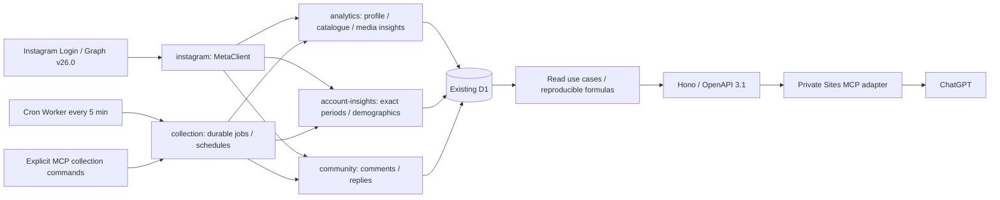

# Аудит данных Instagram в Social Analytics

Дата проверки: **8 октября 2026 года**. Назначение: независимая перепроверка и подготовка задания на реализацию. Исправления и изменения production в этот этап не входят.

## 1. Вывод и границы доказательств

**Основа для анализа уже работает:** официальный Instagram Login, накопленные метрики, реальные снимки, календарные Account Insights, комментарии и частичная демография сохраняются в D1 и читаются через действующий MCP. Полная пагинация каталога и истории действительно проверена. Watch time и skip rate Reels собираются, а не только перечислены в словаре. Проверенные числовые значения и `null` проходят из БД через MCP без подмены.

**Главные ограничения — своевременность, покрытие и сопоставимость.** При одном шаге каждые пять минут создание задания конкурирует с исполнением, а длительный архив комментариев — с остальными работами. Есть два пропущенных часовых окна; первая страница нового discovery job началась примерно через 30 минут после создания. На основном срезе календарная загрузка покрывает 6 из 103 интервалов. Квота не распознана из реально полученного заголовка. Возрастной статус показывает только публикации после подключения и не отражает имеющиеся 7-/30-дневные наблюдения более ранних объектов. Историю обязательств политики отдельно восстановить нельзя.

Доступно 4 настоящих снимка около 7 дней и 5 около 30 дней. Это малые выборки; они не восстанавливают историю остальных публикаций. Рубрики, подтверждённые темы, длительности и коммерческие записи пока не заполнены. Подписки от конкретного Reels через текущие Media Insights **не подтверждаются и не должны обещаться**: справочник относит `follows`, `profile_visits`, `profile_activity` к FEED/STORY, а ограниченные запросы для свежего Reels отвергнуты именно по типу продукта.

### 1.1. Как читать доказательства

В отчёте используются три независимых уровня:

| Метка | Что доказано | Что не следует из этого |
|---|---|---|
| **Код** | Поведение текущего рабочего дерева, конкретная функция/запрос | Что именно этот исходник побайтно развёрнут в production |
| **Окружение** | Прочитанная настройка Worker, Cron, подключения, таблицы | Что задача выполнилась и получила полезные значения |
| **Выполнение** | Реальный ответ Instagram, SELECT D1, ответ установленного MCP, агрегат Cloudflare | Что все аккаунты, форматы и будущие периоды ведут себя так же |

Исходная ревизия Git: `8ed0040c31c818e7331a991704a77e6870b94c6b`. При начале аудита дерево уже содержало изменения backend/MCP и миграцию `0008`; они не являются результатом этого аудита. `/health` и прочитанные переменные развёрнутого Worker подтверждают `BUILD_REVISION=0.2.14`, `INSTAGRAM_API_VERSION=v26.0`. Локальный `chatgpt/src/server.ts` объявляет `0.3.5`; соответствие всего развёрнутого артефакта локальному исходнику не проверялось по хешу сборки. Совпадение проверенных контрактов подтверждено настоящими вызовами MCP.

Основные счётчики БД/статуса зафиксированы до **08:13:33 UTC / 13:13:33 Asia/Yekaterinburg**. Прямые сверки источника выполнены в 08:07–08:34 UTC; позже отдельно проверена история нового автоматического снимка 08:20:26 UTC. Числа разных срезов нельзя складывать как один неизменный экспорт БД: Cron продолжал работать во время чтения.

Контрольный статус **09:49:31 UTC / 14:49:31 local**: уже 9/103 наблюдённых календарных интервалов, 94 missing, 2 rechecks; activity job pages 7/collected 7, comments pages 1448/collected 2905, manual pages 6. Общий lastSuccess 09:45:24.445UTC относится к последнему successful automatic step. RecordedResponses 119 с 06:18:13; quota percent всё ещё null, pause 0, cached unavailable 22. Загрузка **продвигается**, полной остановки не установлено. Подробные таблицы ниже сохраняют исходный cutoff; дополнительный срез не переписывает его задним числом.

### 1.2. Реестр проверок

| ID | Проверка и воспроизводимый результат |
|---|---|
| E01 | GET `/health`, Cloudflare GET script settings/schedules, SELECT подключения: production `0.2.14`, v26.0, Cron `*/5 * * * *`, сохранённые три scopes, срок доступа; без чтения секретов в вывод |
| E02 | SELECT каталог/снимки/профиль: 247 объектов, 647 media snapshots, 556 account snapshots; запросы Q1–Q4 в приложении к отчёту |
| E03 | Реальный `get_collection_status`: 100 возвращённых jobs при 157 строках D1; 103/6/97 календарных интервалов; 1h — 3/1/2; `usagePercent=null`; два последовательных чтения показали прогресс |
| E04 | Полный источник `GET /{account}/media?fields=id,media_type,media_product_type,timestamp&limit=100`: 3 страницы, 238 уникальных объектов, конечного курсора нет; в БД 239 объектов без Stories, один дополнительный сохранённый Reels недоступен прямым GET |
| E05 | Реальный `search_media(limit=100)` с продолжением: 3 страницы, 247 уникальных объектов, последний `nextCursor=null`; совпадает с D1, включая 8 сохранённых Stories |
| E06 | Реальный `get_account_summary(productType=REELS)`: 126 объектов, `truncated=false`; coverage 126/126 для views/likes/comments/saves/shares; суммы 179743/4603/687/381/692; это lifetime выбранных публикаций |
| E07 | Источник → SELECT последнего снимка → `get_media_report` для R-new, R-old, F-carousel, S-last: числовая сверка в §5; ошибки и временные различия сохранены как часть доказательства |
| E08 | Независимый SELECT возрастных окон и `analyze_content(ageDays=1/7/30)`: 1/4/5 настоящих наблюдений; корректировка знаменателя в §4.3 |
| E09 | `get_account_history(limit=100,to=2026-10-08T08:00:00Z)`: 6 страниц, 556 уникальных времён, последняя без курсора; `followerNetChange=-6` на каждой странице означает одну оценку по всему периоду. История R-new до 08:21 UTC: 4 страницы по 2, 7 уникальных снимков |
| E10 | `get_account_insights_history(kind=activity)` вернул 49 завершённых коллекций; точный `get_account_activity` за 4 октября сопоставлен с источником и D1; `get_audience_insights(this_month,age,limit=2)` вернул категории обеих аудиторий и продолжение страницы, но не придуманные проценты |
| E11 | SELECT дублей/осиротевших записей/времён/отрицательных изменений/просроченных операций; результаты в §4 и §6; запросы Q3–Q7 |
| E12 | `describe_metrics` действительно отдаёт 15 полей, включая watch time, skip rate и Facebook; определения шаблонные. `compare_media(R-old)` отдаёт n=125, медиану и честную оговорку о lifetime/разном возрасте |
| E13 | Cloudflare GraphQL `workersInvocationsAdaptive`, завершённый час 07:15–08:15 UTC: 123 вызова, errors=0, 21 subrequest, status=success; CPU P50/P99 9.486/96.965 ms, wall P50/P99 391.686/9611.600 ms. Агрегат включает запросы аудита, не отделяет Cron и не доказывает отсутствие частичных ошибок Meta |
| E14 | Первичные страницы Meta M1–M4 прочитаны целиком с HTTP 200; даты/противоречия и применимость в §3 |
| E15 | Ограниченные отдельные запросы: Reels follows/profile/reposts/FB; `follower_count`, `online_followers`; старый FEED с нулевыми views и `impressions`; `collaborative_media`. Результаты в §3/§5 |
| E16 | Корневой `pnpm check`: 114 backend-тестов и 18 MCP-тестов, типы, границы модулей, контракт и сборки прошли. Нефатальное замечание formatter в существующем `chatgpt/scripts/build.mjs`. Новые миграции не создавались |
| E17 | Реальный `get_comments(F-carousel,limit=3)`: sampled 3 из 9saved, nextCursor есть, completeHistory=false, untrustedData=true. Неверное limitation о несохранении usernames передаётся в MCP; имена/тексты в вывод не включались |
| E18 | Все 16SQL выражений приложения A выполнены как SELECT. Immutable counts/eligibility/negative transitions совпали на cutoff; mutable metadata к повторному чтению стали 7 объектов вместо 4. Это текущая запись Cron, не изменение аудита |
| E19 | Отдельный GET `/me?fields=account_type` в 10:03:39.740 UTC: HTTP 200, версия в заголовке ответа `v26.0`, тип `MEDIA_CREATOR`. Настройка версии и фактическая версия ответа совпали |

Всего для проверки выполнено **29 ограниченных GET к официальному Instagram Graph API**: 16 для объектов/метрик, 4 для профиля и трёх страниц каталога, 6 для дополнительной сверки, 2 для legacy/совместных публикаций и 1 для подтверждения обработанной версии. Эти прямые диагностические чтения обходят счётчик приложения `recordedRequests`; увеличивать его задним числом нельзя. Массовый сбор insights, обновление данных backend, POST команд MCP, включение журналов, изменение расписаний, миграции, push и deployment не выполнялись. Обычные записи действующего Cron продолжались.

Объекты обозначены псевдонимами; их можно найти по формату и точному `published_at` из §5. Для основных четырёх указан префикс SHA-256 внутреннего `media.id`. Подписи, комментарии, имена владельца/комментаторов, токены, OAuth state/code, заголовки авторизации и подписанные media URL в отчёт не включены.

## 2. Фактическое движение данных

Пути модулей вида `instagram/...` и `analytics/...` относятся к `backend/src/modules/`; сокращённое имя файла относится к указанному рядом модулю. Число после двоеточия — строка текущего рабочего дерева, имя — точка входа для поиска.



### 2.1. Авторизация и API

| Свойство | Код | Окружение / выполнение |
|---|---|---|
| Login | `instagram/infrastructure/meta-client.ts:242`, `authorizationUrl`: Instagram OAuth, `enable_fb_login=false`; обмен кода через `api.instagram.com`, long-lived/refresh через `graph.instagram.com` | Источник на `graph.instagram.com/v26.0` вернул данные аккаунта и insights. Facebook Login, Page token, scraping не обнаружены |
| Тип аккаунта | `profile()` и схема `account_type` | Прямой `GET /me`: `MEDIA_CREATOR`; профессиональный creator, не личный account |
| Версия | `platform/config/runtime-config.ts`, `MetaClient.graph()` | v26.0 в локальной конфигурации, фактических Worker vars, исходных запросах и снимках; E19 подтвердил обработанную v26.0 по заголовку ответа Meta |
| Scopes | `InstagramConnections.callback/loadToken`, `D1Connections` | В подключении сохранены `instagram_business_basic`, `instagram_business_manage_insights`, `instagram_business_manage_comments`; чтения insights и комментариев в БД подтверждают практическую работу. Сохранённый grant не гарантирует отсутствия последующего отзыва permission |
| Доступ приложения | M3 различает Standard для собственных/управляемых аккаунтов, добавленных в dashboard, и Advanced для внешних | Уровень Standard/Advanced и режим приложения в Meta dashboard независимо не прочитаны. Историческая `docs/deployment.md` — не доказательство текущего dashboard. Для проверенного собственного аккаунта доступ реально работает |
| Время подключения | `accounts.connected_at`, `D1Connections.save` сохраняет начальное подключение при повторном подключении | 2026-10-02 09:22:36.450 UTC. История включения расписания/смены политики отдельно не хранится |
| Доступ и refresh | `connections.ts:79 loadToken`: проверка срока, refresh при остатке ≤7 дней и возрасте token ≥1 дня | Сохранённый срок 2026-12-01 09:22:36.087 UTC; аудит токен не обновлял. Проверка фактического отзыва/истечения на production не инициировалась |

### 2.2. Обнаружение, обход и сбор

**Каталог.** `MetaClient.catalogPage` (`meta-client.ts:600`) запрашивает фиксированный host/version и продолжает по `paging.cursors.after`; не исполняет `paging.next`, который может содержать token. `paging.next` без курсора — ошибка. `SyncAccount.page` и `Collect.advance` хранят курсор в D1, проверяют повторение курсора. Размер 1–3 — ограничение одного атомарного backend-запроса, не общего каталога. Новый UUID нужен следующей странице; повтор той же страницы использует прежний operation ID.

Автоматическое обнаружение (`origin=scheduled`) прекращает обход после уже известной до начала задания публикации (`sawKnownMedia`). Полные `manual/catalogue` не имеют этого сокращения. Периодический полный каталог настроен **раз в 30 дней**, не каждый день. Завершённый исторический полный проход 2 октября содержал 236 объектов; текущий ручной проход на срезе продвинулся на 3 страницы. Наличие новых/изменённых старых объектов вне верхушки сокращённого обхода обнаруживается полным проходом или отдельным refresh. Поведение сортировки и visibility всех видов соавторства не доказано одним `/media`.

**Публикации.** `InstagramSource.metrics` (`analytics/infrastructure/instagram-source.ts:144`) выбирает поля по типу, пакетно читает совместимые scalar insights; при явно отвергнутом поле убирает только его, при неоднозначном пакетном отказе пробует отдельные поля. Capability cache привязан к аккаунту, версии, объекту и параметрам, срок 24 часа. Likes/comments могут поступить из того же свежего объекта как `like_count/comments_count`; `sourceField` меняется, старый снимок для fallback не копируется. Reels follows/profile intentionally не запрашиваются; FEED/STORY получают дополнительный `profile_activity`.

**Stories.** Отдельный `/stories`, 5 объектов на шаг, часовой автоматический discovery; известный срок публикация+24h используется для срочного повторного прохода. В одном объекте отдельно читается `navigation` с `story_navigation_action_type`, replies находятся в scalar запросе, profile activity — в отдельном запросе. Нельзя получить navigation одним несовместимым breakdown вместе с views/reach. На проверке `/stories` был пуст, хотя три сохранённых объекта ещё имели расчётный возраст <24h. Источник уже не давал перечитать S-last; причина не установлена.

**Календарь и аудитория.** `account-insights/index.ts:26 read`: проверяет identity через profile, разделяет запросы по breakdown; `follows_and_unfollows` автоматически выделяется с `follow_type`. У аккаунта `period=day`; для точного `[from,to)` передаются Unix `since=from/1000`, `until=(to-1000)/1000`, поскольку Meta описывает включительные границы. `metric_type=total_value` сохраняет итог выбранного диапазона; time_series сохраняет points/end_time. Демография: `period=lifetime`, `timeframe=this_month` (rolling 30d), отдельно age/gender/country/city и отдельно follower/engaged populations. Ежедневный supporting-план делает четыре шага демографии и календарный backlog.

`activityPeriodPlan` строит завершённые локальные дни, недели с понедельника и календарные месяцы в 90-дневном окне; максимум одного интервала — 31 сутки. Отдельные месяцы при DST могут выйти за этот guard и отражаются как `uncollectableIntervals`, не заменяются суммой уникальных охватов. Действует повтор до получения наблюдения не раньше конца периода+48h. `refreshActivityQueue` сохраняет текущую голову backlog и добавляет новые интервалы, не перезапускает уже выполненные шаги.

**Комментарии.** `community/Comments.collect`, `collection/application/bulk-comments.ts advanceComments`: корневые страницы по 5, вложенные replies по 50; отдельные страницы больших веток, не более двух probes отсутствующей вложенной ветки. Checkpoint содержит объект, after, родительские ветки, cursors и поколение событий. Доступны полный reconciliation и отдельный refresh после webhook/изменения `comments_count`/истечения срока. Сохранение по ID обновляет запись; повтор страницы не создаёт второй комментарий. Отсутствие в очередном ответе не доказывает удаление. Webhook комментариев подтверждён доставкой; webhook insights Stories не поддерживается при этом Login.

### 2.3. Планировщик, ограничения и повторы

Фактический Cloudflare Cron `*/5 * * * *` создан 3 октября, изменён 8 октября. `backend/src/index.ts:scheduled` вызывает `createScheduledOperations(...).tick()` через `ctx.waitUntil`, не зависит от запуска ChatGPT. В расписании D1 `enabled=true`, `discoveryMinutes=60`, `timeZone=Asia/Yekaterinburg`.

`Collect.tick` (`collect.ts:345`) делает **одну операцию за запуск**. Чётные десятиминутные слоты предпочитают schedule; нечётные — durable jobs. У schedule после обычной операции пауза 15 минут, у age — 5 минут. В очереди есть небольшие форы: Stories 15 минут, comments_refresh 10, discovery 5; старение задания сохраняется. Известная Story с истечением в ближайшие 15 минут получает отдельный первый приоритет. Между periodic и возрастным окном выбирается ранний deadline с grace; общий `dueMedia` выбирает самое старое последнее наблюдение, не самый молодой объект.

`D1Collection.claim/save` (`d1-collection.ts:103/118`) выдаёт lease 15 минут, сохраняет checkpoint только при совпадении lease token и непросроченном владении. `sync_runs/sync_leases` отдельно ограждают атомарный сбор аккаунта. Первая ошибка с исчерпанными полезными попытками даёт 30 минут (`15 * 2^failures`), далее exponential, предел 24 часа; пять подряд завершают job ошибкой. Wait/lease contention не увеличивают source failure. HTTP 429/известные rate-limit codes сохраняют retryable работу и учитывают `Retry-After`; unavailable object получает нейтральный код и паузу 24h, не объявляется удалённым.

**Очередь уже существует в таблицах D1.** Cloudflare Queue, дополнительный Worker, KV, R2 или новая БД для предложенных исправлений не требуются.

### 2.4. Хранилище и путь до MCP

Полная схема: `backend/src/platform/database/schema.ts`; существующая миграция `0008` добавляет диагностические/capability поля и таблицы. Существенные grains:

| Таблица | Grain и сохраняемые факты | Чтение / преобразование / MCP |
|---|---|---|
| `accounts`, `instagram_connections` | Один account; тип, connectedAt, lastSyncedAt; зашифрованный token, scopes, срок | `InstagramConnections`; `list_accounts` читает account, не раскрывает token |
| `media` | Уникальный `(account_id,external_id)`; тип, timestamp, caption, контекст, metadata, duration/source, discovery/source, unavailableUntil | `AnalyticsQueries.search/report`; `search_media`, `get_media_report`, `analyze_content` |
| `media_snapshots` | Реальный снимок: media ID, observedAt, apiVersion, scalar metrics с sourceField/unit/reason, Story/profile структуры, operation ID | `D1Analytics.finish/atAge/history`; `get_media_report/history`, `compare_media`, `analyze_content` |
| `account_snapshots` | Точка followers_count/media_count профиля, observedAt | `accountHistory`: граничная разность, все страницы; `get_account_history` |
| `account_insights` | Операция; requestedAt, observedAt в JSON, статус/error, точный input, version, values/points/breakdowns/description | `AccountInsights.activity/audience/history`; `get_account_activity`, `get_account_insights_history`, `get_audience_insights` |
| `comments`, `comment_collections`, `comment_media_state` | Уникальный comment ID; текст/даты/автор/likes, отдельные page results и состояние полноты | `Comments.list`, coverage; `get_comments` и collection status. Список — сохранённая выборка, не обещание всей истории |
| `collection_jobs`, `collection_schedules`, `sync_runs`, `sync_leases` | Задания/попытки/курсоры/lease и расписание, ошибки | `Collect.status` → `get_collection_status`; явные команды запуска и resume |
| `instagram_api_state`, `instagram_metric_support` | Наблюдённые ответы/usage/backoff и scoped 24h cache | `apiStatus` → поле `api` в collection status; не полноценный журнал запросов |
| `comment_webhook_state/events` | Подтверждение подписки, реальная доставка и очередь событий | Refresh комментариев; webhook activity в status |
| `business_records`, `experiments`, `story_sequences` | Явные данные владельца и планы | `content`/`reviews`; не синтетические продажи из Instagram |

`SyncAccount` сначала читает profile, страницу и все метрики объектов страницы, затем `D1Analytics.finish` атомарно записывает metadata/snapshots/profile и завершает run. ID снимка детерминирован как operation ID + media ID; `ON CONFLICT DO NOTHING` предотвращает повтор. Частичная ошибка до finish не переписывает предыдущий успешный снимок, но откладывает всю страницу. Увеличение страницы без per-object checkpoint усилит это влияние.

Исходные HTTP body для обычных media insights **не сохраняются**: парсер оставляет значения/sourceField/reason, а account insights ещё description/points/categories. `observedAt` media ставится после всего чтения метрик объекта; отдельных времён получения по запросам нет. Profile читается раньше, но account snapshot получает время завершения операции. API version присутствует; версий определений/преобразований нет.

`chatgpt/src/server.ts:58 run` отправляет backend result как текст JSON и как `structuredContent`. `backend-client.ts` проверяет owner, закрепляет backend origin, применяет Zod контракт; неизвестные поля могут быть отрезаны. GET timeout 20s, ответ ≤4MiB; команды collection имеют иной timeout. Чтение statistics/history/summary/activity/audience/content использует сохранённые данные, не скрытый большой сбор. Команды `collect_*`, `refresh_media`, изменения расписания и контекста отдельно помечены write. Аудит вызвал только read-инструменты. Исключение на уровне backend: чтение отдельного просроченного sync status может оформить failed; это необходимо явно описать в контракте восстановления.

## 3. Матрица метрик и возможностей источника

### 3.1. Первичные источники и общие условия

Обязательные M1–M4 и дополнительные M5–M6 проверены 2026-10-08; применимость оценена для **Instagram Login / graph.instagram.com / v26.0 / MEDIA_CREATOR**:

| ID | Первичный источник | Обновление страницы / проверка |
|---|---|---|
| M1 | [Instagram Media Insights](https://developers.facebook.com/docs/instagram-platform/reference/instagram-media/insights/) | Updated Sep 11, 2026; HTTP 200; таблица типов, ограничения, breakdown и response syntax |
| M2 | [Instagram Account Insights](https://developers.facebook.com/docs/instagram-platform/api-reference/instagram-user/insights/) | Updated Jun 16, 2026; HTTP 200; актуальная interaction table, demographics, range и совместимость |
| M3 | [Instagram Platform Insights guide](https://developers.facebook.com/docs/instagram-platform/insights/) | Updated Jan 21, 2025; HTTP 200; Login/scopes/доступ/вебхуки. Старые примеры не считаются актуальной таблицей метрик |
| M4 | [Instagram Platform Changelog](https://developers.facebook.com/docs/instagram-platform/changelog/) | Updated Oct 5, 2026; HTTP 200; просмотрены изменения 2024–2026, включая новые поля и прекращение поддержки |
| M5 | [Graph API Rate Limits](https://developers.facebook.com/docs/graph-api/overview/rate-limiting/) | HTTP 200; прочитаны таблицы header keys/units и InstagramBUC |
| M6 | [Instagram Platform Overview — Rate Limiting](https://developers.facebook.com/docs/instagram-platform/overview/) | HTTP 200; раздел общих Instagram limits; не отдельное подтверждение aliases для Login v26 |

В колонке «документ» ссылки M1–M4 относятся к этим URL и дате, не к общему названию поля в коде. «Нет проверки» означает границу аудита, а не запрет API. R/F/S — Reels / FEED (image, video, carousel parent) / Story. `P` — `get_media_report/history`, `A` — `get_account_activity/insights_history`, `D` — `get_audience_insights`, `C` — `get_comments`, `RANK` — `analyze_content`.

Для всех строк media: **реальный response period=lifetime**, since/until не восстанавливают возрастный снимок. M1 перечисляет несколько period в синтаксисе, но раздел response прямо говорит, что period автоматически lifetime и не меняется. M1 указывает хранение до двух лет, задержку расчётов до 48h; пустой ответ — отсутствие, не ноль. Для Stories окно метрик 24h и ограничения малой/региональной аудитории; для потомков альбома Insights отсутствуют. Подсчёты наличия ниже относятся к последним сохранённым наблюдениям основного среза.

M1 связывает малое число viewers/низкие значения с code 10 `Not enough viewers`; указан порог 5. Это не правило «отбросить любой replies 0»: сохранённые Stories имеют нулевые replies при числовой навигации. Код отличает этот конкретный текст insufficient_audience отпрочих code 10 permissions errors.

### 3.2. Публикации, Reels, Stories

| Вопрос → уровень | Точное API-поле; смысл и единица | Формат / параметры / время | Документ | Разрешённая проверка | БД → MCP | Граница вывода |
|---|---|---|---|---|---|---|
| 1,3,4,6 → media | `views`: число показов/воспроизведений Instagram, повторные включены; count | R/F/S; lifetime | M1/M4; Account table и реальные descriptions уточняют «played or displayed» | R-new=2, R-old=2031 в новом чтении, carousel=756; F-zero=0 в source 200 | R126/126, F85/113, S8/8 → P/RANK | Не уникальные люди; views=0 у старого F не доказывает отсутствие интереса; задержка/исторические определения |
| 1–4 → media | `reach`: уникальные охваченные аккаунты/пользователи объекта, estimated; count | R/F/S; lifetime | M1 | R-new=108, R-old=1688 в новом чтении, carousel=263; F-zero=123 | R126/126, F85/113, S8/8 → P/RANK | Не складывать в уникальный охват аккаунта; ранние views/reach могут быть несогласованны |
| 2,4 → media | `likes` (fallback `like_count`): лайки; count | R/F, не S; lifetime | M1/M3: organic Instagram | R-new=0, R-old=69, carousel=25 | R126/126, F113/113 → P/RANK | Область fallback должна оставаться видимой; не полный promoted/Facebook total |
| 2,4,7 → media | `comments` (fallback `comments_count`): число комментариев; count | R/F, не S; lifetime | M1/M3 | R-new=0, R-old=15, carousel=9 | R126/126, F113/113 → P/RANK; текст отдельно C | Counter и число сохранённых текстов не обязаны совпадать; удаления/permissions/неполные ветки |
| 2,4 → media | `saved` → локальное `saves`: сохранения; count | R/F; lifetime | M1 | R-new=0, R-old=34, carousel=1 | R126/126, F85/113 → P, saveRate | Это действия, не уникальные сохранявшие; `saved` media ≠ `saves` account |
| 2,4 → media | `shares`: пересылки/поделились; count | R/F/S; lifetime | M1 | R-new=0, R-old=19, carousel=0; свежую S перечитать нельзя | R126/126, F85/113, S0/8 → P, shareRate | Не путать с `reposts`; один отказ Story не опровергает документированную применимость |
| 2,4 → media | `reposts`: reposts минус удалённые; count | R/F/S; lifetime | M1; M4 03.12.2025, all versions | R-new: 400 code 100, unsupported metric в этой конфигурации | Числовых значений 0/247, причина not_supported → P | Конфликт таблицы и практики; нельзя объявлять поле недоступным для Instagram вообще; account reposts работает |
| 2,4 → media | `total_interactions`: likes+saves+comments+shares с отменами/удалениями; count, in development | R/F/S; lifetime; organic | M1/M3 | R-new=0, R-old=141, carousel=36 | R126/126, F85/113, S0/8 → P/derived | Fallback суммы компонентов должен иметь отдельное определение/provenance; не добавлять reposts без смены формулы |
| 3,4 → Reels | `ig_reels_video_view_total_time`: всё время воспроизведения, включая повторы; **ms** | Только R; lifetime | M1 + titles/descriptions реального ответа подтверждают milliseconds | R-new=428476, R-old=20045832 в новом чтении | R126/126 → P | Не число досмотров, не уникальное время человека; не суммировать с другой единицей |
| 3,4 → Reels | `ig_reels_avg_watch_time`: среднее время воспроизведения; **ms** | Только R; lifetime | M1 + ответ источника | R-new=3967, R-old=11627 в новом чтении | R126/126 → P; duration отсутствует | avg/duration — отношение времени, может быть >100%; не доля досмотревших |
| 3,4 → Reels | `reels_skip_rate`: initial views, пропущенные за первые 3s / initial views ×100; percent; estimated, in development | Только R; lifetime | M1/M4 03.12.2025 | R-new=100, R-old=47 | R126/126 → P | Это ранний пропуск, не retention curve и не completion; знаменатель initial views, не общий views |
| 4,7 → media | `facebook_views`: Facebook plays, включая crossposted/cross-recommended для Reels; count | R/F/S; lifetime; отдельная поверхность | M1/M4 22.04.2026 | R-new: 400 code−1/subcode 2207086, is_transient=false; другие R реально сохранены | R35/126 (14 нулей), F0/113,S0/8 → P | Не выдавать за органические Instagram views; ошибка одного объекта не опровергает 35 реальных значений |
| 4,7 → Reels | `crossposted_views`: сумма plays Instagram+Facebook для crossposted Reels; count | Только R; lifetime; требует доступного sharing | M1/M4 03.12.2025 | R-new: тот же scoped отказ | R0/126 → P null/reason | Не складывать ещё раз с Instagram/Facebook views; не обещать универсальное наличие |
| 7 → media | `follows`: following metric media; count | **F/S, не R**; lifetime | M1: описание слишком общее, не называет причинную атрибуцию | R-new: 400 code 100, product type unsupported; carousel=1 | F85/113, S0/8, R0/126 → P | Дневной прирост аккаунта не является follows от Reels; уточнить определение media follows до коммерческой атрибуции |
| 7 → media | `profile_visits`: визиты профиля; count | **F/S, не R**; lifetime | M1 | R-new: 400 code 100 product type; carousel=11 | F85/113, S0/8, R0/126 → P | Действия/визиты, не обращения и не продажи |
| 7 → media | `profile_activity`: действия после посещения профиля; total/actions, count | **F/S, не R**, lifetime, `breakdown=action_type`; созданные после 26.10.2017 | M1: BIO_LINK_CLICKED/CALL/DIRECTION/EMAIL/OTHER/TEXT | R-new rejected product type; carousel 200, `values:[{value:0}]`, actions отсутствуют | F total 1/113 (этот carousel), S0/8 → P | Не считать отсутствие категории нулём; старые снимки ещё не имеют новой структуры; сумма действий ≠ visits |
| 5,7 → Story | `replies`: ответы, count, с исключениями Европы/Японии | S; lifetime, доступ до 24h | M1 | Новая S: object unavailable; исторические replies=0 доходят в MCP | S8/8 → P.storyInsights | Региональный 0 может быть ограничением источника; не включает все возможные обращения |
| 4,7 → Story | `navigation`: действия; `story_navigation_action_type` | S; lifetime; отдельный запрос. TAP_FORWARD/TAP_BACK/TAP_EXIT/SWIPE_FORWARD, в БД lowercase | M1 | Живой источник проверить нельзя; историческая S через MCP 42/6/3/2 совпадает с БД | forward 7/8, back 5/8, exit 7/8, next 5/8; scalar total 0/8 → P | 24 числовые категории существуют! Отсутствие total не означает отсутствие navigation; действия не уникальные зрители и не завершения |
| 7 → Story | `link_clicks`: taps на ссылки в Story; count | S; lifetime; **Facebook Login only** | M1 перечисляет без оговорки, M4 22.06.2026 явно ограничивает Login | Не проверялось: текущий Login не соответствует документированному условию | Нет запроса/поля/БД/MCP | Нельзя обещать link sticker taps через текущую интеграцию; profile BIO_LINK_CLICKED — другой объект |
| 4,7 → multi-surface | `total_likes`, `total_comments`, `total_views`; direct `total_like_count/total_comments_count/total_views_count`, `reposts_count/saved_count/shares_count` | Promoted/Facebook агрегаты; **Facebook Login only** по M1/M3/новым engagement fields M4 | M1/M3/M4 22.04.2026 | Не запрашивались при Instagram Login | Нет → нет | UI Instagram может включать другую область данных. Не менять Login ради этих полей в минимальном плане |
| 1,4 → legacy media | `impressions`: экранные показы, count; не `views` | F/S, старые публикации до 02.07.2024; версия поддержки противоречива | M1 vs M4 21.01.2025 | F-zero от 22.12.2022, v26.0 **200, impressions=133** | Не собирается/не отдаётся | Конфликт проверен; точечный legacy сигнал не разрешает переименовать его в views или обещать всем старым постам |
| 1,4 → album | Parent `id`, `media_type=CAROUSEL_ALBUM`, `children`; parent media fields выше | Parent F; child insights недоступны | M1 Album metrics; current metadata mapping | Выбранный album содержит 10 children, childrenComplete=true; отдельные child insights не запрашивались | Parent в `media`; children в metadata только у части обновлённых объектов → P.media | Parent reach/views не сумма children; нельзя ранжировать отдельный слайд по parent метрикам |

### 3.3. Аккаунт, календарь, аудитория, комментарии

Здесь `total_value` — итог **точного запрошенного диапазона**, даже когда `period=day`. Дневные/недельные/месячные итоги в БД хранятся независимо. Общий доступ истории в приложении ограничен 90 днями; специальные метрики могут иметь более короткое окно.

| Вопрос → уровень | Поле; определение / единица | period / type / breakdown / ограничения | Документ | Реальная проверка | БД → MCP | Ограничение |
|---|---|---|---|---|---|---|
| 5 → account | `views`: played/displayed всего контента; count | day/total_value; media_product_type или follower_type | M2 | 04.10=119, сентябрь=48495; дневной source 119 совпал | В 11 числовых scalar полях полного набора → A | Не lifetime публикаций месяца; views не unique |
| 5 → account | `reach`: unique accounts периода, включая ads; estimated count | day/total_value либо time_series; media_product_type,follow_type | M2 | 04.10=97, сентябрь=30531; source 97 совпал | Итоги и отдельные series/points → A | Сумма дней/постов не равна месячной unique audience; total_value надо запросить отдельно |
| 5 → account | `accounts_engaged`: unique interacting accounts, включая ads; estimated count | day/total_value; без breakdown | M2 | 04.10=5, сентябрь=1029; source 5 | Сохраняется → A | Не равно количеству действий; нельзя суммировать дни как уникальных участников |
| 5 → account | `total_interactions`: все post/story/Reels/video/live interactions, включая boosted; count | day/total_value; media_product_type | M2 | 04.10=5, сентябрь=2157; source 5 | Сохраняется → A | Область отличается от organic media total_interactions |
| 5 → account | `likes`, `comments`, `saves`, `shares`: действия соответствующего вида; count | day/total_value; media_product_type | M2 | 04.10=3/0/0/1; source совпадает; сентябрь 1165/230/173/279 | Сохраняются → A | `saves` plural; не складывать календарь с media lifetime |
| 5,7 → account | `replies`: Story text/quick reactions; count | day/total_value, без breakdown | M2 | 04.10=0, сентябрь=7; source 0 | Сохраняется → A | Не весь DM inbox/все лиды; региональные ограничения требуют сохранения context |
| 5,7 → account | `profile_links_taps`: адрес/call/email/text buttons; count | day/total_value; contact_button_type | M2 | 04.10=0, сентябрь=0; source 0; отдельный button breakdown не проверялся | Scalar есть → A; breakdown поддержан контрактом | Название не доказывает все клики bio/Story link; не продажи |
| 5,7 → account | `follows_and_unfollows`: следования/отписки/уход из Instagram за диапазон; count/categories | day/total_value; follow_type; ≥100 followers | M2 | 04.10 total scalar отсутствует, FOLLOWER=1/NON_FOLLOWER=4; source=DB=MCP | Категории сохранены, scalar null/not_returned → A | Не «нет данных»: структура полезна. Сохранять literal categories; документировать их отображение в follows/unfollows, не выводить attribution Reels |
| 5 → account | `reposts`: repost действия контента; count | day/total_value, без breakdown | M2/M4 | 04.10=0, сентябрь=24; source 0 | Есть → A | Наличие account reposts не доказывает доступ media reposts |
| 5,7 → profile | `/me?fields=followers_count,media_count` | Моментный профиль, не since/until/day | Реальный ответ; `MetaClient.profile` | followers_count=5056; media_count=219 | 556 points → get_account_history | Граничное net−6 не дневные follows, не source календарная серия; media_count 219 не каталог 238/239 |
| 5,7 → legacy account | `follower_count`: response title/description — Follower Count/unique accounts following profile; count | day/time_series; лимит 30d из M4 2021; ≥100followers по M2 | M2 упоминает только limits, текущей строки нет; M4 history | v26.0/Instagram Login **200, value=1, end_time=04.10 07:00 UTC** для локального дня 04.10 | Не собирается/не отдаётся | Значение 1 ≠ профиль 5056; временной смысл/описание требуют уточнения. Не объявлять ни total followers, ни net приростом автоматически |
| 6 → account | `online_followers`: сколько followers онлайн по часам/периодам | last 30d, ≥100followers; tested lifetime | M2 limits; текущей metric table строки нет | **200**, два points/end_time, оба `value:{}`; чисел часов нет | Нет → нет | Пустая карта не доказывает API невозможность. Не использовать как доказанное лучшее время; применимость параметров ещё не установлена |
| 4–6 → audience | `follower_demographics`: известные demographics followers; count | lifetime/total_value; age/gender/country/city; timeframe; ≥100followers, top 45, unknown excluded | M2 | История age/this_month: 7 numeric categories, общий scalar отсутствует | Категории → D, percent=null | Не считать sum(categories) всем населением; не представлять rolling окна как календарные месяцы |
| 4–6 → audience | `engaged_audience_demographics`: demographics engaged population; count | lifetime/total_value; this_month=rolling 30d,this_week=rolling 7d в v20+; ≥100engagements | M2, включая примечание против старых timeframe в той же таблице | age/this_month: 7 numeric categories, scalar absent | Категории → D, percent=null | Это другая аудитория, не состав followers; часть старых окон в БД не даёт usable engaged data |
| 4–6 → audience | `reached_audience_demographics` | Текущая M2 не перечисляет; исторические упоминания M4 | M2/M4 | Не проверялось | Нет → нет | Не включать в обязательное обещание до актуального подтверждения |
| 7 → community | `/media/comments`, `/comment/replies`: text, id, timestamp, author, likes/hidden где есть | Корневые и reply cursors; permission manage_comments | Реальная БД/код; не Media Insights показатель | 3791 уникальных comments, 1388 replies, 27 с author/likes; 15 unverified branches | `comments` → C с pagination/coverage | Counter comments не равен этой выборке; sentiment/тема AI — интерпретация текста, не факт покупки |

Необследованные breakdown вариантов `media_product_type/follower_type/contact_button_type` нельзя считать реально собранными только из наличия схемы. Автоматический полный набор получает общие итоги и follow_type; demographic — четыре отдельных dimensions. Совместимость запросов проверяется в `account-insights/domain/model.ts supportsActivityMetric`, а группы в `index.ts`; добавление метрики требует проверки группы, а не простого дописывания имени.

### 3.4. Прекращения поддержки и противоречия

1. M4 21.01.2025: `views` введён для media/user; `plays`, `clips_replays_count`, `ig_reels_aggregated_all_plays_count`, `impressions` прекращены для v22+ / всех версий с 21.04.2025. Legacy `impressions` для старых объектов в changelog оговорён v21 и ниже; M1 такой версии не указывает. **Реальный старый пост на v26 вернул 133.** Хранить отдельно с version/object/date; не «чинить» нулевые views копированием impressions.
2. M4 02.10.2024: `video_views` и старые account time_series `email_contacts/get_direction_clicks/profile_views/text_message_clicks/website_clicks/phone_call_clicks` удалены с v21 / для всех с 08.01.2025. Старые примеры M3 всё ещё показывают `engagement/impressions/profile_views`; они не обосновывают новое внедрение.
3. M4 03.12.2025 добавляет skip rate/reposts/crossposted/Facebook views для всех версий. Практически skip работает 126/126, Facebook 35/126, media reposts 0/247. Не сводить разную применимость к одному «API не поддерживает».
4. M4 22.04.2026 вводит прямые engagement fields для Facebook Login, multi-surface totals, расширение Facebook views и collaborative_media. Пробный collaborative_media при этом Instagram Login:400/code 100 `nonexisting field`. Это scoped результат, а не доказательство отсутствия collab-публикаций у владельца.
5. M4 22.06.2026: Story `link_clicks` только Facebook Login. M1 перечисляет metric без этой оговорки; план следует явному Login ограничению changelog.
6. M1 рекомендует story_insights webhook возле срока 24h, но отдельно запрещает insights webhook для Instagram Login; M3 тоже указывает Facebook Login only. Рекомендация webhook Stories **не применима** к текущей интеграции.
7. M2 одновременно перечисляет старые demographic timeframe и пишет об их удалении для engaged с v20+. Приложение для новых engaged запросов правильно допускает только this_month/this_week; сохранённые старые пустые окна не восстанавливают demographic history.
8. M1 обещает media retention до 2 лет; F-zero от 2022 года реально вернул базовые значения и impressions в 2026. Наличие отдельных старых данных не является гарантией полной доступности за 4 года.

## 4. Покрытие, свежесть и временная модель

### 4.1. Объекты и последние значения

| Формат | Объектов БД | Реальных снимков | Что доступно в latest | Причины отсутствия |
|---|---:|---:|---|---|
| REELS / VIDEO | 126 | 370 | views/reach/likes/comments/saves/shares/interactions/avg watch/total watch/skip: **126/126**; FB35/126 | reposts/crossposted: not_supported; follows/profile отсутствуют по типу. Один объект вне текущего каталога, последние сохранённые данные остаются |
| FEED | 113: 51 carousel,61 image,1 video | 231 | likes/comments 113/113; views/reach/saves/shares/interactions/follows/profile visits 85/113; profile activity total 1/113 | 28 объектов latest с not_supported для основных insight fields; причина по каждому не доказана. 80 из 85 известных views равны 0; один source 0 проверен |
| STORY | 8:4image,4video | 46 | views/reach/replies 8/8; navigation forward/exit 7/8, back/next 5/8 | navigation total 0/8, часть categories not_returned; shares/follows/profile/interactions/FB/reposts 0/8. Это не отсутствие всей Story аналитики |
| Профиль | 1 аккаунт | 556 | Followers 5053–5063, последняя 5056; первое 5062, разность−6 | Это ~6 дней наблюдений, не произвольная историческая серия до подключения |

Первый profile snapshot — 02.10 09:42:46.591 UTC, последний основного среза — 08.10 07:40:24.368 UTC. Последние Reels snapshots лежали между 02.10 14:49:47.932 и 08.10 07:35:26.642 UTC: охват 126/126 не означает одинаковую свежесть. Ноль в диагностике `older_than_7days` не делает шестидневное значение свежим для вчерашнего ролика.

Доступные настоящие нули Reels: views/reach по 1 объекту, likes 7, comments 44, saves 44, shares 54, interactions 6, skip 1; FB14 из 35. Парсер сохраняет 0. У S-last сохранён reach 0 при views 8; исходного исторического HTTP body нет, поэтому сам первоначальный source 0 отдельно не доказан. У F-zero source 0 доказан сегодняшним GET.

Metadata присутствует у 4/247 (3Reels и 1carousel); duration 0/247; context/rubric/sponsored/proposals 0/247; business_records 0. Наличие caption/permalink позволяет ручную/предполагаемую классификацию, но не даёт тему фактического видео, озвучку, рекламу, расходы и лиды.

E04: источник сейчас отдаёт 125R+113F=238, БД 126R+113F=239. Прямой GET дополнительного R от 14.09 22:22:33 UTC —400/code 100/sub 33. Нейтральное описание: объект не найден/недостаточно permissions/операция неприменима; причина не разграничена. Не удалять автоматически его сохранённую историю. `me.media_count=219` — ещё иной счётчик, не доказанный знаменатель каталога; разница 219/238/239 остаётся не объяснённой этим аудитом.

Количество **полученных значений**, отличное от объектов и запросов: во всех 647 media snapshots —9705 scalar slots,5549numeric values,1138 из них 0. В latest на фиксированный cutoff: R1295/1890 numeric slots, F821/1695, S16/120; всего 2132/3705,502 настоящих сохранённых 0. Знаменатель 15fields×objects здесь технический: включает неприменимые поля и не является показателем аналитического покрытия. Story replies/navigation и profile_activity посчитаны отдельно в матрице. Количество HTTP requests, запланированных per-field чтений и исключений по каждой исторической попытке из этих чисел не восстанавливается — соответствующего ledger сейчас нет.

### 4.2. Календарь и аудитория

В `account_insights` найдено 50 activity operations:49completed и 1physical running; 34 demographic operations:30completed,3failed,1physical running. Это **операции, не число уникальных периодов или доступных значений**. 49 activity history entries смешивают параметры/повторные чтения, old metric sets и timezone.

Для текущего полного 12-field набора, v26.0, `total_value`, `Asia/Yekaterinburg` найдено 7 completed operations на **6 точных календарных диапазонов**:

| Тип | Нужные интервалы 90d | Наблюдено хотя бы раз | Не наблюдено | Примеры |
|---|---:|---:|---:|---|
| Локальный день | 89 | 4 | 85 | 04–07 октября; views 119/132/545/835, reach 97/68/333/565 |
| Неделя Mon–Sun | 12 | 1 | 11 | 28 сентября–5 октября `[27.09 19Z,04.10 19Z)` |
| Календарный месяц | 2 | 1 | 1 | Сентябрь `[31.08 19Z,30.09 19Z)` |
| **Всего** | **103** | **6** | **97** | recheckIntervals=2; не «97 потерянных дней» |

Статус `observedIntervals` считает завершённый подходящий набор запросов, **включая null metrics**, не подтверждённую полноту 12 значений. У полного набора 11 scalar fields доступны; `follows_and_unfollows` имеет полезные breakdown без scalar total. Для demographic age/this_month обе популяции имеют 7 numeric categories, но неизвестен общий scalar знаменатель; MCP правильно оставляет проценты null. В сумме 30 completed demographic operations не означают 30 полностью сопоставимых периодов.

Очередь activity на срезе:pages 4,collected 4,97remaining intervals; ближайший архивный день 11 июля `[10.07 19Z,11.07 19Z)` ещё подлежал чтению. Его начало пересекает guard 90d **8 октября в 19:00 UTC / 9 октября 00:00 local**. Это конкретный deadline восстановления; после него новое расписание не вернёт этот период. Аудит не запускал восстановление. Текущий planner ставит сначала свежие 3 дня, а затем старые по from; сохранённая голова предотвращает полную потерю прогресса, но не даёт гарантии прочитать всё до deadline. Контрольный SELECT подтвердил позднейшие наблюдения 11, 12 и 13 июля: получены 08:35:24.679, 09:05:24.550 и 09:40:24.722 UTC соответственно. Ближайший период успел сохраниться до границы; подтверждён риск приоритизации, а не потеря этих трёх дней.

### 4.3. Возраст 1/7/30 дней: реальные окна и правильный знаменатель

Существующий выбор `D1Analytics.atAge`: ближайший **реальный** snapshot к published+target, симметричные tolerances 1d±6h,7d±12h,30d±24h. Lifetime, полученный сегодня, не ставится на дату target. Основной контракт эту границу соблюдает.

Для независимой проверки использован минимально допустимый критерий: подключение произошло **до конца соответствующего окна**, nominal target уже наступил. Он шире узкого текущего условия `published>=connectedAt`. Это верхняя оценка operational eligibility: истории фактического включения расписания/политики нет, поэтому нельзя объявить любой недостающий snapshot внутри этого критерия нарушением прежнего обещанного SLA. Если сбор соответствующего окна ещё не был включён, объект должен быть отдельно помечен `policy_not_active`, а не записан как пропущенный.

| Формат / target | Всего | Подключение после конца окна | Ещё молоды среди остальных | Допущены, target наступил | Из них окно закрыто / ещё открыто | Настоящий подходящий snapshot |
|---|---:|---:|---:|---:|---:|---:|
| R,1d±6h |126|123|2|1|1/0|1|
| R,7d±12h |126|119|3|4|4/0|4|
| R,30d±24h |126|108|13|5|4/1|5|
| F,1d±6h |113|113|0|0|0/0|0|
| F,7d±12h |113|113|0|0|0/0|0|
| F,30d±24h |113|112|1|0|0/0|0|

Открытое окно 30d уже имеет валидное наблюдение; его нельзя приравнивать к окончательно нарушенному deadline. Опциональные часовые срезы статуса:1h±0.5h — expected 3,captured 1,missed 2;6h±1h —3/3/0. Все три новые публикации — Reels. Причины каждого missed 1h по отсутствующему source log не восстановлены. Первые снимки этих трёх появились примерно через 43.29/209.99/11.62 минут; discovery migration помечает их `history_inferred`, поэтому это только задержка первого сохранённого наблюдения, не точное время обнаружения.

**Подтверждённое ограничение контракта E03/E08:** status 7d/30d показывает expected 0/captured 0, поскольку `D1Collection.coverage` (`d1-collection.ts:421`) требует публикацию после подключения. Этот узкий cohort прямо описан в существующем note: код соответствует своему узкому определению, но не показывает всё полезное возрастное покрытие. Четыре и пять настоящих наблюдений существуют у более ранних публикаций. Для оценки нарушенного SLA нужны реальные интервалы активности политики, которых нет в истории. RANK отдаёт 1/4/5 observations, но `missing125/122/121` включает слишком старые/молодые объекты; это не количество пропущенных задач.

Реальные возраста E08:1d≈1.015;7d≈6.928–7.080;30d≈29.266–30.976. У 7d peers максимум 3, у 30d максимум 4; существующий порог классификации 5 peers не выполнен. Часовые группы n=1–2. Получить причинный вывод «лучшее время публикации» сейчас нельзя.

### 4.4. Три разных временных сущности и отсутствующие значения

1. **Latest lifetime media:** accumulated к `observedAt`; возраст публикации отдельно. Даты cohort — публикации, не даты взаимодействий.
2. **Snapshot:** реальная попытка чтения в данном времени. Изменение двух точек — разность наблюдений, не source календарная активность; Meta может пересмотреть счётчик.
3. **Account period:** итоги и categories exact `[from,to)` / source timeframe, плюс время получения и зрелость данных. Monthly unique reach получается прямым account запросом, не суммой дней.

Возрастной срез относится ко времени получения, **не к доказанному effective времени всех взаимодействий**. При возможной задержке Meta до 48h snapshot около 1/7/30 дней —результат, известный источнику в этот момент. API не даёт дату каждого media interaction, чтобы восстановить точное число действий к концу 7-го дня. Позднее уточнение lifetime не переносится в старый age snapshot.

Реализованные media reasons: `not_returned`, `not_supported`, `permission_required`, `invalid_value`, `insufficient_audience`; полноценная ошибка HTTP/transport чаще хранится в run/job и не становится новым snapshot. Для неприменимого типа null корректен; для structured insight отсутствующий scalar не означает отсутствие categories. Не различаются явно «не собиралось», «данные ещё не готовы», «причина неизвестна», «устарело», источник/время последней неудачной попытки по полю. Ни пустой body, ни возраст<48h сами по себе не доказывают `not_ready`.

E11: duplicate `(media_id,operation_id)`0, duplicate `(media_id,observed_at)`0, duplicate catalog 0; orphan snapshots/comments 0; snapshot без operation 0; до publication/в будущем 0. В проверенной истории не обнаружено переходов `nonnull→null` для scalar metrics. Один saves и один totalInteractions уменьшились: их надо сохранить, не исправлять монотонностью. avg watch уменьшился 63 раза, skip 21 раз — для средних/долей это обычное изменение, не нарушение счётчика. `calculateGrowth` оставляет `netChange<0`, а положительные velocity/gain делает null с `counter_decreased`; это честно, но не полная аналитика пересмотров всех полей.

Риск после частично успешного чтения: latest null скроет прежнее корректное поле в отчёте, хотя предыдущий snapshot остаётся в истории. Сейчас такого перехода не найдено; изменение модели нужно для явного last-known-good с прежним временем, **не для копирования старого числа в новый snapshot**.

## 5. Ограниченная сквозная сверка

### 5.1. Объекты и времена

Времена ниже — UTC. Сопоставлялись значения, единицы, нули, причины null и время наблюдения, а не только HTTP status.

| Псевдоним / hash | Формат / publication | Последний снимок при начале сверки | Прямое чтение источника | Что доказано |
|---|---|---|---|---|
| R-new / `a5fb6b61aae3` | Reels;07.10 18:52:15 |08.10 07:20:26.070|08.10 08:07:58.977|Source=DB=MCP по всем 10 проверенным основным полям, включая реальные 0 |
| R-old / `2fbb31ce30fc` | Reels;07.09 18:10:32 |07.10 11:30:37.924|08.10 08:08:05.192|DB=MCP; позже source изменился в views/reach/watch time, поэтому не требовалось равенство разновременных наблюдений |
| F-carousel / `2e0b63af2d0e` | Album FEED;09.09 11:27:22 |08.10 06:18:35.041|08.10 08:08:07.242|9 scalar полей совпали; отдельный profile_activity=0 совпал;10children принадлежат parent |
| S-last / `b51658bf0516` | Story;07.10 16:50:02 |07.10 17:15:33.658|08.10 08:08:09.908|DB=MCP; source identity и insights уже 400/code 100/sub 33, edge stories пуст. Live сверка чисел ограничена недоступностью объекта |
| S-history | Story;01.10 16:29:54 |02.10 14:47:02.638|Не перечитывалась после expiry|DB=MCP по replies 0 и navigation 42/6/3/2; отсутствие нового navigationTotal сохранено как отсутствие поля |
| F-zero | FEED;22.12.2022 13:59:32 |latest views 0, reach 123|08.10 08:28:18.962; legacy 08:33:59.073|Source действительно даёт views 0, reach 123; отдельно impressions 133 на v26.0. Не ошибка преобразования null→0 |

Для воспроизведения: `SELECT id FROM media WHERE product_type=? AND published_at=?`; timestamp в epoch ms приведён в Q8. Hash вычисляется над точным внутренним ID, не над содержимым публикации. Нет необходимости раскрывать permalink/caption/имя автора.

### 5.2. Критичные значения и формулы

| Поле | R-new: source / DB / MCP | R-old: сохранено DB=MCP → более поздний source | F-carousel: source / DB / MCP |
|---|---|---|---|
| views |2/2/2|2026→2031|756/756/756|
| reach |108/108/108|1684→1688|263/263/263|
| likes/comments |0/0 во всех слоях|69/15→69/15|25/9 во всех слоях|
| saves/shares |0/0 во всех слоях|34/19→34/19|1/0 во всех слоях|
| total_interactions |0/0/0|141→141|36/36/36|
| avg watch ms |3967/3967/3967|11632→11627|Неприменимо; null|
| total watch ms |428476/428476/428476|19984746→20045832|Неприменимо; null|
| skip percent |100/100/100|47→47|Неприменимо; null|
| follows/profile_visits |null/not_supported; нет Reels attribution|null/not_supported|1/11 во всех слоях|
| profile_activity |Для Reels структуры нет|Для Reels структуры нет|total 0,actions{}; реальный values-shaped ответ поддержан парсером|

Пример воспроизводимой формулы R-old из сохранённого snapshot: saves на 100 охваченных=`34/1684*100≈2.0190`; shares=`19/1684*100≈1.1283`. На 100views было бы `34/2026*100≈1.6782` и `19/2026*100≈0.9378`: другой знаменатель. Carousel saveRate=`1/263*100≈0.3802`. `calculateMetrics` возвращает саму формулу, её inputs и reason, поэтому эти показатели воспроизводимы. Не использовать новые 2031/1688 вместе со старым временем snapshot.

S-last: views 8/reach 0/replies 0, четыре navigation null/not_returned; shares и другие недоступные поля null/not_supported. При denominator 0 derived rate остаётся null/zero_denominator. S-history показывает, что другие Stories имеют реальные navigation values; 42+6+3+2=53 — число действий выбранного snapshot, не число зрителей и не native source total, которого нет.

**Календарная сверка:** локальный 04.10 `[03.10 19:00Z,04.10 19:00Z)`; source запросы 08.10 08:28:15–16 UTC с `period=day,metric_type=total_value,since=1791054000,until=1791140399`. DB observedAt 08.10 07:55:24.598 и MCP совпали: views 119,reach 97,accounts_engaged 5,interactions 5,likes 3,comments 0,saves 0,shares 1,replies 0,taps 0,reposts 0. Отдельная группа follow_type вернула категории FOLLOWER 1/NON_FOLLOWER 4 без scalar total; DB и MCP сохранили именно такую форму. Она не превращена в follows от R-new.

### 5.3. Частичный отказ и безопасная проверка преобразования

Реальная ограниченная ошибка: для R-new отдельно проверены `follows`, `profile_visits`, `profile_activity` —400/code 100 с указанием неприменимого product type; `reposts` —400/code 100; `facebook_views/crossposted_views` —400/code−1/sub 2207086/is_transient=false. При этом основной запрос 10 полей вернул 200 и значения, совпадающие с БД/MCP. Это проверяет mixed availability, сохранение полезных 0 и отсутствие выдуманных чисел; ошибки отдельных полей не доказывают универсальную недоступность.

Для S-last прямой ответ object unavailable не записывался в приложение; прежний snapshot остался неизменным. Это ограничение live сверки, а не доказательство удаления Story. Удаление/отзыв доступа/timeout на production намеренно не создавались.

Дополнительно безопасно воспроизведён чистый `quotaObservation` с фактически полученным header body `{"call_volume":0,"cpu_time":0}`: usagePercent=null,backoff 0. Моки не заменяли source/DB/MCP: replay подтверждает неизвестную приложению schema, а не право объявить её числа процентами. `meta-client.spec.ts` также фиксирует broad mapping code 100→not_supported; нового бизнес-кода не добавлено.

## 6. Подтверждённые проблемы, причины и последствия

### F01 — заголовки usage получены, но оценка квоты не определена (P0)

**Доказательство:** E03 recordedRequests 72→73, sinceAt 08.10 06:18:13.047, last response 08:05:23.810, usagePercent=null,usageObservedAt=null,blockedUntil 0,cachedUnavailableMetrics 13. Реальные source ответы E07/E15 содержат `x-app-usage` с call_volume/cpu_time, business header и Retry-After отсутствуют. Replay E15 сохраняет null.

**Причина:** `instagram/domain/request-policy.ts:1 quotaObservation` понимает только call_count/total_time/total_cputime. Существующая защита 429/code и Retry-After реализована, но advisory usage в этой конфигурации не читается. `D1RequestPolicy.observe` сохраняет последний распознанный процент через COALESCE, без явной пригодности/старения оценки.

Это конфликт с документацией, не просто забытый alias: M5 определяет как проценты call_count/total_cputime/total_time; call_volume/cpu_time там не определены. Парсер соответствует опубликованным ключам, но не различает отсутствие header и неизвестную schema в status. M6/M5 задают InstagramBUC rolling 24h как `4800 * impressions` для пары app/user. Нельзя подставить followers 5056, media lifetime views 179743 либо views 119 за 4 октября вместо внутреннего impressions за 24h и вычислить «свободную квоту». HTTPresponses counter также не обязательно равен тарифицируемым Meta calls при multi-ID/expanded queries.

**Влияние:** нельзя обосновать свободную квоту, увеличение concurrency/page budget или вычислить устойчивую вместимость по проценту. recordedRequests — ответы после transport, включая source errors; OAuth/timeout до ответа и прямые чтения аудита туда не входят.

**Исправление:** сохранять распознанную структуру и статус неизвестной схемы; подтвердить единицы новых keys по актуальной первичной документации/ограниченному тесту, только затем нормализовать. Отдельно attempts/responses/timeouts/rate errors с временным окном и lastUsageAt; неизвестный header не превращать в 0%. Сохранить backoff при 429.

**Приёмка:** source header→D1→MCP содержит измерение с schema/unit/time либо явный unknown_schema; malformed/absent/stale различимы; Retry-After не потерян. Суточная read-only сверка счётчиков с числом receipt/attempt не смешивает внешние diagnostics.

### F02 — ограниченный бюджет и двухступенчатое планирование создают измеряемую задержку (P0)

**Доказательство:** E03/E11 шесть running jobs (activity,audience,comments,comments_refresh,manual,scheduled). Discovery job начался 07:50:23.146 UTC и в 08:13:33 всё ещё pages 0/collected 0 без source error. Comments full pass с 03.10 18:50:37 остаётся running:pages 1446,collected 2895,mediaProcessed 164 из 236 на начало прохода,remaining 72. Одновременно другие автоматические jobs продвигаются. В 1h windows 2/3 missed; причинную привязку каждого missing 1h к comments без лога делать нельзя.

Продолжение проверки: первая страница этого discovery job действительно началась 08:20:23.341, закончилась 08:20:26.531. `sync_runs.kind=page`; deterministic operation ID сопоставлен с `collection_jobs.origin=scheduled,automatic=1,page=0`. **Около 30 минут ожидания первой страницы** подтверждено независимо от предположения по статусу. Наблюдение осталось реальным новым чтением с неизменными значениями R-new, не копией старого snapshot.

**Причина:** `Collect.tick:345` один шаг; создание нового periodic job занимает слот, actual page остаётся `nextJob`. Head start 5min discovery уступает давно ожидающей работе. `dueMedia:216` сортирует по абсолютной старости snapshot, поэтому большой архив может опередить молодые regular refresh; explicit age deadline защищён отдельной веткой. Comments уже пакетированы 5/50, checkpoint и unverified branch limits реализованы — рекомендация просто «добавить пакетирование» была бы неверна.

**Влияние:** часовой discovery не означает получение insights каждый час; входящая работа может опоздать в early/Story окна. Текущие данные доказывают задержку, но не доказывают постоянное превышение суточной мощности или исчерпание Meta quota.

**Исправление:** общий порядок по deadline/laxity для обеих веток, отдельный резерв для discovery/early/Story/истекающего календаря; создавать и исполнять первый малый шаг в одном ограниченном tick, если budget допускает. Контролировать wall time и реальные HTTP attempts вместо предположения «одна операция=один запрос». Архив comments должен сохранять прогресс при уступке срочной работе. Политика нагрузки в §7.

**Приёмка:** тест с 239archive objects, большим reply backlog и одновременными fresh/Story/day expiry; fresh discovery queue delay≤15min, целевые deadlines не уступают архиву, архив тоже продвигается. Затем фактические 24h Cron receipts, latency и quota/backoff; только успешный HTTP invocation недостаточен.

### F03 — неопределённый code 100 ошибочно представляется отсутствием поддержки метрики (P0)

**Доказательство:** `meta-client.ts:370 json` любой metricRequest/code 100 после исключения sub 33 бросает `MetricUnavailable("not_supported",rejectedFields)`, даже когда rejectedFields пуст. В существующем `backend/test/meta-client.spec.ts` invalid-query случай тоже трактуется как not_supported. M1/M2 прямо предупреждают, что неправильный breakdown/mixed request вызывает ошибку.

**Причина:** смешаны unsupported metric/product и invalid parameters/query/неясная ошибка. Cache уже ограничен явными отказами и scope, но returned reason всё равно шире доказательства.

**Влияние:** дефект запроса может выглядеть как нормальная недоступность поля, job завершится completed с null. Числового ущерба в проверенной истории доказать нельзя; incorrect classification в коде доказана.

**Исправление:** доказанное unsupported отделить от invalid_request/unknown_source_error, сохранять sanitized code/subcode/request signature/receipt, неизвестное не negative-cache. Пакетные совместимости валидировать до отправки; per-field диагностический probe ограничить budget.

**Приёмка:** unsupported product даёт scoped not_supported, invalid breakdown — query error, ambiguous 100 — unknown; source scalar 0 остаётся 0, generic errors не создают ложное «не поддерживается Instagram».

### F04 — покрытие возрастных окон и discovery нельзя читать буквально (P0)

**Доказательство:** E03 expected 7d/30d0; E08 даёт 4/5 real snapshots. Код требует published>=connectedAt. measured discovery 0, inferred 247, overOneHour 0 при неизвестных average/max. RANK missing 125/122/121 включают ineligible objects.

**Причина:** знаменатель задан узким cohort по дате публикации, а не пересечением collecting policy с окном. Inferred timestamps правильно исключены из измерений; measured 0 и average/maxnull присутствуют, но overOneHour 0 нельзя читать как нулевую задержку при полном покрытии. Captured означает любой snapshot в окне, даже при отсутствии нужной метрики.

**Влияние:** ложное впечатление отсутствия 7-/30 дневной истории или отсутствия задержек; при per-metric null можно переоценить качество captured.

**Исправление:** policy effectiveFrom/to, window eligibility, closed/open/not_connected/policy_not_active/too_young, captured per metric+definition; историческую неизвестную политику не выдумывать. RANK coverage отделяет missing eligible от excluded; discovery показывает measured denominator и explicitly not_measured.

**Приёмка:** E08 воспроизводится; публикация до подключения, но с target после него включается; молодая/слишком поздно подключённая не попадает в missed; all-null snapshot не закрывает metrics coverage; all-inferred не отображается как доказанный нулевой lag.

### F05 — status скрывает часть операций и не показывает физически зависшие записи (P0)

**Доказательство:** E02/E03 D1 jobs 157, MCP jobs 100, нет nextCursor/truncated/totalJobs. `D1Collection.jobs:27` LIMIT 100 сортирует running first, затем старые due; свежие completed могут не попасть. E11: activity и demographic physical running с 04 октября,23comment page operations physical running с 03 октября; failed sync_runs 54 (media 20,page 9,stories 25), failed comments 2. Не равно 54 текущих failed jobs: это история разных grains.

**Причина:** для jobs status нет pagination/aggregate buckets; collections старше 15min превращаются в virtual COLLECTION_EXPIRED только при чтении конкретного ID, history выбирает completed. Top-level lastSuccess обновляется при любом automatic job, включая пустой Story pass/комментарии.

**Влияние:** lastSuccess 13:05local не означает свежесть всех Reels, календаря или complete comments. Физические running без heartbeat нельзя различить с реально исполняемой работой по одному history.

**Исправление:** aggregate counts отдельно от paginated jobs; per-kind last planned/attempt/success/useful value/lease/heartbeat/deadline age и virtual expiry в общей диагностике. Старые записи показать как expired в отдельном read view; последующую cleanup делать контролируемо, не переписывая историческое receivedAt.

**Приёмка:** >100jobs все доступны по cursor, counts sum совпадает с D1; свежие failures видны; event-loop timeout/lease expiry отличим от source unavailable; comments success не повышает свежесть Reels/календаря.

### F06 — доступность календарной истории и зрелость чтения требуют отдельных признаков (P1, deadline часть P0)

**Доказательство:** E03 всего 6/103 exact intervals; ближайший day guard expires 8 октября 19Z. `periods.ts:108` сначала recent, затем archive. `AccountInsights.activity:225` requestedWindowComplete вычисляет только `to<=now−48h`; не проверяет, был ли snapshot получен после `to+48h`. Recent rechecks уже предусмотрены planner.

**Причина:** deadline calendar history не участвует в общем `nextJob` приоритете, maturity диапазона и финальность фактически полученного значения представлены одним внешним флагом.

**Влияние:** window может стать «complete» по часам без нового source обращения; coverage присутствия операции не доказывает complete values. Риск ложной финальности подтверждён веткой кода, фактический неправильный вывод ChatGPT не воспроизводился.

**Исправление:** source-history expiry приоритет перед неистекающим backfill; periodEnded/sourceDelayElapsed/observedAfterDelay/recheckDue независимы, finalized только при подтверждённом позднем чтении. Для завершённых диапазонов хранить ревизии, выбрать последнюю по одним параметрам, не суммировать.

**Приёмка:** старейший разрешённый диапазон читается до expiry; expired явно counted и reason; early observedAt остаётся provisional даже спустя 48h до перечитывания. Период source вне 90d не восстанавливается синтетической суммой.

### F07 — недостаточны provenance, времена запросов и определения полей (P1)

**Доказательство:** `media_snapshots` хранит observedAt/apiVersion/metrics, но не source body/request parameters/definitionVersion. Profile time отмечается после более раннего чтения. E12 describe_metrics — шаблон; E07 raw частичных отказов невозможно сверить с первоначальным историческим body. `instagramReportDefinition:12` задаёт всем media `organic_instagram_lifetime`, хотя 35Reels содержат Facebook views.

**Причина:** агрегированная source definition на весь snapshot вместо field-level surface/definition; receipt data не выделены в порт/таблицу. Structured scalar null и полезные categories не имеют отдельного completeness state.

**Влияние:** смешение поверхностей/определений, невозможно доказать точное первоначальное преобразование или отличить последний успех поля от нового отказа. Нельзя использовать cache-hit/копию как новый successful metric receipt.

**Исправление:** минимальная модель §7; per-field definition/scope/receipt, requestStart/receivedAt, lastAttempt и lastKnownGood с исходным timestamp, shape/status отдельно; versioned dictionary/formula. Ограниченный sanitized raw evidence в существующей D1.

**Приёмка:** source→receipt→snapshot→MCP проверяется по field/source time/version/params/hash; FB scope отдельный; новый отказ не стирает историческое значение и не делает старое свежим; profile время соответствует его source запросу.

### F08 — аналитическая выдача ещё не обеспечивает все сравнения из задания (P1)

**Доказательство:** rates в `calculateMetrics` правильны и units явны. `Content.rank:83` считает `metric/reach` как ratio, но сортирует/классифицирует по absolute; API не предлагает rank именно save/share rate. `compare_media` real n125 сравнивает lifetime разных возрастов, честно предупреждает. RANK учитывает product/apiVersion и actualAge, но не known promotion в peers; рубрики/длительность не заполнены. Наблюдения hour groups n1–2.

**Причина:** базовые отчёты и описательные группировки уже есть, но размер comparable cohort, denominator availability, object eligibility и режим сортировки/агрегирования не объединены в явный контракт.

FEED peers совпадают только по productType, поэтому IMAGE/VIDEO/CAROUSEL_ALBUM могут смешиваться. Сохранённый mediaType не является условием peers; manual content format — другое измерение и сейчас отсутствует. Для сопоставимости нужны оба.

**Влияние:** ChatGPT может вручную вычислить rate, но reproducible ranking по относительным saves/shares требует собирать сопоставимую выборку; lifetime median не заменяет age-controlled comparison. Причинный вывод о времени необоснован.

**Исправление:** режим absolute/per 100reach/per 100views; paired valid sample; явно median individual rates vs ratio-of-sums; product/age/definition/confirmed rubric/promotion groups, n/exclusions. Minimum n не выдавать за статистическую значимость; пока n<5peers показывать значения без winner claims.

**Приёмка:** пример с null numerator/denominator не смешивает выборки, с reach 0 rate=null; медиана ratios и ratio sums различаются и названы; age mismatches/unknown promotion visible; hours annotated observational, n=1–2 не объявляет best time.

### F09 — данные контента и коммерции не заполнены (P2)

**Доказательство:** E02/E11 duration/context/rubric/sponsored/business count 0; metadata 4. `content` уже поддерживает предложения и подтверждения, business_records и attribution; новая инфраструктура не нужна.

**Причина:** автоматический сбор metadata только недавно расширен, owner inputs ещё отсутствуют; caption не является содержимым видео. Context хранит updatedAt и proposal/confirmed, но нет достаточной версии классификатора/ссылки на использованный материал.

**Влияние:** нельзя честно ответить «какие темы лучше» или вывести стоимость/продажи. Watch ratio не рассчитывается без duration; это корректное отсутствие, не ошибка API.

**Исправление:** небольшой проверяемый словарь рубрик/тем/целей, duration с источником, sponsor/collab и owner business records; AI classification только как proposal с source/model/prompt version, confidence и owner override. Дополнительный media processing лишь для отобранных объектов с полезной целью.

**Приёмка:** owner confirmed tags отличаются от AI assumptions; caption-only не утверждает визуал/озвучку; business вывод содержит источник/валюту/период/attribution и coverage, отсутствующее не 0.

### F10 — описание сохранения комментариев противоречит данным (P1)

**Доказательство:** `community/application/comments.ts:170` сообщает, что usernames/profiles не сохраняются; схема содержит author_id/author_username,27 строк имеют author data; mapping через MetaClient и миграция 0008 это реализуют.

**Причина:** limitation не обновлена вместе с расширением модели.

**Влияние:** неверная информация владельцу и агенту о содержимом/ограничениях данных. Это не доказательство публичного доступа: owner-only защита есть, аудит её не ломал.

**Исправление:** точное описание минимальных author fields, цели, owner-only доступа/retention/erase; аналитические summaries не должны без необходимости выводить имена.

**Приёмка:** реальный get_comments соответствует документированным полям; description не отрицает то, что хранится; deletion/retention не обещаны без проверки реализации.

### 6.1. Отдельные гипотезы и непроверенные риски

| Гипотеза | Основание | Как подтвердить без массового production обновления |
|---|---|---|
| Полный суточный backlog превышает доступную мощность | Один шаг/tick,6runningjobs,239archive, измеренная задержка |24h per-kind receipts/queue deadlines/attempt cost; сейчас есть только ограниченное часовое окно |
| Комментарии непосредственно вызвали оба missed 1h | Длительный comments pass и общая очередь | Связать историю tick selection/discovery/receipt с published/target. Такие исходные tick logs не сохранены; причинность сейчас не доказана |
| Некоторые 28FEEDnull связаны с возрастом/переходом аккаунта/бывшим типом | Oldcatalog и not_supported | По 2–3 представителя с разными датами/типами, documented scope/permissions и explicit reason; не применять одну гипотезу ко всем |
| S-last и R-not-in-catalogue удалены владельцем | code 100/sub 33, отсутствие в edge | Owner confirmation или последующий source availability; сам code допускает permissions/unsupported |
| Одновременный Cron/ручной tick дублирует schedule выбор | `nextSchedule` не имеет claim lease; finish fence по updatedAt защищает изменение config, не параллельный tick | Safe local concurrency test; current duplicate SQL 0, production race не воспроизводился |
| Large RANK/summary превысит MCP 4MiB/20s | Все страницы агрегируются без output pagination | Репрезентативная локальная нагрузка и payload size; сегодняшний 247-object reader работал |
| Старые good values могут скрыться за новым null | Latest snapshot chosen целиком | Safe partial-read fixture с existingcontracts; historical nonnull→null на основном срезе 0; повтор до 10:03:39.740 UTC также не нашёл таких переходов. Не переносить old value в new observation |
| Category naming upper/lower либо новое source definition меняет навигацию | Документ upper,сохранённые lower; raw старых HTTPbody нет | Новая доступная Story: sanitized source→DB→MCP, canonical aliases без двойного счёта |

## 7. Минимальная целевая модель и политика сбора

Это проект следующего этапа. Сохраняются один Worker/Hono, существующий D1/Drizzle, feature-first модули, capability ports и композиция через корневые фабрики. Domain получает времена, ID и политику как параметры; HTTP, clock, config и генерация ID остаются вне domain. Межмодульные импорты — только index/public-contracts. Дополнительная очередь или сервис анализа не обоснованы.

### 7.1. Наблюдение, доказательство запроса и контекст

| Сущность | Минимальные обязательные данные | Существующая основа |
|---|---|---|
| Объект | Account/platform/externalID, product/media type, publishedAt, metadata, firstDiscoveredAt и его источник, доступность | `media`; inferred не превращать в измеренное обнаружение |
| Наблюдение поля | Media ID, field/definitionVersion, value либо status, unit/surface/aggregation, параметры period/type/breakdown/timeframe, requestedAt/receivedAt, receiptID/operationID | `media_snapshots`; возраст вычислять из настоящего времени и immutable publishedAt |
| Доказательство запроса — receipt | Санитизированные host/path/version/query signature, объект и поля, requestStart/receivedAt, HTTP/code/subcode/retry flags, usage schema/unit/time, transformVersion, ограниченный response/hash | Небольшая таблица или JSON в той же D1, порт модуля `instagram`. Это доказательства преобразования, а не invocation logs |
| Состояние сбора | Last attempt отдельно от last good observation; due/deadline, lease/heartbeat, counters attempts/responses/values, исключения; интервалы действия политики/version | `collection_jobs/schedules`, `sync_runs`, API/capability state |
| Календарное наблюдение | Account ID, exact `[from,to)`, timezone, source period/type/breakdown, request/receipt time, definitions, values/categories/points, provisional/recheck state | `account_insights`; повторное чтение — новая revision, не прибавка к прошлому |
| Аннотация контента | Confirmed/proposed значения; источник каждого утверждения, material/hash, classifier/model/prompt version, confidence, proposedAt/confirmedAt, owner override | `context_json`: существующие состояния переиспользовать |
| Коммерческий факт | Явное событие/increment, дата, валюта/единица, source reference, media attribution и её правило, однократная аллокация затрат/времени | `business_records`, без синтетических продаж |

Нужны отдельные состояния: `value_received` (включая 0), `not_collected`, `request_error`, `permission_required`, `not_supported_for_case`, `source_not_ready` **только при явном подтверждении**, `unknown_missing`. `stale` — признак свежести поверх последнего результата. Существующие `insufficient_audience` и `invalid_value` сохранить. Для structured metric различать наличие scalar и categories: отсутствие scalar при числовом breakdown не означает отсутствие метрики.

В отчёт добавить `latestAttempt` и `lastKnownGood{value,receivedAt,receiptID}` с признаком устаревания. После отказа не обновлять timestamp последнего успеха. Не дополнять новый исторический снимок старыми числами. Отрицательные изменения счётчиков сохранять как возможный пересмотр/отмену; для средних и долей снижение нормально. Объект вне актуального каталога сохраняет историю и evidence доступности.

Обычные санитизированные числовые envelopes можно хранить 7 дней, выбранные ошибки и сверки — 30 дней; signature/status/version/timestamps/hash остаются с историей. До сохранения удалять tokens/state/code, token-bearing paging.next, подписанные media URL и ненужные author/text fields. Доступ через существующую owner-only защиту; raw не выдавать обычному отчёту ChatGPT. Зафиксировать размер receipt и бюджет D1; cleanup — малый шаг существующего Cron. Invocation logs остаются выключенными.

### 7.2. Вместимость и порядок работы

Теоретический потолок текущего Cron — **288 шагов в сутки**, не HTTP-запросов. При постоянной очереди schedule с паузой 15 минут и чередованием получает примерно один слот за 20 минут, до 72 возможностей в сутки. Это расчёт по коду, не измеренная суточная мощность. Создание задания тоже расходует шаг. Activity обычно требует profile + две группы insights, то есть 3 HTTP-запроса; media — profile + metadata + insights и возможные fallback. Размер страницы не является бюджетом запросов.

97 оставшихся календарных интервалов требуют минимум 97 полезных шагов и обычно около 291 source HTTP, отдельно от недавних rechecks. Архив 239 публикаций с обновлением каждые 7 дней требует около 34 media steps/сутки; ежемесячно — около 8. Три Reels младше двух дней при текущем hourly regular rule теоретически требуют 72 refresh/сутки, помимо обнаружения, Stories, календаря и комментариев. Это требования политики, а не доказательство фактического исполнения всех 72: выбор `dueMedia` и бюджет ограничивают выполнение.

Минимальный порядок определяется **deadline и оставшейся работой**, а не одним origin:

1. Истекающие окна: финальное чтение известной Story, ближайший возрастной target, календарный `from+90d`, особенно с истечением в ближайшие сутки.
2. Новые публикации: обнаружение metadata, первые insights и объявленные ранние контрольные точки. Дедупликация по объекту/окну.
3. Недавние календарные rechecks, активные события комментариев и обязательные 1/7/30d; затем backfill по раннему истечению.
4. Неизменяющийся архив и полный обход старых комментариев с checkpoint и небольшим гарантированным бюджетом, чтобы архив тоже продвигался.

Если Story истекает через 12 часов, а часовой target Reels через пять минут, Reels идёт раньше. Для большого reply backlog нужны сохранение позиции и максимальный размер одного шага; уже реализованные 5/50 и два probes не отменяются.

| Работа | Минимальная целевая частота / пакет | Основание и условие |
|---|---|---|
| Обнаружение metadata | Раз в 30 минут; первый шаг в том же tick; 1–3 объекта страницы, продолжение до known | Для 1h±30min при queue delay≤15min худшая задержка около 45min после publication. Текущие 60min+реальные 30min ожидания исчерпывают deadline 90min. Отделить discovery от архивного refresh insights |
| Reels snapshots | 1d±6h, 7d±12h, 30d±24h, предпочтительно около номинальной точки | Достаточно для главных вопросов. Существующие 1h/6h оставить объявленными опциональными точками, если политика их обещает; они не требуют hourly обновления всех полей каждые 48h |
| Посты/карусели | Те же 1/7/30d после начала доступного окна, parent metrics; один объект за insight step | При одинаковом deadline ниже Reels. Child metadata отдельно; child insights не обещать |
| Stories | Базовый discovery 60min; first, около 12h и final 23–23.75h для найденной Story; исполнение urgent≤15min, page≤5 | Окно 24h и измеренное ожидание 30min требуют приоритета. Discovery 30min вводить, если реальные пропуски коротких Stories или профиль публикаций этого требуют; неизвестная квота не оправдывает произвольное удвоение |
| Недавний календарь | Предварительный D−1 около end+12h, повтор после 48h, удобная плановая точка end+60h; отдельные week/month totals | +60h оставляет 12h резерва после документированной задержки 48h. Provisional зависит от времени настоящего чтения; абсолютную финальность дальнейших пересмотров не обещать |
| Восстановление календаря | Earliest `from+90d` сначала, один exact interval за шаг; expired skip виден | Конкретный backlog 97 и deadline первого периода. Recent rechecks не перезапускают текущую голову |
| Аудитория | Сейчас есть 4 dimension steps/день; минимально достаточно еженедельного наблюдения, дополнительно по явному запросу | Rolling 30d соседних дней сильно перекрывается. Daily сохранять, если нужен анализ быстрых изменений и измерен бюджет |
| Активные комментарии | Webhook/изменение counter в приоритете; pages 5, replies 50 и максимум 2 omitted probes оставить | Уже оптимизировано; полнота веток важнее формального completed. Старый архив уступает срочным снимкам |
| Архивные метрики | После 30d — ежемесячный baseline либо точечный refresh активных/сравниваемых объектов; полный catalogue 30d пока оставить | 239/30≈8 шагов в день вместо≈34 при 7d. В отчёте видна давность; collab/visibility scope проверяется отдельно |

До F01 и суточного измерения сохранить pageSize 1 для insights, Stories 5, comments 5/replies 50; **не повышать сетевую параллельность**. Исправить приоритеты и первый шаг создания задания без увеличения числа полезных сетевых операций на tick. Начальный pilot — 24h: attempt cost, queue delay/deadlines, usage либо unknown schema, backoff по виду работы. Затем решать, нужны ли два малых шага за tick: только при подтверждённом резерве квоты/wall time и checkpoint после каждого объекта. Пакет 3 использовать для дешёвого каталога/проверенной совместимой группы, не для старых веток комментариев.

Точный безопасный процентный ceiling из нынешнего null usage определить нельзя. Это явная зависимость выбора бюджета. Частоты выше выведены из требуемых окон и размера работы; они являются целями пилота, а не обещанием пропускной способности при неизвестной квоте.

### 7.3. Формулы и контракт MCP

| Расчёт | Правило |
|---|---|
| Saves/shares на 100reach | `100 * numerator/reach` одной observation; numerator не null и reach>0, иначе null/reason |
| На 100views | Отдельное имя/definition: `100 * metric/views`; иной знаменатель |
| Сводный относительный показатель | Либо `100*sum(numerator_valid_pairs)/sum(denominator_same_pairs)`, либо median individual rates. Разные имена, paired n и exclusions |
| Уникальная аудитория периода | Прямой account total_value за exact range; не сумма публикаций, дней или categories |
| Изменение followers | Профиль: last−first с настоящими границами/пропусками. Calendar follows/unfollows отдельно; не attribution media |
| Изменение счётчика | After−before по одинаковой definition/surface; negative сохранить. Разность наблюдений не календарная активность |
| Watch ratio | `100 * avg_watch_ms/(duration_s*1000)`, duration>0 с источником; не completion/retention, может быть>100% |
| Сравнение публикаций | Product, target/tolerance, definition/surface, подтверждённая рубрика/формат и promotion state; n и разброс actualAge |
| Час публикации | Локальная timezone, распределение hour×format×age×topic, n и период. Ассоциация; для причинности нужен контролируемый эксперимент |

Backend уже считает individual rates, обрабатывает null/zero denominator и различает lifetime/calendar; сохранить это. Дополнить ответы: definitionVersion/scope, observedAt/freshness, exact period/actualAge, eligible/observed/paired/excludedByReason, provisional/recheck, sample size, nextCursor/truncated. Агрегаты показывают диапазон времени снимков и известный promotion mix; rank rate — unit и критерий сортировки.

`describe_metrics` должен дать содержательные определения, Login/API applicability, единицы, знаменатели, ads/Facebook scope, lag и дату проверки документации. Описать profile activity, navigation и account fields: 15 scalar полей не охватывают всю модель. После изменения backend обновить OpenAPI и генерируемый Zod контракт MCP; проверить реальные вызовы, поскольку неизвестные поля могут быть отрезаны адаптером.

Read/write разделение сохраняется. Stale read возвращает давность и явный инструмент обновления, не запускает полный сбор. Аналитический ответ должен объяснять ограничение в данных, а не скрыто менять их.

## 8. Обогащение данных

| Данные | Источник и текущая готовность | Польза / граница / минимальное решение |
|---|---|---|
| API format/timestamp/caption/permalink/children/alt_text | Instagram; тип и дата есть, rich metadata 4 объекта; alt_text — images, не Reels по M4 | Контроль формата/возраста, структура карусели и текстовые гипотезы. Caption/alt_text не доказательство содержимого видео |
| Rates, deltas, age bands, watch/skip | Значения Instagram + формулы §7 | Распространение и действия; не лиды/продажи/причинность |
| Рубрика, тема, серия, цель, содержательный формат | Owner confirmed; AI proposal из доступного материала | Самый полезный дешёвый контекст для вопроса 4. Начать с небольшого стабильного словаря; не требовать от владельца перечня метрик |
| Место/география | Owner input либо доказанное описание; audience city/country — другая сущность | Разделение локальных тем/съёмок; география зрителей и hashtag не доказывают место съёмки |
| Длительность | Owner measured либо разбор разрешённого видео; сейчас 0/247 | Watch ratio и duration groups; хранить unit/source. Не обещать неподтверждённое API поле |
| Hook/CTA/озвучка/визуальный формат | Caption-only proposal для текста; для фактического видео нужен материал | Полезно для дизайна эксперимента. Подпись не доказывает первый кадр, первые 3s или произнесённый CTA |
| Реклама, продвижение, сотрудничество | Owner confirmed и доступные явные metadata; сейчас не определено | Сопоставимость и scope. Unknown не означает отсутствие рекламы; отказ collaborative_media не отрицает сотрудничество |
| Время/стоимость производства | Owner ledger/increments с источником и аллокацией | Уже есть business_records. Валюты отдельно, затраты распределяются однократно, отсутствие не 0 |
| Обращения/лиды/продажи/revenue/profit | Явный CRM/orders/UTM/forms/owner ledger; записей 0, DM интеграции нет | Только после определения источника, периода и атрибуции. Replies/taps не весь inbox и не продажи; revenue не profit |

Для анализа видео/озвучки отобранного Reels нужен собственный разрешённый файл: доступный официальный `media_url` либо явно предоставленный архив владельца, без scraping. URL может истечь/быть недоступен. Временная локальная обработка извлекает длительность, несколько кадров и transcript; Worker не превращается в тяжёлый video transcoder, дополнительная инфраструктура автоматически не добавляется.

Первый условный пилот P2 — несколько сопоставимых Reels одной рубрики с высоким/низким результатом, чтобы проверить, дают ли audio/visual annotations пользу сверх caption. Этот расход в аудите не выполнялся. Сохранить source/hash, processing/model/prompt version, confidence, затраченное время/стоимость и owner review. Если материал отсутствует — caption_only. AI предложение исправляется владельцем и не становится confirmed автоматически.

Текущий `content/domain/business.ts` уже отделяет gross revenue/profit/currencies и manual attribution, не вычисляет ROI из views. Переиспользовать owner workflow; не обещать коммерческие выводы из одних лайков.

## 9. План изменений и критерии приёмки

Пути модулей в таблице относительно `backend/src/modules/`, если не указан другой корень. Каждое изменение требует отдельного задания/проверяемого patch. Deployment, remote migrations и push — следующий этап с явной авторизацией. Не применять миграцию 0008 или новую миграцию только потому, что она упомянута в этом отчёте.

| ID / приоритет | Изменение и конкретные файлы | Зависимость / миграция | Эффект и критерий приёмки |
|---|---|---|---|
| P0.1 / F01,F03 | Правильная классификация source error и usage schema: `instagram/domain/request-policy.ts`, `instagram/infrastructure/meta-client.ts`, `d1-request-policy.ts`, `application/ports.ts`, `public-contracts.ts`; tests `backend/test/meta-client.spec.ts`, `collection-upgrades.spec.ts` | Независимо от новых метрик. Для attempts/schema counters нужны additive fields в существующей D1; broad code 100 fix возможен без миграции | Header не теряется молча; unknown schema не 0%; invalid query не not_supported; raw codes безопасно видны; explicit unavailable cache остаётся scoped. Проверить реальные header→MCP и безопасные invalid/429 fixtures |
| P0.2 / F02,F06 | Deadline selection и первый шаг задания, резерв истекающим period/Story: `collection/application/collect.ts`, `bulk-comments.ts`, `infrastructure/d1-collection.ts`, `domain/activity-policy.ts`, `comment-policy.ts`; `account-insights/domain/periods.ts`; `backend/src/app/create-features.ts` | Использовать имеющиеся D1 jobs/checkpoints/lease. Базовая перестановка приоритетов без новой storage/миграции; увеличение бюджета только после P0.1 и измерений | Fresh queue delay≤15min, backfill начинает с скоро истекающего allowed range, early/Story windows не блокируются архивом. Comments checkpoint не теряется. Сначала безопасный нагрузочный тест, затем 24h реального Cron и per-kind прогресса |
| P0.3 / F04 | Исправить eligibility/coverage и denominator: `collection/infrastructure/d1-collection.ts`, `domain/age-policy.ts`, `application/collect.ts`; `analytics/infrastructure/d1-analytics.ts`; `content/application/content.ts`; presentation schemas | Без миграции разделить существующий cohort и более широкое покрытие по connected-before-window как upper bound с неизвестной policy activation. Точная история policy activation — P1.1; старое SLA не выдумывать | SQL E08 и API/MCP совпадают; open/closed/too_young/connected_after_window отдельно; captured по нужным полям, null snapshot не закрывает coverage. RANK не выдаёт 125excluded за 125missed |
| P0.4 / F05 | Status pagination/aggregates, per-kind freshness, expired operations: `collection/application/collect.ts`, `application/ports.ts`, `infrastructure/d1-collection.ts`, `presentation/http.ts`; `account-insights/application/insights.ts`, `infrastructure/d1-insights.ts`; `community/application/comments.ts` | Сначала SELECT/view без очистки исторических записей. Для базовых агрегатов/курсора миграция не нужна. Новые heartbeat/attempt поля согласовать с P1.1 | Все 157jobs доступны, nextCursor/truncated/total присутствуют; buckets совпадают с D1; expired видны без знания operation ID; последний успех comments не заявляет свежесть Reels. Реально проверить MCP >100jobs |
| P1.1 / F06,F07 | Версионированная политика и request receipts, точные времена: `instagram` transport/ports; `analytics/application/sync-account.ts`, `ports.ts`, `domain/model.ts`, `infrastructure/instagram-source.ts`, `d1-analytics.ts`; `account-insights/domain/model.ts`, `application/insights.ts`, `d1-insights.ts`; `backend/src/platform/database/schema.ts` | Additive migration в **существующей D1**, не новая БД. На старых строках definition/time/activation unknown, не выдуманные. Domain остаётся pure | Повтор той же операции без дубля, новый source ответ с настоящим временем; profile timestamp соответствует запросу; source signature/version/receipt воспроизводимы; early reading остаётся provisional до нового чтения; история смены политики не переписывается |
| P1.2 / F07,F10 | Last attempt/last known good, field scope, dictionary и точные limitations: `analytics/application/queries.ts`, `domain/calculations.ts`, `infrastructure/instagram-source.ts`, `presentation/schemas.ts`; `community/application/comments.ts`; `docs/metrics.md` | Опирается на P1.1 для точной receipt linkage; часть dictionary/author wording/scope можно исправить раньше без миграции | Новый null/error не обновляет время старого good value; Story categories при absent total видны; Facebook scope отдельный; слова о usernames соответствуют хранению; definitions включают units/denominator/Login/version/lag |
| P1.3 / F08 | Reproducible relative ranking и comparable cohorts: `content/application/content.ts`, `domain/analysis.ts`, `domain/model.ts`, `presentation/http.ts`; `analytics/domain/calculations.ts`, `application/queries.ts`; `reviews/application/review.ts`, `domain/signals.ts` | P0.3 + definitions P1.1/2. Обычно без миграции; context пока unknown | Sort by saves/shares per 100reach/per 100views — явный режим. Paired n/exclusions; ratio sums и median individual ratios различимы; format/age/definition/promotion доступны; n1–2 не winner; отрицательная delta не исправлена |
| P1.4 / все output changes | OpenAPI/MCP contract и фактическая выдача: `chatgpt/contract/openapi.json`, `chatgpt/src/contract.ts`, `server.ts`, `roadmap-tools.ts`, `backend-client.ts`; имеющиеся MCP tests | После изменения backend schemas; без D1 миграции. Частный Sites deployment только при отдельной авторизации | Реальные GET показывают новые поля, Zod не обрезает их; null/0/status/times/coverage/continuation сохраняются. Read не запускает сбор; commands явные. Payload/time budget проверен на полном текущем каталоге |
| P2.1 / F09 | Минимальные confirmed/proposed рубрики/темы/цели, sponsor/collab, duration с источником: `backend/src/shared/domain/content.ts`, `content/application/content.ts`, `infrastructure/d1-content.ts`, `domain/model.ts`, `presentation/http.ts`; `analytics` metadata mapping; MCP context tools | После сопоставимости P1.3. JSON может расширяться без DDL; для истории коррекций/provenance зафиксировать additive storage contract | Пилот сопоставимой рубрики с owner review; все AI признаки tagged as proposal/source/version, owner override; duration не взята из caption и watch ratio не completion |
| P2.2 / §3 conflicts | Ограниченные capability probes для media reposts/FB, legacy impressions, follower_count/online_followers и collab: `instagram/infrastructure/meta-client.ts`, metric support policy; `account-insights/domain/model.ts`; `docs/metrics.md` | После P0.1 и с малым probe budget. Новая метрика — только после подтверждения definition/scope/time/Login. Для отдельного сохранения новой структуры может потребоваться P1.1 migration | Не широкое not_supported по одному отказу; conflict сохраняется с version/object/params. Impressions не переименованы в views; follower_count 1 не объявлен 5056 или net−3. Не добавлять Facebook Login/Story link clicks в минимальный scope |
| P2.3 / F09 | Явный источник commercial records и selective media processing: `content/domain/business.ts`, `application/content.ts`, `infrastructure/d1-content.ts`; имеющиеся business import tools; отдельный ограниченный processor лишь при доказанной пользе | Требует источника/правила attribution от владельца; existing business_records достаточен. Новая инфраструктура не обоснована, media processing — отдельный согласованный объём | Реальные owner records с датой/валютой/source/attribution; нет double allocation или overlapping cumulative totals; unknown не 0, revenue не profit; расходы обработки измерены, outputs исправляются владельцем |

### 9.1. Готовность кода отдельно от готовности данных

Минимальная приёмка будущего исправления:

1. Новые и старые Reels, album parent и доступная Story: source response → receipt → D1 → **действующий MCP** совпадают по единицам, значениям/статусам, параметрам и времени. Если source изменился между чтениями, сравниваются соответствующие observations, а не искусственное равенство live и stale.
2. Все страницы catalogue/history/jobs прочитаны с теми же фильтрами; следующий cursor виден, последняя страница заканчивается; нет повторных ID/курсорного цикла/скрытого cutoff.
3. Повтор operation ID/потеря ответа, частичный field error, rate backoff и lease expiry проверены безопасно. Сохранённый прогресс и last known good не теряются; retry не создаёт второй snapshot той же операции или ложный исторический age.
4. Coverage подтверждено independent SELECT, причины исключения/пропуска видны. Scalar null с breakdown values не объявляется полной потерей; true 0 сохраняется.
5. Автоматическая работа подтверждена выполнениями `automatic=1`, привязанными к Cron времени, без collection commands из чата;24h проверки включают пересоздание daily plan и влияние backlog. Invocation HTTP success отдельно от полезного значения.
6. Новую миграцию применить локально и выполнить root `pnpm check`; production migration/deploy не входит в автоматическое разрешение на аудит.

**Ожидание истории — отдельная строка приёмки.** 7-/30 дневные prospective snapshots новых объектов появятся только после наступления окон. Уже существующие 4/5 real observations можно использовать немедленно с малым n. Никакой deploy/«тест прошёл» не делает остальной 126-object каталог снабжённым историей. Для честного подтверждения новой политики наблюдать реальные будущие публикации/окна и явно указать, сколько ещё не созрело.

### 9.2. На какие вопросы можно отвечать

| Вопрос | Уже сейчас | После исправлений / накопления | Что не обещать |
|---|---|---|---|
|1. Какие публикации имеют больший охват? | Latest reach 126Reels,85FEED,8Stories с давностью; descriptive lifetime ranking | Freshness/status и ranking по одинаковому возрасту; больше real cohort observations | Единый причинный рейтинг разных возрастов/форматов и unique охват суммы |
|2. Какие сохраняют/пересылают относительно охвата? | Individual saveRate/shareRate для доступных pairs, формулы уже есть | Явный relative ranking, paired n и сопоставимые группы | Подмена reach views, усреднение по разным выборкам |
|3. Результат 1/7/30 дней? | Real наблюдения 1/4/5Reels; остальные — нет/ещё молоды/окно до подключения | Исправленный denominator сразу; новые prospective окна по мере времени | Today's lifetime как исторический 7d/30d |
|4. Лучшие темы и форматы при одинаковом возрасте? | API format известен; confirmed topics/rubric/duration отсутствуют, age sample мала | Owner/AI proposals с provenance и накопленные controlled cohorts | Тема/озвучка/первый кадр по caption как факт; winner с n1–2 |
|5. Активность и аудитория за календарь? |4 точных дня,1 неделя,1 месяц;556 профильных точек и частичные demographics | Backfill, своевременный recheck, новые календарные периоды/аудитории | Lifetime опубликованных за месяц как активность; sum daily reach как month unique |
|6. Вывод о времени публикации? | Описательные локальные hour groups, n1–2, известные ограничения | Более крупная возрастная/тематическая выборка и контролируемые эксперименты | Причинное «этот час увеличивает охват» из корреляции; online_followers пока без usable hours |
|7. Followers, обращения, коммерция? | Профильный net−6, exact calendar follow categories, некоторые F profile actions, Story replies | Точные definitions/история аудитории; owner leads/orders/cost/time | Подписки от Reels, все DM, продажи/profit из views; FB-only clicks/totals при текущем Login |

## 10. Незавершённые проверки и участие владельца

### 10.1. Установленные границы

| Проверка | Что сделано / точный предел | Минимальное дальнейшее действие |
|---|---|---|
| Живая Story source→DB→MCP | `/stories`200,data=[]; S-last identity/insights 400/code 100/sub 33 в 08:08 UTC, при расчётном возрасте 15h18m; stored categories реально доходят | Повторная малая сверка следующей естественно доступной Story, без просьбы публиковать тест ради аудита. При отсутствии — оставить format boundary |
| App Standard/Advanced и текущий режим | Scopes сохранены, source reads успешны; dashboard уровень не доступен использованными read-инструментами | Администратор Meta подтверждает режим и access level трёх permissions без token/code; это не блокирует вывод о работающем собственном аккаунте |
| Состав catalogue и media_count |3pages 238unique;DB239nonstory;extraReels GETsub 33;profile 219;collaborative_media 400/nonexistingfield | Ограниченная сверка видимости/соавторства, owner explanation при необходимости; не объявлять все 238 полнотой всех UI поверхностей |
| Причины 28FEED null | Missing reasons прочитаны, source 0 и legacy 133 проверены на одном доступном старом F |2–3 целевых probes null случаев разных типов/дат, explicit source reason и current applicability; не массовый refresh |
| Семантика follower_count/online_followers | Первый 200 с value 1/end_time 07Z, второй 200 с двумя empty maps; current table не определяет всё | Узкие compatible запросы/актуальное разъяснение Meta. Пока не включать в обязательный аналитический набор |
| Demographic denominators и другие breakdown | Реальные age categories обеих populations, scalar absent; проценты null. Daily dimensions в job 3/4 на срезе | Полная проверка country/city/gender и top/unknown limits на saved collections; denominator не заменять суммой categories |
| Причина старых missed 1h | Реальные missed и inferred first-snapshot lags; точного tick/source log старого времени нет | Причину обозначить unknown; измерять новые receipt/selection events. Не реконструировать log из caption или jobcollected |
| Суточная вместимость / replanning | Worker settings, hourly aggregate, несколько real checkpoints, новый automatic page; отсутствие текущих job errors |24h bounded passive verification после будущего patch, включая daily plan. Новая версия planner пока не проверена вторым суточным циклом |
| Закрытый чат / длительная автономность | Код scheduled, активный Cloudflare Cron и исполнение automatic job без команды аудита подтверждены. GraphQL requestSource дал `unknown field "requestSource"`; introspection dimensions не содержит event source. Агрегат не доказывает тип каждого отдельного trigger | Для строгой привязки каждого tick —existing Past Events dashboard либо будущий receipt с triggerType. Период без чата проверяет длительный SLA; отдельного закрытия чата не было |
| Meta delays/revisions | Документ 48h, явные later changes R-old, recent reread planner; source effective data time не предоставлен | Повтор недавних ranges и field readiness. 48h —ограничение/ожидание, не доказательство причины любого нуля |
| Границы календаря у источника | Requested since/until/timezone переданы; source совпал с DB/MCP. Total_value не возвращает effective start/end. Legacy follower_count даёт end_time 07UTC; его buckets нельзя считать локальными днями | Проверить source bucket semantics на граничных интервалах; requestedRange отдельно от returned period/points. Не восстанавливать почасовые события из daily aggregates |
| Retention/erase/comment deletion | Схема и existing erase прочитаны; texts могут пережить upstream removal; usernames limitation ложна | Тест erase на локальной БД и точное retention правило. Production тексты не удалялись |
| Исходные исторические envelopes | Для media не хранятся. Эфемерные raw diagnostics с 29 ограниченных reads есть, report содержит values/params/errors; source snapshot хеши M1–M4 ниже | Сопоставление первоначальных старых HTTPbody невозможно. P1.1 добавляет доказательства новых чтений; не выдумывать задним числом |

### 10.2. Затруднения доступа, которые были разрешены

Первое обращение к четырём Meta URL через web-инструмент получало **HTTP 429**. Локальный Node fetch в ограниченной сети получал **ENOTFOUND**, включая backend host. После разрешённого выполнения read-only диагностики вне сетевого ограничения все четыре официальные страницы вернули 200; прочитаны таблицы и changelog, не только поисковые snippets. Сторонние статьи не использовались как основание применимости метрик.

Cloudflare read около 08:14 получил **403/code 7403**: проверка expiry существующего Wrangler OAuth профиля установила истечение сессии, не отказ Instagram permission. Выполнен существующий `wrangler d1 execute --remote --command 'SELECT COUNT(*) AS objects FROM media' --json`; Wrangler обновил собственную авторизацию, запрос вернул 247, rows_written 0/changed_db=false. Последующий каталог и агрегаты прочитаны. Remote migrations не выполнялись.

Первый root check в sandbox встретил EPERM при Wrangler log path и bind 127.0.0.1. Повтор с `WRANGLER_LOG_PATH=/private/tmp/instagram-audit-wrangler pnpm check` в разрешённом окружении прошёл полностью. Это ограничения среды проверки, не подтверждённые дефекты приложения. Invocation logs не включались: в wrangler observability/logs выключены, прочитанный production settings имеет logpush=false,tail_consumers 0; отсутствие отдельного observability поля в ответе settings само по себе не является дополнительным доказательством всех dashboard настроек.

Скрипт `/private/tmp/instagram-audit-read.mjs` выполнял fixed SELECT и ограниченные GET, держал credentials только в памяти, не выводил их. Временные envelopes `/private/tmp/instagram-audit-{source,catalogue,bounded,extra,version,final-control}.json` и HTML Meta доступны с mode 0600 в текущей рабочей среде; не являются долговременным репозиторием доказательств и не коммитятся. Новому агенту достаточно этого отчёта, SQL/параметров ниже и существующего разрешённого подключения, чтобы перепроверить факты; получить **тот же исторический live ответ** повтором позднее невозможно.

### 10.3. Минимальное участие владельца

Владелец не должен перечислять метрики или проектировать сбор. Только следующие внешние сведения нужны для соответствующих частей следующего этапа:

- Администратор Meta: текущий режим/access level и, если доступен, факт удаления/изменения доступа двух недоступных объектов. Без этого причины остаются нейтральными; аудит и P0 не блокируются.
- Для коммерческого анализа: какой реальный источник обращений/заказов и как связывать их с публикациями; известные продвижение/сотрудничество. До ответа эти данные unknown. Рубрики агент может предложить сам и дать владельцу исправить.
- Переход к реализации — следующее задание. Deployment, remote migrations и push требуют явной авторизации по AGENTS. Локальная миграция и проверки относятся к подготовке разрешённого исправления; отдельное разрешение на каждую рутинную проверку не требуется.

## Приложение A. Повторяемые чтения и запросы

SQL только на чтение. Для независимого агента использовать существующий D1 read access; не печатать строки подключения, tokens или .dev.vars. Если время меняется, новые counts закономерно отличаются. Фиксированный cutoff основного immutable snapshot среза: `1791447213541` (08.10.2026 08:13:33.541 UTC). Mutable catalogue/comments/job rows не имеют полной as-of истории; их позднее состояние нельзя выдавать за этот старый срез.

### Q1. Каталог и snapshot counts

```sql
SELECT product_type, media_type, COUNT(*) AS objects,
       SUM(metadata_json IS NOT NULL) AS with_metadata
FROM media GROUP BY product_type,media_type;

SELECT m.product_type, COUNT(*) AS snapshots,
       COUNT(DISTINCT s.media_id) AS observed_objects,
       MIN(s.observed_at) AS first_observed,
       MAX(s.observed_at) AS last_observed
FROM media_snapshots s JOIN media m ON m.id=s.media_id
WHERE s.observed_at<=1791447213541 GROUP BY m.product_type;
```

### Q2. Последние scalar values и reasons

```sql
WITH latest AS (
 SELECT s.*,m.product_type,
        ROW_NUMBER() OVER(PARTITION BY s.media_id ORDER BY s.observed_at DESC,s.id DESC) AS rn
 FROM media_snapshots s JOIN media m ON m.id=s.media_id
 WHERE s.observed_at<=1791447213541
)
SELECT product_type,j.key AS metric,COUNT(*) AS objects,
 SUM(json_extract(j.value,'$.value') IS NOT NULL) AS available,
 SUM(json_extract(j.value,'$.value')=0) AS true_zeroes,
 group_concat(DISTINCT json_extract(j.value,'$.reason')) AS reasons
FROM latest,json_each(metrics_json) j WHERE rn=1
GROUP BY product_type,j.key;
```

Для Stories дополнительно `json_each(story_insights_json,'$.navigation')`: проверить каждую категорию, а не только navigationTotal. Для account insights проверять и `.value`, и `.breakdowns/results`, и `.points`; нельзя считать scalar null отсутствием структуры.

### Q3. Дубли и orphan rows

```sql
SELECT media_id,operation_id,COUNT(*) AS n FROM media_snapshots
WHERE operation_id IS NOT NULL GROUP BY media_id,operation_id HAVING n>1;
SELECT media_id,observed_at,COUNT(*) AS n FROM media_snapshots
GROUP BY media_id,observed_at HAVING n>1;
SELECT account_id,external_id,COUNT(*) AS n FROM media
GROUP BY account_id,external_id HAVING n>1;
SELECT COUNT(*) AS orphan_snapshots FROM media_snapshots s
LEFT JOIN media m ON m.id=s.media_id WHERE m.id IS NULL;
SELECT COUNT(*) AS orphan_comments FROM comments c
LEFT JOIN media m ON m.id=c.media_id WHERE m.id IS NULL;
```

### Q4. Независимая eligibility 1/7/30d

```sql
WITH targets(h,tolerance) AS (VALUES(24,6),(168,12),(720,24))
SELECT h,m.product_type,COUNT(*) AS all_objects,
 SUM(a.connected_at>m.published_at+(h+tolerance)*3600000) AS connected_after_window,
 SUM(a.connected_at<=m.published_at+(h+tolerance)*3600000
     AND m.published_at+h*3600000>1791447213541) AS too_young,
 SUM(a.connected_at<=m.published_at+(h+tolerance)*3600000
     AND m.published_at+h*3600000<=1791447213541) AS eligible_nominal,
 SUM(a.connected_at<=m.published_at+(h+tolerance)*3600000
     AND m.published_at+(h+tolerance)*3600000<1791447213541) AS eligible_closed,
 SUM(a.connected_at<=m.published_at+(h+tolerance)*3600000
     AND m.published_at+h*3600000<=1791447213541
     AND EXISTS(SELECT 1 FROM media_snapshots s WHERE s.media_id=m.id
       AND s.observed_at<=1791447213541
       AND abs(s.observed_at-m.published_at-h*3600000)<=tolerance*3600000)) AS captured
FROM media m JOIN accounts a ON a.id=m.account_id CROSS JOIN targets
WHERE m.product_type!='STORY' GROUP BY h,m.product_type;
```

Это connection-based upper bound, не доказательство начала policy. Для closed coverage использовать eligible_closed и captured в этом закрытом подмножестве; для каждого metric добавить nonnull/definition predicate. Не ставить слишком молодые и connected-after-window в denominator missed.

### Q5. Календарные операции, уникальные диапазоны и полезные значения

```sql
SELECT json_extract(payload_json,'$.input.kind') AS kind,
       json_extract(payload_json,'$.status') AS status,COUNT(*) AS operations
FROM account_insights GROUP BY kind,status;

SELECT json_extract(payload_json,'$.input.from') AS period_from,
       json_extract(payload_json,'$.input.to') AS period_to,
       json_extract(payload_json,'$.input.timeZone') AS timezone,
       json_extract(payload_json,'$.input.metricType') AS metric_type,
       json_extract(payload_json,'$.apiVersion') AS api_version,
       COUNT(*) AS revisions,
       MAX(json_extract(payload_json,'$.observedAt')) AS last_received
FROM account_insights
WHERE json_extract(payload_json,'$.input.kind')='activity'
 AND json_extract(payload_json,'$.status')='completed'
 AND json_extract(payload_json,'$.input.timeZone')='Asia/Yekaterinburg'
 AND json_extract(payload_json,'$.input.metricType')='total_value'
 AND json_extract(payload_json,'$.apiVersion')='v26.0'
 AND json_array_length(payload_json,'$.input.metrics')=12
 AND (SELECT COUNT(DISTINCT j.value)
      FROM json_each(account_insights.payload_json,'$.input.metrics') j
      WHERE j.value IN ('views','reach','accounts_engaged','total_interactions',
        'likes','comments','saves','shares','replies','profile_links_taps',
        'follows_and_unfollows','reposts'))=12
 AND json_extract(payload_json,'$.observedAt')<=1791447213541
GROUP BY period_from,period_to,timezone,metric_type,api_version;
```

Фильтр проверяет точное множество 12 metric names, а не только длину массива. Одинаковая длина разных наборов не обеспечивает сравнимость. Привести интервалы к локальному календарю, сопоставить с `activityPeriodPlan(cutoff,timezone,observations)`, не суммировать observed operation counts. Сохранённые failed/running reservation rows не являются observations.

### Q6. Пересмотры/потеря значений

```sql
WITH flat AS (
 SELECT s.media_id,s.observed_at,j.key AS metric,
        json_extract(j.value,'$.value') AS value,
        LAG(json_extract(j.value,'$.value')) OVER(
          PARTITION BY s.media_id,j.key ORDER BY s.observed_at,s.id) AS previous
 FROM media_snapshots s,json_each(s.metrics_json) j
 WHERE s.observed_at<=1791447213541
)
SELECT metric,COUNT(*) AS observations,SUM(value<previous) AS decreasing,
       SUM(value IS NULL AND previous IS NOT NULL) AS newly_missing
FROM flat GROUP BY metric;
```

Average watch/skip — не монотонные counters. Decrease не удалять. Такой adjacent query не обнаруживает потерю через несколько null подряд относительно давнего last good; для будущего lastKnownGood тестировать отдельно.

### Q7. Состояния работы и недостоверность единого collected

```sql
SELECT origin,status,COUNT(*) AS jobs,SUM(pages) AS executed_steps,
       SUM(collected) AS origin_specific_observations,
       SUM(media_processed) AS media_processed,
       SUM(skipped_media) AS skipped_media,SUM(skipped_periods) AS skipped_periods,
       SUM(error_code IS NOT NULL) AS with_error
FROM collection_jobs GROUP BY origin,status;

SELECT json_extract(payload_json,'$.input.kind') AS kind,
       json_extract(payload_json,'$.status') AS physical_status,
       COUNT(*) AS operations,MIN(json_extract(payload_json,'$.requestedAt')) AS oldest_request
FROM account_insights
WHERE json_extract(payload_json,'$.status')!='completed'
GROUP BY kind,physical_status;

SELECT json_extract(result_json,'$.status') AS physical_status,COUNT(*) AS operations,
       MIN(json_extract(result_json,'$.startedAt')) AS oldest_request
FROM comment_collections
WHERE json_extract(result_json,'$.status')!='completed'
GROUP BY physical_status;
```

`collected`: media objects для media jobs, увиденные comments для comment pages, categories для audience, intervals для activity. Это не один показатель «количество полученных данных» и не HTTP requests. Comments current pass ограничен `published_at<=job.started_at`:164+72=236, а не 239 текущего каталога; три новые публикации отдельно обрабатываются refresh/discovery. Active lease count считать через `COALESCE(SUM(lease_expires_at>now),0)`, пустая сумма не 0 сама по себе. В физической `account_insights.observed_at` при reserve стоит requestedAt; для реального receivedAt использовать JSON только completed.

### Q8. Ограниченное повторение сквозной проверки

```sql
SELECT id,external_id,product_type,published_at
FROM media WHERE (product_type,published_at) IN (
 ('REELS',1791399135000),
 ('REELS',1788804632000),
 ('FEED',1788953242000),
 ('STORY',1791391802000)
);
```

Для каждого найденного объекта получить последний immutable snapshot (или `observed_at<=cutoff` для старого среза), вызвать read `get_media_report`, затем один совместимый source query. Реальные запросы аудита:

- R-new/R-old: `/{id}/insights?metric=views,reach,likes,comments,saved,shares,total_interactions,ig_reels_avg_watch_time,ig_reels_video_view_total_time,reels_skip_rate`.
- F-carousel: `metric=views,reach,likes,comments,saved,shares,total_interactions,follows,profile_visits`; отдельно `metric=profile_activity&period=lifetime&metric_type=total_value&breakdown=action_type`.
- S-last: сначала identity/edge stories. При object unavailable остановить числовую сверку; не объявлять недоступность всех Story metrics. В аудите source insights S-last тоже вернул sub 33; bundle содержал FEED scalar поля и сам по себе не был бы достаточным доказательством совместимости Story запроса. Реальный collector использует правильный Story subset плюс replies.
- Account 04.10: `/{account}/insights?period=day&metric_type=total_value&since=1791054000&until=1791140399&metric=views,reach,accounts_engaged,total_interactions,likes,comments,saves,shares,replies,profile_links_taps,reposts`; отдельно `follows_and_unfollows&breakdown=follow_type` с теми же range параметрами.
- Follower probe: `metric=follower_count&period=day&since=1791054000&until=1791140399`; online probe: `metric=online_followers&period=lifetime`. Это зафиксированные параметры, не универсальный рецепт совместимости.

Запросы должны идти на фиксированный `https://graph.instagram.com/v26.0`; credentials передавать разрешённым существующим способом, никогда не выводить. Не выполнять token-bearing paging.next. Для каталога продолжать только after с теми же fields/limit до отсутствия next; для MCP сохранять account/from/to/limit и filter. Не выполнять POST collect ради этой сверки.

### Q9. Честная цепочка source→metric

Минимальные санитизированные фрагменты сегодняшнего source, соответствующие преобразованию:

```json
{
  "alias": "R-new",
  "receivedAt": "2026-10-08T08:07:58.977Z",
  "status": 200,
  "apiVersion": "v26.0",
  "data": [
    {"name":"views","period":"lifetime","values":[{"value":2}]},
    {"name":"reach","period":"lifetime","values":[{"value":108}]},
    {"name":"saved","period":"lifetime","values":[{"value":0}]},
    {"name":"ig_reels_avg_watch_time","period":"lifetime","values":[{"value":3967}]}
  ]
}
```

Сохранённое/MCP поле saves: `{"value":0,"unit":"count","sourceField":"saved","reason":null}`; R-new `observedAt=1791444026070`. Позднейший source timestamp не подставляется вместо времени сохранения. После автоматического чтения 08:20 `observedAt=1791447626531`, новый operation ID, те же values — легитимное новое наблюдение.

```json
{
  "alias": "account-2026-10-04-local",
  "metric": "follows_and_unfollows",
  "period": "day",
  "total_value": {
    "breakdowns": [{
      "dimension_keys": ["follow_type"],
      "results": [
        {"dimension_values":["FOLLOWER"],"value":1},
        {"dimension_values":["NON_FOLLOWER"],"value":4}
      ]
    }]
  }
}
```

Здесь нет `total_value.value`. В БД/MCP scalar value=null/reason=not_returned, но breakdown results 1/4 присутствуют. Корректная проверка не заменяет null суммой 5 и не объявляет данные полностью отсутствующими.

## Приложение B. Снимки первичной документации

SHA-256 извлечённого из сохранённого HTML текста (`instagram-audit-meta-N.txt` для M1–M4 и `instagram-audit-rate-N.txt` для M5–M6, UTF-8), прочитанного 08.10.2026. Пробелы/переводы строк относятся к локальной процедуре извлечения; хеш проверяет эту копию, не неизменность Meta URL:

| Источник | SHA-256 |
|---|---|
| M1 | `1c008f2f2ab788574103f00a8d325291e69676cb872505c31150d4983aa5eab1` |
| M2 | `b1c85619d27f70aef0afe1bf5902955adab52a69e655a45bc02547376f9918f0` |
| M3 | `c33553eca80e1bd60951a7b13a243a43c528188188a567d76598056dfcebbb8c` |
| M4 | `cfab651c44fecfdd6ccdbcdf16394dc6648ad5d5f957dcba5f1ffc8d2511ef24` |

| M5 | `4349778339a68e0f272e11cc041f36701e9c2c6f6178e4cdfd2bda1a2c2fd378` |
| M6 | `248fbeb34e03067452c98f5ae1436e79d00dc430807fb679b56fb253a5c29938` |

Cloudflare interpretation опирается на первичные [Workers metrics query](https://developers.cloudflare.com/analytics/graphql-api/tutorials/querying-workers-metrics/) и [D1 metrics/analytics](https://developers.cloudflare.com/d1/observability/metrics-analytics/). Invocation success/aggregate subrequests не заменяют ledger конкретных Instagram запросов, полезных полей и полноты периодов.
