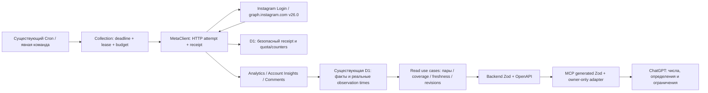

# Social Analytics: исправление сбора и качества аналитики Instagram

Дата: 8 октября 2026 года. Основа — [instagram-data-audit.md](instagram-data-audit.md), findings F01–F10 и исходный Git HEAD `8ed0040c31c818e7331a991704a77e6870b94c6b`.

Обновление 9 октября: проверка обычных Cron обнаружила 13 exceededResources
на `0.2.15`. Критерий отсутствия ресурсных ошибок не выполнен; прежнее окно
наблюдения не является успешной суточной приёмкой. Опубликована оптимизация
старта `0.2.16`, version `e659a098-741f-47ba-891f-ad25274efa70`.
Первый новый Cron успешно выполнил ежедневный пересчёт, но CPU остаётся
высоким и устойчивость ещё не доказана. Результаты первоначального выпуска
и его immutable manifests ниже сохранены как исторические; последняя проверка
и новое окно — в [collection-production-verification.md](collection-production-verification.md).

## 1. Результат и граница готовности

Изменения A–F подготовлены в существующей архитектуре: один Cloudflare Worker/Hono, существующая D1/Drizzle, feature-first модули и частный MCP в Sites. Instagram Login, `graph.instagram.com` и v26.0 сохранены. Новая инфраструктура не добавлена.

Пользователь получает явный рейтинг по абсолютным значениям, действиям на 100 охваченных аккаунтов или просмотров; реальные пригодные возрастные наблюдения; причины исключения; отдельные времена попытки и последнего хорошего значения. ChatGPT получает эти сведения через обновлённые backend schemas → OpenAPI → Zod → MCP. Чтение статуса и аналитики не запускает сбор.

Scheduler выполняет первую ограниченную полезную порцию нового срочного задания в том же tick, сохраняет leases/checkpoints/retries и отдаёт фактическое число HTTP attempts и длительность порции. Неизвестный usage header не объявляется свободной квотой. Исторические обязательства не выводятся из сегодняшнего enabled=true. Раннее календарное чтение не становится зрелым без нового запроса.

**Код, локальная интеграция и разрешённый production release выполнены.** Частный MCP `0.4.0` опубликован в существующем Site, версия13; backend `0.2.15` опубликован после явного разрешения владельца, production migrations0009–0012 применены. Health подтверждает0.2.15. Cloudflare version `6ebe6029-74e1-4551-b68a-0b1c30a56f68` связан с проверенным source inventory через native tag/message; скачанный активный Worker module побайтно совпадает с проверенным bundle. [Build manifest](instagram-data-build-manifest.json) и [production evidence](instagram-data-production-evidence.json) фиксируют эту связь. Первые два обычных Cron-запуска и реальные MCP-чтения подтверждены. **24-часовая эксплуатационная приёмка и будущие7-/30-дневные наблюдения остаются отдельными незавершёнными проверками.**

## 2. Сопоставление с аудитом и сохранение рабочего дерева

До реализации уже существовали durable jobs, leases, checkpoints, retries, обход каталогов, история снимков, календарный backfill, context/business tools и рабочая интеграция ChatGPT. Эти механизмы использованы, а не пересозданы. Числа 247/126/113/8, 6→9→10 из 103 интервалов и 1/4/5 возрастных наблюдений относятся к cutoff аудита. Они не зашиты в код и не считаются текущими production counts.

Перепроверены только затронутые причины: parser usage; broad code 100; отдельный цикл создания job; фильтрация возрастного покрытия; LIMIT 100 jobs; maturity по текущим часам; provenance/field scope; абсолютная сортировка; ложное описание author fields. Полный аудит API и всех production-таблиц не повторялся.

Рабочее дерево перед реализацией содержало чужие незакоммиченные изменения backend/MCP, миграцию0008 и документы. Сделана отдельная локальная копия исходного состояния. `0008_strong_brother_voodoo.sql`, её snapshot и `instagram-data-audit.md` сохранены байт в байт; старые миграции не перенумерованы. Общий Git diff включает предыдущую работу, поэтому его нельзя целиком приписывать этой реализации. В корневом/backend-репозитории commit/push не выполнялись. Отдельный разрешённый source push частного Sites MCP и последующий явно разрешённый backend deploy зафиксированы в §8.

План зависимостей, реализованный в этом этапе:

1. A: достоверный транспорт, классификация ошибок, usage/counters и минимальная добавочная D1-модель.
2. B: выбор следующего действия и первая порция в рамках существующего Cron, с реальным HTTP/time budget.
3. C: пригодность анализа отдельно от записанных обязательств, стабильная пагинация и свежесть по видам работы.
4. D: receipt/operation identity, времена, последний хороший результат и ревизии календаря.
5. E: единый словарь и области полей, ограничения комментариев; F: сопоставимые коэффициенты/рейтинги.
6. Каждый контракт изменён в том же этапе и проверен через настоящий MCP SDK. Затем миграционные, сквозные и корневые проверки.

## 3. F01–F10: реализация и доказательства

Пути в таблице относительны `backend/src/modules/`, если не указано иное. Таблица фиксирует проверенную реализацию; production release и начальные проверки подтверждены отдельно в §8. Суточная эксплуатационная приёмка ещё не завершена.

| Finding | Состояние | Конкретное изменение / файлы | Доказательство и оставшаяся граница |
|---|---|---|---|
| F01, P0 | Реализовано | `instagram/domain/request-policy.ts`, `infrastructure/meta-client.ts`, `d1-request-policy.ts`: четыре состояния header, отдельная давность quota, настоящие attempts/responses/failures/timeouts/rate responses; safe sample; Retry-After/backoff | Header fixtures, stale quota, transport failure и 429 в `backend/test/instagram-data-quality.spec.ts`; реальный header `call_volume/cpu_time` проходит до MCP как unknown_schema. Единицы новых ключей не доказаны и не подменены alias |
| F02, P0 | Реализовано и выпущено;24h приёмка ожидается | `collection/application/collect.ts`, `domain/selection.ts`, `infrastructure/d1-collection.ts`, `bulk-comments.ts`, root `app/create-features.ts`: единый выбор по deadline/due/cost, создание+первая порция, HTTP/time budget, schedule claim fencing, архивный резерв, latency/overload | Конкурирующие claims дают один job/проход; первая полезная работа в creation tick; transport portions3/750ms и5/1250ms в fake-clock fixture; backlog236 объектов продвигается в144ticks. Production Cron16:20 и16:25UTC выполнил2/2531ms и3/5278ms; календарь получил полезные значения. Это не суточная приёмка |
| F03, P0 | Реализовано | `instagram/infrastructure/meta-client.ts`, `d1-request-policy.ts`: узкие source reasons, объект/параметры/API/Login-scoped negative cache v2; legacy broad evidence игнорируется; полезные partial fields сохранены | Явный unsupported / invalid_breakdown / ambiguous100 / unavailable object / insufficient audience / deferred budget разделены тестами. Проблемные FEED-объекты массово не перепроверялись; число 28 не объявлено исправленным |
| F04, P0/P1 | Реализовано | `collection/domain/coverage.ts`, D1 coverage, `analytics/infrastructure/d1-analytics.ts::atAge`, `content/application/content.ts::rank`, shared schemas: analysis vs policy obligations, валидная метрика/пара, nearest usable snapshot, deterministic ties, policy history | Pre-connection 30d, open window с нулём, all-null, молодая публикация, позднее подключение/короткая возможность/unknown policy проверены. Один существующий настоящий 30d снимок SELECT→новый MCP даёт прежние 2/445 и исходное время |
| F05, P0/P1 | Реализовано | `collection` status/jobPage/diagnostics/dataFreshness, `analytics`/`account-insights`/`community` effective operation state: keyset/cutoff, total/full aggregates, lastAttempt/useful по видам, expired atomic attempt без записи при GET | 137 jobs полностью пройдены через backend и MCP за 7 страниц; независимый COUNT совпадает; running→completed между страницами не теряет ID. Новый job после cutoff проверен отдельно backend-тестом. Неизвестная причина прежних аварий остаётся неизвестной |
| F06, P1 + deadline P0 | Реализовано | `account-insights/domain/periods.ts`, `maturity.ts`, `application/insights.ts`; `collection/domain/activity-policy.ts` и scheduler: ближайший внутренний guard expiry, поздние ревизии, pending-plan restart, recheck обязательство | Раннее чтение после перевода часов остаётся observedAfterDelay=false; настоящий поздний запрос создаёт новую revision того же periodKey в D1. 90d/31×24h обозначены внутренними guards, не универсальными лимитами Meta |
| F07, P1 | Реализовано | shared `domain/measurement.ts`, `instagram_http_attempts`, `analytics` source/store/queries/schemas, `account-insights` source/result JSON, `community` page receipt: времена/версии/поле/единица/область, lastKnownGood и sequential observation | HTTP retry создаёт новый receipt, завершённая logical operation не создаёт новый snapshot. Profile time, ошибка после хорошего значения, категории при null total и source→receipt→D1→MCP проверены. Legacy provenance остаётся unknown; receipts не являются полным raw-архивом |
| F08, P1 | Реализовано | `content/application/content.ts`, `domain/analysis.ts`, `presentation/http.ts`; `analytics/domain/calculations.ts`, `reviews/domain/signals.ts`: rankingMode, соответствующие peers/baseline, валидные пары/n/exclusions, mediaType/возраст/версия/область/контекст | A лидирует по абсолютным saves, B — по saves/100reach через backend/MCP. Median индивидуальных rates отличается от ratio of sums; 0/null/zero denominator/несовместимые времена/IMAGE vs CAROUSEL проверены. Small n описательный; причинность не заявляется |
| F09, P2 | Сознательно отложено; существующие tools сохранены | `shared/domain/content.ts`, content/business contracts: unknown, proposed/confirmed и независимые paidDistribution/brandPartnership/coauthor не теряются | MCP-тест сохраняет manual/proposal, null/false/true отдельно. Массовые AI tags, ASR, видеообработка и новый CRM-import не запускались. Следующий этап — §11 |
| F10, P1 | Реализовано | `community/application/comments.ts`, analytics dictionary, root `app/public-information.ts`, `docs/metrics.md`: правдивое описание author fields и owner-only/current sample/retention limits | Тесты существующего comment storage; local account erasure каскадирует новые receipts/policy history. Никакие production comments/accounts не удалены. Disconnect не обещает полное удаление данных |

Основные проверяемые артефакты:

- [Офлайн полный путь](instagram-data-implementation-evidence.json): очищенные fixtures, настоящий backend/D1/MCP SDK, source values/параметры/версии/время, ranking и полная пагинация.
- [Ограниченная реальная сверка](instagram-data-implementation-live-evidence.json): реальный Meta GET и существующий исторический SELECT, новый код в одноразовом локальном окружении, hash проверенного bundle.
- [Миграционная сверка](instagram-data-migration-evidence.json): старые значения до/после 0009–0012 и unknown новых полей.
- [Manifest исходников и сборок](instagram-data-build-manifest.json): hashes без credentials; опубликованные MCP/backend и связь native version с source inventory/downloaded module.
- [Частный MCP release evidence](instagram-data-sites-release-evidence.json): Site13, native deployment succeeded, source commit, hashes и owner-only read calls на adapter-first срезе, до последующего backend deploy.
- [Production release evidence](instagram-data-production-evidence.json): разрешённые migrations/deploy, скачанный активный module/hash,177jobs/9MCP pages/SQL, пять исторических30d пар, календарные receipt→D1→MCP и первые два обычных Cron-запуска.
- `backend/test/instagram-data-quality.spec.ts`, `chatgpt/src/data-quality.test.ts` и существующие completeness/recovery/comment scheduling tests.

## 4. Фактический путь данных после изменения



`operationId` — логическая работа; стабильный UUID страницы/порции сохраняется через retries. Каждый HTTP attempt имеет свой UUID. Receipt записывается перед transport; transport response или pre-response failure завершает именно эту попытку. Исторический snapshot идемпотентен по операции, а не по receipt retry. Старый worker generation не может завершить повторно захваченную operation/lease.

Receipt содержит account/object (когда известен), endpoint family, безопасные metric/period/metric_type/timeframe/breakdown/since/until/limit/fields, факт continuation без cursor/token, requestStartedAt/responseReceivedAt/failedAt, requested/actual API, Login, HTTP status, Graph code/subcode и классификацию. Разрешённые числовые значения/избранные ошибки имеют очищенный ограниченный sample. Authorization, OAuth code/state, token, media URL, caption, comment text и author names в receipt sample не пишутся. Числовой Graph error.code не считается OAuth-секретом.

Одна попытка подтверждает несколько нормализованных полей. Media provenance содержит per-field sourceField/unit/definitionVersion/surface/distribution/receipt и границы sequential observation. Profile timestamp соответствует собственному ответу. Страница комментариев сохраняет receipt/definitionVersion в уже существующем JSON операции, commentIds и настоящее время ответа; это текущие обновляемые строки, не новый полный неизменяемый архив комментариев.

Safe sample ограничен 4096 символами, usage sample — 2048. На первом finish запроса экземпляра транспорта ограниченно удаляются до 100 receipts старше 30d и samples старше 7d. Без дальнейших запросов точный срок физической очистки не гарантирован. Нормализованные данные и compact provenance сохраняются отдельно. Истечение receipt retention не означает удаление исторического наблюдения; после очистки исходный ответ полностью восстановить нельзя. Обычный MCP не получает транспортный журнал.

## 5. Транспорт, расписание и измеренная нагрузка

### 5.1. Квота и ошибки

Usage header имеет parsing state `absent`, `recognized`, `unknown_schema` или `malformed`. Свежесть распознанной оценки отдельная; stale threshold — политика сервиса 1h. Published keys `call_count`, `total_time`, `total_cputime` обрабатываются как соответствующие проценты. `call_volume`/`cpu_time` не подставляются по сходству названий. При неизвестной схеме предыдущий распознанный процент сохраняет прежнее usageObservedAt; receivedAt нового header не обновляет его давность.

Новые счётчики имеют собственный nullable epoch. `recordedRequests` оставлен для совместимости как прежний response counter, без переименования старой истории. Новые `http.attempts`, `responses`, `failuresBeforeResponse`, `timeouts`, `rateLimitedResponses` различаются. Timeout возможен до ответа или во время чтения тела уже полученного ответа; он не увеличивает failuresBeforeResponse во втором случае. HTTP429 учитывается даже при повреждённом/непрочитанном теле, с сохранением Retry-After/backoff. Счётчики timeout/rate-limit пересекаются с responses/failures и не складываются второй раз. Прямой диагностический GET не добавляется в счётчик приложения задним числом. Pending receipt после незавершённой попытки не доказывает причину crash.

Code100 без явного доказательства неприменимости — source_error; неправильный breakdown — invalid_breakdown; параметры — invalid_request; отсутствие доступа и object_unavailable отдельны. Empty response или возраст <48h не создают not_ready. Недоступный прямой объект остаётся нейтрально unavailable с прежним cooldown, без удаления истории. Только явно отвергнутое поле/комбинация записывается в cache v2 на 24h, с account/Login/API/object/существенными параметрами. Старое broad cache evidence не применяется; повторная проверка проходит в обычном бюджете, без массовых probes.

429, известные rate codes, Retry-After и прежний quota backoff сохраняются. При частичном полезном результате transport success, numerical coverage и field errors разделены. Полностью неправильный запрос не становится «все данные получены».

### 5.2. Порция Cron и приоритеты

Cron остаётся 5min, discovery — 60min по прежнему default. Частоты аудитории/архива полезного сбора молча не сокращались. Одна порция tick ограничена максимумом 6 **реальных HTTP attempts**, 90s work budget, 15s reserve на сохранение и 15s timeout одного HTTP запроса. Сетевой параллелизм одного аккаунта не повышен. Insight/Story atomic page — один объект; размер insights не увеличен.

Discovery, активные возрастные deadlines, известные Stories до окончания окна и activity periods около внутреннего guard expiry участвуют в общем выборе schedule/job. При наличии lease и бюджета создаваемое срочное задание выполняет первый шаг сразу. Порядок учитывает deadline, due/ожидание и ожидаемую cost. Архив получает каждый третий слот, свободный от близкого deadline; archive heads продвигаются по времени последней попытки. При постоянном превышении доступной мощности deadlines и непрерывный архив одновременно не обещаются: status показывает estimated_deficit, нижнюю оценку due steps, assumptions и причину выбора/ожидания.

При repeated optional media-field rejection резервируются запросы базового каталога и scalar insights. Отложенные metadata не заменяют старые metadata; их собственное observedAt остаётся прежним. Deferred metric не выдумывает receipt и не отмечается свежим числом. Работа сохраняет атомарную порцию/checkpoint, а следующая порция продолжает тот же logical page identity.

Lease contention, access/backoff и budget wait не увеличивают source failures. Первая попытка, первая полезная observation и ожидание между продолжениями измеряются отдельно. Legacy first latency остаётся unknown; накопленный HTTP counter имеет собственный httpAttemptsSinceAt. `lastStepHttpAttempts`/`lastStepDurationMs` показывают именно последнюю порцию, не всё задание.

| Проверенный сценарий | Фактический результат | Условия / что не доказано |
|---|---|---|
| Новое discovery + одновременно competing scheduled claims | Один job, один полезный проход; первая попытка в creation tick | Fake clock, доступный lease/source; это локальный тест гонки, не наблюдение всех production invocations |
| Настоящий MetaClient с receipt/D1, короткое discovery | 3 HTTP attempts, 750ms simulated source time; profile response +250ms, полезные метрики +750ms | Ответы fixture по 250ms; реальная CPU/Meta latency и D1 billing capacity отдельно |
| Два отказа optional fields, затем базовый каталог/метрики | 5 attempts, 1250ms; reach=100; firstUsefulObservationAt +1250ms | Та же порция, max6 attempts; необязательное обогащение уступает полезным данным |
| Большой legacy comments backlog | 236 публикаций, 144 ticks /12h simulated; fresh comments, Stories, activity, discovery/lifetime и архив продвигаются | Source ports fixture; не измерение реальных HTTP costs этого полного backlog и не production 12h/24h |
| Deadline vs archive reserve | Срочное discovery/age/calendar/Story получает приоритет; свободный третий слот — архиву | Cost/pressure — оценка; при permanent overload архив может ждать, что явно объявлено |

Условный ориентир createdAt→firstAttempt ≤15min проверен локально с запасом (0ms) при доступном аккаунте/lease, работающем Cron и спросе в пределах порции. Он не является максимальным временем обнаружения ещё неизвестной публикации и не действует при блокировке Meta. Для фактического эксплуатационного результата нужен §10.

## 6. Покрытие, времена и календарные ревизии

### 6.1. Анализ и обязательства

`analyze_content` проверяет пригодность **выбранной metric**, а в relative mode — пары. Полученный 0 полезен; denominator=0 сохраняет исходные числа, но коэффициент undefined. Ближайший пригодный snapshot выбирается реально, без интерполяции: 1d ±6h, 7d ±12h, 30d ±24h; при равном расстоянии порядок детерминирован по observedAt/id. Часовые окна описаны отдельно в status.

Публикация до подключения не исключается, если пригодное наблюдение существует. Слишком молодые, target-not-reached, connected-after-window и missing inputs не выдаются за одинаковые пропущенные jobs. Open window с подходящим наблюдением уже покрыт для анализа. Более близкий all-null или несовместимый snapshot не вытесняет реально пригодную пару в tolerance.

Overview в collection status явно обозначен `metric=reach`, `rankingMode=absolute`: это не обещание покрытия всех полей. `analysisCoverage` и `collectionCoverage` возвращают отдельные вложенные analysis/obligations. История политики записывается с effectiveFrom/effectiveTo, version и доступностью начиная с configure/tick. Старым данным миграция не присваивает историческую активность.

Conditional collection obligation требует записанного активного policy interval, подключения, известных границ доступа и не менее одного Cron-slot (5min) возможности после target внутри окна. Короткое подключение на несколько секунд не доказывает SLA. Исторический revoke/доступность Meta измерены не полностью: unknown/insufficient opportunity остаётся отдельной причиной, а не missed. Никакая такая модель не делает весь старый каталог обязательствами нынешнего расписания.

Measured discovery и history_inferred различаются. При denominator=0 выдаются not_measured и null average/max; overOneHour=0 в этом случае не доказывает отсутствие задержек.

### 6.2. Свежесть и статус

`freshness.lastAttempt` содержит фактическую последнюю попытку/статус; `lastKnownGood` — прежнее числовое значение с исходным timestamp/receipt/definition. Новый отказ/null не обновляет время старого good. Это справочная информация; старые good разных времён не складываются в новый свежий snapshot или rate.

Status jobs использует immutable startedAt (семантика createdAt)/id keyset и cutoff. Все ID с startedAt≤cutoff доступны через nextCursor/hasMore; total/aggregates вычисляются по всему cutoff, не странице. Состояния остаются live at calculatedAt: изменение running→completed не фиксирует старое состояние и не удаляет ID. Mutable status filter не поддерживается. Поздно появившиеся строки с искусственно backdated createdAt не составляют гарантированный MVCC snapshot; обычное создание использует реальное время.

Job freshness по origin и dataFreshness по REELS/FEED/STORY разделяют check/attempt/success/useful, backlog/oldestDue. Пустая успешная Story-проверка или comments не означают свежие Reels. Expired atomic operation/lease вычисляется на чтении отдельно от persisted status; GET не очищает массово старые записи. Длительный durable job с checkpoint не считается crash по одному возрасту.

### 6.3. Календарь и аудитория

Period maturity v`account-delay-v1` — 48h policy, с periodEnded/sourceDelayElapsed/observedAfterDelay/recheckDue/matureByPolicy и `sourceFinal=false`. Для составного результата maturity опирается на самый ранний полезный receipt; late failed group не делает ранние значения зрелыми. Legacy observation time помечен своим basis.

Переход часов за to+48h без нового запроса сохраняет observedAfterDelay=false и создаёт recheckDue. Поздний запрос создаёт новую revision того же periodKey. Ключ включает account, requested range/timezone, metric set/type, breakdown/timeframe, Login/API и definition version. Ревизии выбираются по одному логическому периоду, не суммируются как разные интервалы. Следующие пересмотры Meta возможны после 48h.

requestedRange/timezone отдельно от source period/endTime/points. `[from,to)` переводится в integer-second since/until с until=to−1s по текущему контракту; это не доказательство соответствия source bucket местной полуночи. 90d и 31×24h — guards сервиса. Приоритет backfill основан на приближении guard expiry; реальное field-specific source expiry сверх доказательств аудита не выдумано. Уже сохранённые июльские интервалы не объявляются потерянными по раннему cutoff.

Literal demographic timeframe и population сохраняются. Engaged this_month rolling30d не переносится автоматически на follower_demographics. Полезные values/categories/breakdowns сохраняются при scalar total=null. Без известного population denominator доля всей аудитории null; верхушка пагинированных категорий не становится всей популяцией. Calendar monthly unique reach берётся из отдельного native period response, не суммы дней/публикаций.

## 7. Формулы, области и компактные примеры MCP

Единый словарь — `analytics/domain/metric-definitions.ts`; общая версия measurement вынесена в shared pure domain, прежний infrastructure export сохранён для совместимости. `describe_metrics` объясняет scalar и structured media/account/comment fields, units/sourceField/API/Login/product/surface/distribution/period/aggregation/denominator/limitations. Native total_interactions остаётся native; component sum — другой результат. Story navigation — действия, replies не все DM/лиды; watch average/duration не completion; skip denominator initial views не overall views.

Пара для rate берётся из одной выбранной observation: известный numerator, известный denominator>0, одинаковые единица/definition/Login/API/surface и responses в пределах 60s. Явный organic/includes_paid конфликт исключает пару. Unknown paid coverage допускает только явно оговорённое описательное отношение источниковых чисел и не называется organic. Legacy обе стороны без provenance допустимы в одной сохранённой observation с definition/surface unknown; одна известная и одна неизвестная provenance не смешиваются.

Peers разделены по productType **и mediaType**, возрасту/tolerance, definitions/API/field scope, подтверждённой rubric/topics и независимым признакам продвижения. Режим absolute сохранён по умолчанию. В relative mode меняются сортировка и baseline; 100×saves/reach или views — actions_per_100, не процент уникальных людей и без ограничения 100. Group медиана individual rates и 100×sum(numerator)/sum(denominator) используют объявленные валидные пары; n, examined, excludedPairs/reasons и ID состава доступны.

Малый sample остаётся видимым. 5 peers — продуктовая эвристика, не тест значимости; время/темы не доказывают причинный эффект при любом n. Skip/watch не объединены произвольными весами или выдуманным aggregate denominator. Отрицательные counter changes сохранены с диагностикой; views≥reach, monotonic counters или watch-time identities не навязаны.

Ниже — **сокращённые обезличенные extracts** из проверок; timestamps 1000–3200 обозначают fixtures, не production. Полный контракт и реальные times находятся в JSON evidence.

**Статус и продолжение** — настоящее SDK-чтение локального набора 137 jobs:

```json
{
  "api": {
    "usagePercent": null,
    "quotaFreshness": "unknown",
    "usageHeaders": {"app": {"state": "unknown_schema", "sample": "{\"call_volume\":12,\"cpu_time\":4}"}},
    "http": {"attempts": 21, "responses": 21, "failuresBeforeResponse": 0, "timeouts": 0, "rateLimitedResponses": 0}
  },
  "jobsPage": {"limit": 20, "total": 137, "hasMore": true, "nextCursor": "<opaque cursor>", "cutoff": 1791468191623}
}
```

7 страниц содержат 137 уникальных jobs. Агрегаты — по всем 137. Локальный mixed-format catalogue —136 объектов/7 страниц/136 уникальных. Cursor в extract заменён меткой; cutoff фиксируется в реальном ответе и может отличаться при повторном запуске диагностики.

**Реальный pre-connection 30d** — существующий SELECT→новый MCP, без исторического запроса Meta:

```json
{
  "actualAgeDays": 30.02988939814815,
  "observedAt": 1791199559444,
  "saves": 2,
  "reach": 445,
  "rankingValue": 0.449438202247191,
  "definitionVersion": null,
  "coverage": {
    "analysisCoverage": {"examined": 3, "usable": 1, "missingEligible": 0, "excludedByReason": {"too_early": 1, "connected_after_window": 1}},
    "collectionObligations": {"state": "not_evaluated", "note": "Policy obligations are reported by collection status"}
  }
}
```

В collection status для legacy history отдельно видны expected/captured/missed и policyHistoryUnknown. При неизвестной политике expected=0/missed=0 не означают доказанный исторический SLA.

**Последняя попытка и хороший факт** — fixture, прошедший Zod/MCP:

```json
{
  "freshness": {
    "views": {
      "lastAttempt": {"requestStartedAt": 3000, "responseReceivedAt": 3200, "status": "invalid_breakdown", "httpStatus": 400, "graphCode": 100},
      "lastKnownGood": {"value": 42, "observedAt": 1200, "receiptId": "receipt-1", "definitionVersion": "instagram-measurement-v2", "sourceField": "views", "unit": "count"},
      "currentReason": "invalid_breakdown"
    }
  }
}
```

Отдельный backend-тест создаёт настоящий receipt source error после successful field и проверяет, что новый snapshot не выдуман, а good time осталось исходным.

**Relative ranking** — настоящий backend/MCP на двух 7d fixtures:

```json
{
  "input": {"metric": "saves", "ageDays": 7, "rankingMode": "per_100_reach"},
  "items": [
    {"alias": "B", "saves": 10, "reach": 100, "rankingValue": 10, "sampleSize": 1, "baseline": 2},
    {"alias": "A", "saves": 20, "reach": 1000, "rankingValue": 2, "sampleSize": 1, "baseline": 10}
  ],
  "group": {"paired": {"n": 2, "medianIndividualPer100": 6, "ratioOfSumsPer100": 2.727272727272727, "numeratorSum": 30, "denominatorSum": 1100}},
  "coverage": {"analysisCoverage": {"usable": 2, "missingEligible": 0, "excludedByReason": {"too_early": 1, "connected_after_window": 1}}}
}
```

Absolute mode ставит A выше B. `sampleSize` здесь — число peers, не весь group n; n=1 peer крайне мал. Другой независимый backend-набор добавляет C=0/50, missing numerator и zero reach: valid-pair n=3, median=2, ratio=100×30/1150≈2.6086956522, excludedPairs=2. CAROUSEL peer не смешивается с IMAGE.

Native total=141 при component sum=137 сохранён в полном fixture пути. Реальная карусель показывает native36/component35. Разница не «лечится»; причина может оставаться неизвестной. Facebook zero сохраняет `surface=facebook`, а crossposted — combined, не общий organic_instagram_lifetime.

## 8. Миграции и порядок совместимого выпуска

| Новая миграция | Минимальное изменение | Применено |
|---|---|---|
| `0009_common_jocasta.sql` | `instagram_http_attempts`, `collection_policy_history` с account FK cascade; nullable snapshot provenance; job attempt/useful times; schedule claims; новые HTTP counters/nullable epoch/header JSON | Локально и production;16:15:48UTC после разрешения |
| `0010_clean_talon.sql` | Nullable sync_run useful_values/coverage_state/first_useful_at | Локально и production;16:15:49UTC |
| `0011_unique_black_widow.sql` | Nullable job latency_origin/http_attempts_since_at | Локально и production;16:15:49UTC |
| `0012_hesitant_northstar.sql` | Nullable last_step_http_attempts и sync_run last_useful_at | Локально и production;16:15:49UTC |

Старые unknown timestamps/definition/counter epochs/activation не заполнены сегодняшним временем. Новые counters начинают собственную эпоху, не реконструируют transport прошлого. Account Insights и comment-page дополнения используют существующий result JSON; дополнительная таблица для каждого поля не создана.

Migration verifier применяет 0000–0008, создаёт representative legacy rows в восьми таблицах, затем 0009–0012. Все восемь старых строк совпали по исходным facts; provenance/history/epochs unknown; FK errors=0. Локальный cascade deletion test удаляет receipts/policy history вместе с тестовым account. Он не доказывает наличие публичного удаления аккаунта: disconnect удаляет connection, а полный erase остаётся существующей административной процедурой.

Новые response fields в backend/OpenAPI/Zod добавочны и optional для старого backend. Расширены enums reasons/units; новый adapter читает старые default absolute ответы. Если старый backend проигнорировал relative ranking query, новый MCP отвечает `FEATURE_UNAVAILABLE`/409 вместо выдачи absolute как relative. Старый adapter может отвергнуть новые enum/units либо обрезать добавочные поля — **adapter следует выпускать первым**.

Порядок выпуска и фактическое выполнение:

1. **Выполнено:** hashes проверены; существующий source Site12 восстановлен в отдельный checkout и сопоставлен с исходной копией (расхождений не было). MCP `0.4.0` собран/проверен, source commit `0bda71f779fff2ce07895bbf02f28b21481003bf` опубликован как Site13. Native deployment `appgdep_6ac7b6a89a8081918ab53fb76730d986` succeeded в 15:29:33UTC. Plugin ID, owner-only audience и storage сохранены; новых Site automations нет. Реальные connected-app calls подтвердили list_accounts/status и FEATURE_UNAVAILABLE409 для relative mode со старым backend.
2. **Выполнено после ответа владельца «Разрешаю»:** pending list содержал только0009–0012; все четыре миграции применены. Повторный migrations list: `No migrations to apply`. Production0008 не переименована и не повторялась вручную.
3. **Выполнено:** backend0.2.15 из source inventory `9b65885c973c212ad9c1f71f41380aa08b366cd2d2ae7092b40cbc0f171b01de`, Worker version `6ebe6029-74e1-4551-b68a-0b1c30a56f68`, created16:16:47.859319UTC. Native tag/message содержат ссылку на inventory; активная версия подтверждена API. Скачанный активный module и проверенный bundle имеют одинаковый SHA256 `98d616b2fe7d96cba1472ae208972391fdd906487490c02577cd5d2fb1be032b`. Cron5min/frequencies сохранены, invocation logs не включались.
4. **Выполнено:** реальные owner MCP status/relative analysis/calendar read;177jobs/9pages/177unique/0duplicates на cutoff1791476318330, SQL COUNT и full aggregate совпадают. Пять30d pairs сохраняют исходные times, sum(saves)=79/sum(reach)=7834, median=0.7575757575757576, ratioOfSums=1.0084248149093693. Существующий2/445 snapshot сохранён. Календарный период обычного Cron:12 значений D1→MCP совпали,11 числовых/1not_returned, все12 receipt links сохранились; observation1791476760654 и definitionVersion не изменились.
5. **Начато:** обычный Cron16:20UTC завершил пустую Story-проверку за2HTTP attempts/2531ms, lastUsefulObservation остаётся null. Cron16:25UTC продвинул прежний activity job за3attempts/5278ms и сохранил полезное наблюдение. Requested/actual API=v26.0, quota state=unknown_schema, usagePercent=null. Ручных collection commands не было. Два запуска не заменяют24h приёмку §10. Backend rollback выполняется первым; additive tables/columns и operation IDs не удалять, adapter совместим с предыдущим backend.

Private Site: [Social Analytics](https://social-analytics.scary-rustles-7p.chatgpt.site). Его native saved-version source commit совпадает с pushed commit; опубликованный Worker bundle совпадает с проверенным root MCP bundle (`00f61c834adc7a952c0ccfbf83406a586959a6babcabf1c78a9c3e40d7c317ef`). Provider archive content hash записан буквально и не объявлен идентичным hash submitted gzip/tar representation. [Release evidence](instagram-data-sites-release-evidence.json) содержит обе стороны. Переносимый ZIP `chatgpt/dist/social-analytics-plugin.zip` содержит только три allowlisted plugin files; это дополнительный артефакт, существующий Sites plugin не пересоздан.

На промежуточном adapter-first срезе прежний backend0.2.14 возвращал100jobs без jobsPage и activity21/103. После backend release jobsPage и quota header-state проходят через тот же установленный MCP. После первого полезного Cron activity status показал23/103. Это overlapping intervals, не23 уникальных дня; изменение не объявляет backfill завершённым. Новый deployed source подтверждён скачанным module/hash и active version API, а не одной строкой health.

Release commands, **выполненные после разрешения**:

```sh
pnpm --dir backend exec wrangler d1 migrations list social-analytics-db --remote
pnpm --dir backend exec wrangler d1 migrations apply social-analytics-db --remote
pnpm --dir backend exec wrangler deploy --outdir dist --tag instagram-data-0.2.15-9b65885c973c --message 'Instagram data quality P0/P1; sourceInventorySha256=9b65885c973c212ad9c1f71f41380aa08b366cd2d2ae7092b40cbc0f171b01de'
```

Pending list перед remote apply сверен с0009–0012; произвольный mutating SQL не выполнялся. Правило [AGENTS.md](../AGENTS.md): “Deployment, remote migrations and push require explicit authorization.” Hosting частного MCP разрешён отдельным follow-up; новое backend/D1 разрешение получено прямым ответом владельца. Git push основного репозитория не выполнялся.

## 9. Выполненные проверки и ошибки

| Команда / проверка | Результат / область |
|---|---|
| `pnpm install --offline --frozen-lockfile --config.confirmModulesPurge=false` | Установка от корня, единый прежний lockfile, без новых dependencies |
| `pnpm db:generate` при добавлении каждой миграции; `pnpm db:migrate:local` | 0009–0012 добавлены после существующей 0008 и применены локально; после разрешения также production |
| `pnpm --dir chatgpt contract:generate` | OpenAPI снят с текущего локального backend без credentials/network; generated Zod синхронизирован |
| Корневой `pnpm check` | Backend typegen/formatter/module boundaries/types/tests/dry-run build, MCP formatter/types/tests/build; итоговые количества указаны ниже |
| `node scripts/verify-instagram-data-migrations.mjs` | Legacy facts preserved, unknown defaults, FKcheck0; [JSON](instagram-data-migration-evidence.json) |
| `node scripts/verify-instagram-data-quality.mjs` | 21 fixture source requests; четыре формата + two ranking objects; настоящее receipt/D1/MCP совпадение; 137 jobs и 136 catalogue objects без дублей; GET analytics/status не вызывает source |
| `node scripts/verify-instagram-data-quality.mjs --live-readonly` | 25 ограниченных Meta GET: 24 через транспорт приложения в одноразовом окружении + один прямой Story GET; несколько SELECT production; **ноль production writes** |
| `node scripts/instagram-data-build-manifest.mjs` и release annotation manifest | Public source/build hash inventory; MCP source/deployment и backend version/active module hash записаны |
| Sites `site-workflow.mjs` + native private save/deploy/status/version | Существующий Site13, pinned source commit, 24 MCP tests и build; root bundle equality; owner-only audience/plugin сохранены; [release evidence](instagram-data-sites-release-evidence.json) |
| `git diff --check`, сравнение baseline защищённых файлов | Patch whitespace и сохранность 0008/audit проверены перед передачей |
| Production migrations list/apply/list и tagged `wrangler deploy` | Только 0009–0012, повторный list пуст; Worker version 0.2.15 связан с inventory |
| Native connected MCP calls + SELECT/PRAGMA + download active Worker module | 177 jobs/9 pages/SQL, 5 исторических пар, 12 calendar values/receipts; duplicate snapshots=0, foreign-key issues=0; скачанный bundle совпадает. Все диагностические SQL read-only |

Корневые проверки после изменений: **136 backend tests /12 files и 24 MCP tests**. Включают новые существенные transport/coverage/retry/maturity/ranking/comment-receipt tests и сохранённые project utilities. Генератор контракта, типы, границы и обе сборки входят в check; standalone checks не заменяют его. Один существующий нефатальный formatter info в `chatgpt/scripts/export-sites.mjs` (`useTemplate`) не препятствует проверке. Предупреждения NO_COLOR/FORCE_COLOR и обновления Wrangler не являются ошибкой данных.

В ходе работы тест optional metadata сначала ожидал пять attempts, а fixture ошибочно отвергал `audio_type` вместо запрашиваемого `media_audio_type`: фактически было четыре. Fixture исправлен; теперь проверены два настоящих explicit rejections, base request и useful insights, всего пять attempts. Это не исправление счётчика под ожидаемое число.

При последней внешней сверке существующая Cloudflare OAuth-session истекла: `HTTP401`, Graph/Cloudflare code10000, до GET Meta. Попробован обычный read-only Wrangler `SELECT1`, штатная сессия восстановлена; ответ `changed_db=false`, `rows_written=0`. После этого ограниченная реальная сверка прошла. Tokens/codes/session contents не выводились. Live evidence всегда содержит собственный cutoff и hash локально проверенного bundle; это не hash развёрнутого production Worker.

Реальные source objects: свежий Reels, старый Reels и parent карусели, соответственно 10/10/9 числовых полей сверены source→receipt→D1→MCP в одной observation. Это не сверка всего production-каталога и не прежний R-old из аудита, если критерий выбора дал другой объект. Карусель native36/component35 сохранена. Получены lifetime-поля старого Reels возрастом около 1927d; это ограниченное наблюдение доступности, не универсальная отмена документированных возрастных ограничений. Views/reach могут отличаться без навязанного инварианта.

Живых Stories на момент ограниченного GET нет. Fixture проверяет Story normalization, navigation categories при null total, receipt/time и MCP. Публикация тестовой Story от владельца не требуется. Source values могут измениться между отдельными запусками диагностики: сверяется собственный captured response одной observation, а не две произвольно разновременные цифры.

Live evidence сохраняет hash точного диагностического bundle своего запуска. Последующее исправление timeout при чтении тела и HTTP429 с повреждённым телом проверено локальными transport fixtures и итоговым `pnpm check`; реальные аварийные ответы Meta намеренно не вызывались. Итоговая сборка и повторная локальная сквозная проверка имеют собственные hashes в manifest/evidence и не выданы за тот прежний live bundle.

При production release диагностический seven-term UNION SELECT был отклонён D1: code7500, `too many terms in compound SELECT`. Он заменён одним SELECT со scalar subqueries; pre-migration counts не получены и не выданы за доказанное before/after сравнение. Сохранность проверена локальным migration verifier и сверкой пяти реальных старых observations после выпуска. Первый MCP calendar call с числовыми датами был отклонён проверкой параметров; повтор с документированными ISO datetime прошёл. Ни одна из этих диагностических ошибок не выполняла запись или source collection.

## 10. Эксплуатационная проверка обычного Cron после разрешённого выпуска

Наблюдение начато с первого подтверждённого нового Cron: T0=`2026-10-08T16:20:24.586Z`; 24h завершаются не раньше `2026-10-09T16:20:24.586Z` (Asia/Yekaterinburg21:20:24). Подтверждены первые два запуска, включая полезный activity progress. Суточные нагрузка, продвижение архива, перезапуск daily plan и соблюдение сроков при обычном спросе ещё не проверены. Не создавать новые ручные jobs для подмены этой проверки.

Это **подготовленная процедура**, не проведённые 24h. Ручные collection commands не заменяют автономный запуск.

1. Зафиксировать uploaded artifact hashes, Worker version ID, private Sites deployment ID, migration list, фактическую API version из receipt, timezone и T0. Health version недостаточно. Проверить сохранённую automatic policy, cron5min, discovery60min и access expiry через read-only status.
2. В течение суток делать сохранённые read-only срезы раз в15min. Обходить jobs до hasMore=false с одним cutoff; состояния/aggregates live at calculatedAt. Хранить только обезличенные counts/times, без comments/captions/tokens. Закрыть чат хотя бы на отдельный наблюдаемый интервал: новые receipts/jobs должны появляться от Scheduled invocations независимо от MCP.
3. Проверить daily activity-plan restart после смены локальной даты: старый pending head/checkpoint не пропал; новые recent rechecks добавлены; earliest internal-guard period обслужен с учётом доступного бюджета. Различать дни/недели/месяцы и их пересечения — missingIntervals не число потерянных дней.
4. По origin и productType сопоставить lastCheck/lastAttempt/lastSuccess/lastUsefulObservation, pages/checkpoint, backlog/oldestDue и source statuses. Comments progress не считать обновлением Reels. Новые source failures, lease waits, budget waits и backoff считать отдельно.
5. Условная приёмка fresh work: createdAt→firstAttempt≤15min при available account/lease, Cron и measured demand≤capacity. firstUseful latency и между продолжениями оценить отдельно. Если overload/access/rate block, сохранить причину/порядок/deficit, не записывать выполненный SLA.
6. Сопоставить прирост HTTP counters и receipts на одном временном cutoff. Не суммировать timeouts дважды и не включать прямые диагностические GET. Pending attempt после grace/expired lease виден; причину crash без дополнительного доказательства не назначать.
7. Проверить unique logical observations, real response times, partial/null/0 и field provenance. Дубликаты `(media_id,operation_id)` отсутствуют; повтор completed operation не обращается к Meta. Годные old-age snapshots остаются доступными.

Read-only запросы подготовлены через существующий CLI (ACCOUNT_ID — локально выбранный ID, не token):

```sh
pnpm api request GET '/api/accounts/ACCOUNT_ID/collection?limit=100'
pnpm api request GET '/api/accounts/ACCOUNT_ID/content-analysis?ageDays=30&productType=REELS&metric=saves&rankingMode=per_100_reach&timeZone=Asia%2FYekaterinburg'
pnpm api request GET '/api/accounts/ACCOUNT_ID/insights/history?kind=activity&limit=100'
```

Для продолжения использовать nextCursor с URLSearchParams, не shell-interpolate непроверенный cursor. Точные source calendar requests читать из собственных receipts, не выводить secrets или arbitrary transport payload.

Независимые SELECT для владельца/проверяющего, с одним заданным `:cutoff` и `:account_id`:

```sql
SELECT origin,status,COUNT(*) n,
       MIN(CASE WHEN status='running' THEN next_attempt_at END) oldest_due,
       MAX(last_attempt_at) last_attempt,MAX(last_success_at) last_success,
       MAX(last_useful_observation_at) last_useful
FROM collection_jobs
WHERE account_id=:account_id AND started_at<=:cutoff
GROUP BY origin,status;

SELECT origin,latency_origin,COUNT(*) n,
       MAX(first_attempt_at-started_at) maximum_first_attempt_delay_ms,
       MAX(first_useful_observation_at-started_at) maximum_first_useful_delay_ms,
       SUM(http_attempts) attempts,MAX(last_step_http_attempts) maximum_last_portion_attempts,
       MAX(last_step_duration_ms) maximum_last_portion_duration_ms
FROM collection_jobs
WHERE account_id=:account_id AND started_at<=:cutoff
GROUP BY origin,latency_origin;

SELECT json_extract(payload_json,'$.result') result,COUNT(*) n
FROM instagram_http_attempts
WHERE account_id=:account_id AND requested_at>=:from AND requested_at<=:cutoff
GROUP BY result;

SELECT media_id,operation_id,COUNT(*) n
FROM media_snapshots
WHERE operation_id IS NOT NULL AND media_id IN
  (SELECT id FROM media WHERE account_id=:account_id)
GROUP BY media_id,operation_id HAVING COUNT(*)>1;

SELECT effective_from,effective_to,version,enabled,
       json_extract(policy_json,'$.availability') availability
FROM collection_policy_history WHERE account_id=:account_id ORDER BY effective_from;
```

SQL aggregate по jobs совпадает с MCP aggregate на одном cutoff только при учёте live change/calculatedAt. Исторические counters с null epoch не включать в новое measured throughput. Для receipt retention до30d counters накопленные могут быть больше сохранённых receipts; сравнивать приращение в ограниченном непрунингованном окне, а не произвольные all-time totals.

## 11. Готовность, внешние действия и следующий этап

| Слой | Фактически готово | Что ещё требуется |
|---|---|---|
| Код A–F / схемы / контракты | Подготовлено и проверено локально | Независимый review diff/artifacts при желании; P2 не входит в приёмку A–F |
| Локальная D1/backend/MCP интеграция | Миграции, fixtures, реальный источник в bounded read-only flow и существующий age snapshot проверены | Живая Story source-response сверка при её естественном появлении |
| Фактически развёрнутая версия | MCP0.4.0/Site13 и backend0.2.15 опубликованы; production0009–0012 применены. Native active version, source annotation и downloaded module equality подтверждены | Разрешение и выпуск завершены; code/local/initial-production ready |
| Автоматическая работа нового кода | Fake-clock/concurrency/backlog/cost tests и первые два production Cron с5HTTP responses, полезным activity observation и quota unknown_schema; Cron не перенастроен | Оставшаяся24h приёмка §10, включая архив и daily-plan restart |
| Будущие age observations | Реальные старые snapshots сохранены и пригодны; расписание не создаёт прошлую историю | Новые7d/30d окна с течением времени; не блокируют готовность кода и не обещаются сразу после deploy |

Разрешение владельца получено; migrations/backend release и реальные MCP-чтения выполнены. Private Sites adapter опубликован первым и прошёл совместимость со старым и новым backend. Если конкретный ChatGPT chat кэширует прежнюю input schema, обновить plugin/tool list; повторная установка/новый plugin не требуются. Новый Login, массовые пробы, изменение Meta scopes и тестовая Story для завершения кода не требуются. Неизвестные единицы call_volume/cpu_time — честное unknown_schema, не блокер при прежнем безопасном бюджете. Остаток — суточное эксплуатационное наблюдение и естественное накопление будущих возрастных данных, а не новое разрешение на уже выполненный выпуск.

F09/P2 — короткий следующий этап на существующих content/business механизмах:

- Небольшой словарь рубрик/тем/целей; AI suggestion хранит использованный материал, rule/model/prompt version и proposal; owner confirmation/исправления имеют историю. Caption-only не знает первые кадры и озвучку.
- Длительность берётся из измерения либо подтверждённого источника, с происхождением; отсутствующая остаётся null. ASR/визуальное извлечение — только выбранные объекты и отдельно измеряемая польза/стоимость, не массовый обязательный этап.
- Paid distribution/boost, коммерческое партнёрство и соавторство — независимые nullable признаки. Один не доказывает другой; old sponsored не переименован в organic/boost.
- Обращения/заказы/выручка/затраты/затраченное время — реальные внешние owner records с source/валютой/периодом и правилом attribution. Не придумывать продажи, прибыль, все DM или подписки от Reels из likes/views/replies.

Существующие context/business tools и различие unknown/proposed/confirmed сохранены. Их заполнение и новые коммерческие источники не задерживают исправление надёжности и сопоставимости.
